# Dyad agent architecture and GasCity reuse

Status: investigation only. No runtime change.

This separates what the code does today from what a GasCity integration
would have to add. The question is whether GasCity can choose the agent
while Dyad's existing chat UI shows the live work.

## 1. Current architecture

Dyad does not have a small agent interface that a second runtime can
implement. The user-facing "agent" is the local-agent chat mode, and that
mode is a main-process loop around the Vercel AI SDK.

```text
Composer
  -> renderer chat-stream facade
  -> IPC chat:stream
  -> chat actor (one owner per chat)
  -> local_agent_handler
  -> streamText(model, tools, messages)
  -> tool execute() in the Electron main process
  -> chat:response:chunk
  -> message list renders XML inside the assistant message
```

Verified files:

| Piece | File |
| --- | --- |
| Renderer submit/cancel surface | `src/chat_stream/renderer_facade.ts` |
| Wire names | `src/chat_stream/protocol.ts` |
| Chunk schema | `src/ipc/types/chat.ts` (`ChatResponseChunkSchema`) |
| IPC entry | `src/ipc/handlers/chat_stream_handlers.ts` (`chat:stream`) |
| Local-agent loop | `src/pro/main/ipc/handlers/local_agent/local_agent_handler.ts` |
| Tool table | `src/pro/main/ipc/handlers/local_agent/tool_definitions.ts` |
| Tool consent and mutation tracking | `src/pro/main/ipc/handlers/local_agent/tools/tool_invocation.ts` |
| Path jail | `src/pro/main/ipc/handlers/local_agent/tools/path_safety.ts` |
| GasCity host bridge | `src/main/factory_host_bridge_server.ts`, `src/main/factory_host_service.ts` |

The model decides when to call a tool. Dyad does not have a separate
planner that picks tools. `streamText` receives `tools: allTools`. The SDK
emits `tool-input-*` and `tool-call` parts. Dyad's `execute` wrapper runs
the matching tool, returns the result to the model, and also folds an XML
rendering of that call into the assistant message the UI already knows how
to paint.

Chat modes (Ask, Build, Agent, Plan) change which tools and prompts are
legal. They are not separate agent products. Factory runs force
`requestedChatMode: "local-agent"`.

## 2. Execution sequence

```mermaid
sequenceDiagram
  participant UI as Composer
  participant R as Renderer facade
  participant IPC as chat:stream
  participant Actor as Chat actor
  participant LA as local_agent_handler
  participant Model as Model provider
  participant Tool as Tool execute
  participant DB as SQLite messages

  UI->>R: submit(prompt, chatId, mode)
  R->>IPC: invoke chat:stream
  IPC->>Actor: admit one turn for this chat
  Actor->>DB: persist user message
  Actor->>LA: run local agent
  LA->>LA: build system prompt and tool set
  LA->>Model: streamText
  loop tokens and tool calls
    Model-->>LA: text-delta or tool-call
    LA->>DB: update assistant message
    LA-->>UI: chat:response:chunk
    alt tool call
      LA->>Tool: execute(args, ctx)
      Tool-->>LA: result
      LA->>Model: tool result
    end
  end
  LA-->>UI: chat:response:end
  Actor->>Actor: release chat, drain queue
```

Cancellation is an abort on that chat's stream. The end event can carry
`wasCancelled`. Errors use `chat:response:error`. A chat has one active
owner; a second prompt queues. History lives in the Dyad message table.
The model transcript is rebuilt from that history, then sanitized so tool
calls and tool results stay paired.

## 3. Tool capability matrix

`TOOL_DEFINITIONS` is the harness. The model cannot do these things by
itself. Each tool is a function in the Electron main process with the app
path, database, and consent context.

| Capability | Tool names | Boundary |
| --- | --- | --- |
| Read and search the app | `read_file`, `list_files`, `grep`, `code_search`, `explore_code` | Paths must stay inside the app directory |
| Edit the app | `write_file`, `search_replace`, `copy_file`, `delete_file`, `rename_file` | Consent plus mutation tracking |
| Dependencies and app process | `add_dependency`, `restart_app`, `reinstall_and_restart_app` | Uses Dyad's app runtime, not a free shell |
| Checks | `run_type_checks`, `run_tests`, `run_build`, `run_pre_commit` | Bounded commands for the app, not an open terminal |
| Script | `execute_sandbox_script` | Sandbox script, not arbitrary host shell |
| Git | `git_status`, `git_diff`, `git_log`, `git_show_commit`, `git_show_file`, `git_restore_file` | App repo only |
| Data | `execute_sql`, `get_database_table_schema`, `get_supabase_project_info`, `get_neon_project_info` | Connected project, SQL consent |
| Web | `web_search`, `web_crawl`, `web_fetch` | Provider-backed fetch, not a browser the user drives |
| Images | `generate_image` | Provider image API |
| Sub-agents | `spawn_agent`, `list_agents`, `wait_agents`, `cancel_agent`, `send_message`, `followup_task` | Child Dyad agents, same harness |
| Plan / blueprint | `planning_questionnaire`, `write_plan`, `exit_plan`, `write_app_blueprint` | Plan mode and app-create flow |
| MCP | `search_mcp_tools`, `get_mcp_tool_schema`, dynamic MCP tools | User-configured MCP servers |
| Other | `read_logs`, `read_guide`, `update_todos`, `set_chat_summary`, `add_integration`, `enable_nitro`, `suggest_plugin`, chat search/read | Dyad product surfaces |

What this agent cannot do:

- It has no generic "run this shell command" tool.
- It cannot see or edit files outside the app path, except referenced-app
  reads that the tool explicitly allows.
- It cannot attach an arbitrary external agent loop. Sub-agents are more
  Dyad agents.
- It does not speak to GasCity. GasCity speaks to Dyad through the host
  bridge, and the bridge starts this same loop.

## 4. Interface inventory

| From | To | Mechanism | Reusable by GasCity? |
| --- | --- | --- | --- |
| UI | main | Electron IPC `chat:stream` | Only from inside the app |
| Main | UI | `chat:response:chunk`, `end`, `error` | Yes, if some main-process code emits the same payloads |
| Agent | model | AI SDK `streamText` over HTTPS | No. That is one model client |
| Agent | tools | In-process `execute(args, ctx)` | No. Tools expect `AgentContext` |
| Tools | disk / git / app runtime | Direct function calls | The tools can be called by Dyad. An outside process cannot call them unless a bridge wraps them |
| Tools | DB | Drizzle, same message rows the UI reads | The rows are the durable UI state |
| GasCity | Dyad | HTTP `127.0.0.1:32100` | Already exists: start run, append message, question, approval |
| Dyad | GasCity | Supervisor HTTP for formula source | Formula config only. Not agent streaming |

Internal details that should stay internal: `AgentContext`, tool execute
signatures, and the AI SDK part stream (`text-delta`, `tool-call`).

The surface that is already a protocol: `ChatResponseChunk`.

## 5. Streaming architecture

There are two streams. They are not the same thing.

**Model stream.** `streamText(...).fullStream` yields AI SDK parts:
`text-delta`, `reasoning-delta`, `tool-input-start`, `tool-call`,
`tool-result`, `finish`. Only `local_agent_handler` understands these.

**UI stream.** The handler turns those parts into text inside one
assistant message, then sends:

```ts
{
  chatId: number
  messages?: Message[]          // full snapshot when needed
  streamingMessageId?: number
  streamingPatch?: {            // replace the tail from offset
    offset: number
    content: string
    prefixHash?: number
  }
  streamingPreview?: {          // live tool-args XML, not message content
    content: string
  }
}
```

Wire names in `src/chat_stream/protocol.ts`:

- invoke: `chat:stream`
- start: `chat:stream:start`
- chunk: `chat:response:chunk`
- end: `chat:response:end`
- error: `chat:response:error`
- transport end: `chat:stream:end`

Reasoning becomes `<think>...</think>`. Tool activity becomes Dyad XML
tags in `message.content`. The renderer does not receive a typed
"tool started" event. It parses the message text it already renders for
a normal chat.

The host bridge's `POST .../messages` writes a finished message. It does
not emit `streamingPatch`. A GasCity agent that only appends messages
appears as completed bubbles, not as a live agent turn.

## 6. Integration architecture

Feasible reuse is the UI stream, not the agent class.

A GasCity-managed agent can show up in the current UI if some Dyad
main-process adapter:

1. Owns the chat turn the same way `chat:stream` does (one owner, a
   streaming assistant row, cancel, end).
2. Accepts GasCity events.
3. Translates them into `chat:response:chunk` patches and the same XML
   the message list already renders.
4. Writes the final row to the message table.

GasCity keeps its own tools and runtime. Dyad does not need those tool
calls to be `TOOL_DEFINITIONS`. It only needs a text or XML rendering.
Unknown tags would show as plain text. Tags the UI already understands
(file edits, status, questions) would light up existing cards.

The factory bridge is the place to add that translation. It already
authenticates GasCity and already knows `appId`, phase, and chat.

## 7. Before and after

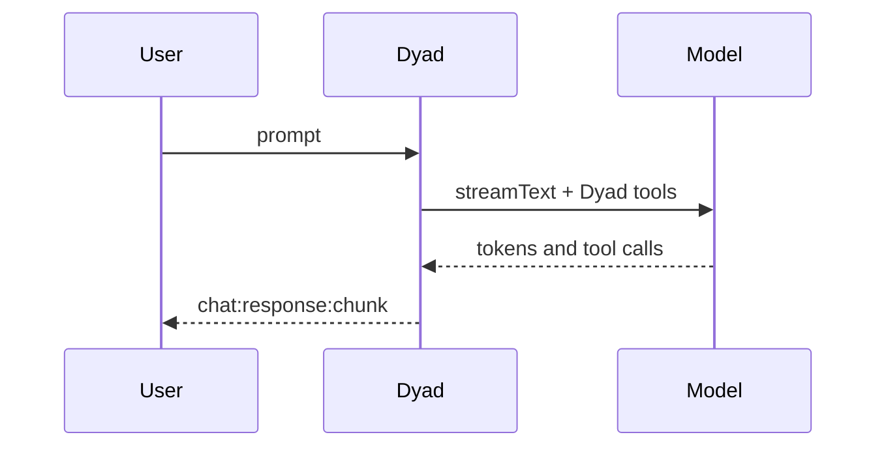

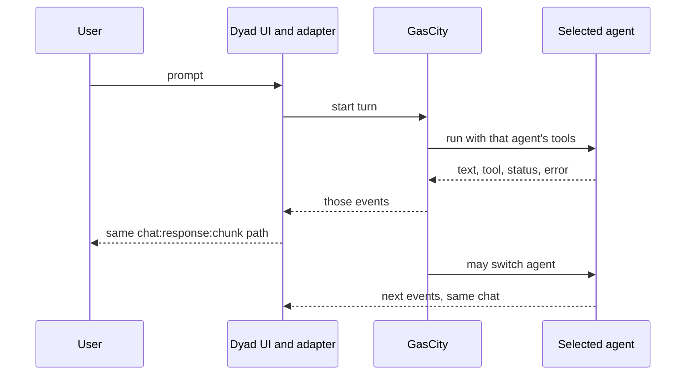

Switching agents does not require a second UI. It requires the events to
keep targeting the same `chatId` and streaming message.

## 8. Impact matrix

| Component | Change? |
| --- | --- |
| Composer and message list | Unchanged if chunks and XML stay the same |
| `ChatResponseChunk` schema | Unchanged for text and known XML. A new field only if we want typed tool cards for unknown agents |
| `local_agent_handler` and `TOOL_DEFINITIONS` | Unchanged. Native mode keeps working |
| Chat actor owner / cancel / queue | Small change so an external turn can hold the same lock |
| Host bridge | New event ingress, mapped to chunks |
| GasCity | New emitter. Dyad cannot invent GasCity's event format from this repo |
| Message table | Same rows. External turns must still persist there or reload loses them |
| Formula TOML | Unchanged. It picks steps, not this stream |

## 9. Options and recommendation

**Option A — GasCity orchestrates, Dyad agent still executes.** This is
the bridge today: `POST /runs` starts local-agent. GasCity can sequence
work, but it cannot put a different agent's tools or token stream in the
UI. Lowest risk, does not meet the goal.

**Option B — Pluggable agent backend inside Dyad.** Replace
`local_agent_handler` with an interface both the native loop and a
GasCity client implement. Clean in theory. High blast radius: prompts,
tools, consent, cancel, and retries all live inside that handler.

**Option C — GasCity owns execution, Dyad is only UI.** Native agent
becomes a GasCity agent too. That rewrites the primary path and makes
ordinary chat depend on the supervisor. Too large for the goal.

**Option D — Shared UI events, separate executors.** Native mode stays.
GasCity agents publish events. A Dyad adapter renders them through
`chat:response:chunk`. Executors stay different; the picture in the
window is the same.

**Recommendation: Option D.** Add an adapter on the host bridge. Do not
abstract the AI SDK loop. Do not make GasCity a required backend for
normal chat.

The adapter contract can be small:

- `turn-start` — create the streaming assistant row and take the chat lock
- `text` — append or patch message text
- `activity` — XML or status the current cards understand
- `message` — commit a bubble (the current append-message route)
- `turn-end` / `turn-error` / `cancel` — same end and error events the UI
  already handles

Until GasCity emits those, the UI can only show finished messages from
`POST /messages` and native local-agent runs from `POST /runs`.

## 10. Diagrams: current, B, C, and D

The current diagrams name the code that exists. The B, C, and D diagrams
are proposed layouts on top of that code. Same names mean the same box.

| Name in the diagrams | Code today |
| --- | --- |
| Renderer facade | `src/chat_stream/renderer_facade.ts` |
| `chat:stream` handler | `src/ipc/handlers/chat_stream_handlers.ts` |
| Chat stream host | `src/chat_stream/` host state machine, one owner per chat |
| Local agent | `handleLocalAgentStream` in `local_agent_handler.ts` |
| Tool harness | `TOOL_DEFINITIONS` |
| Host bridge | `factory_host_bridge_server.ts` on `127.0.0.1:32100` |
| Chunk | `chat:response:chunk` (`ChatResponseChunkSchema`) |

### Container diagram — current

GasCity can start the local agent or append a finished message. The model
call and the tools stay inside Dyad.

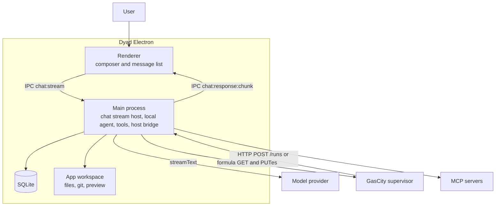

### Container diagram — B, pluggable backend

The renderer and the chunk IPC stay. The chat stream host no longer calls
the local agent directly. It calls an `AgentBackend`. The native backend
wraps today's loop. A second backend delegates the turn to GasCity.
A remote agent that edits the app needs a workspace callback, because the
files are on the user's machine.

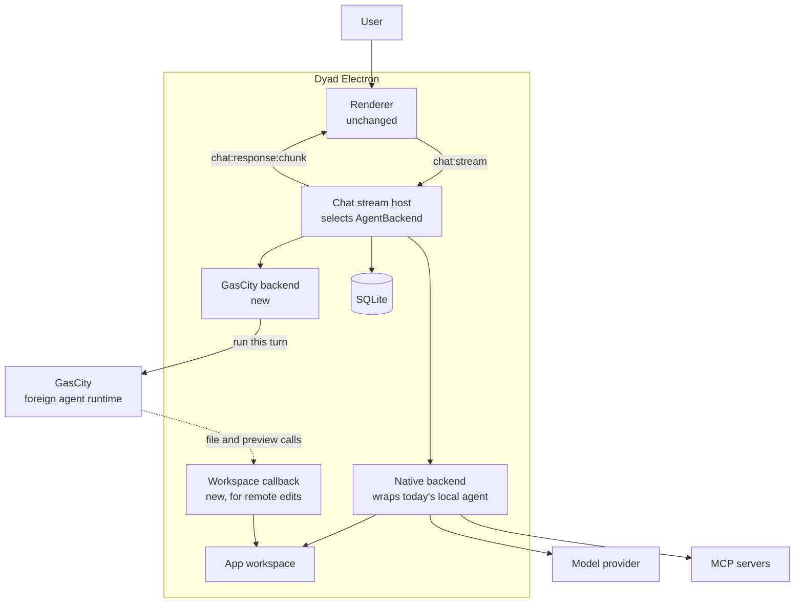

### Container diagram — C, GasCity executes every turn

Ordinary chat leaves Dyad. GasCity hosts the old Dyad agent and every
other agent. Dyad's main process keeps the UI, the message rows, and a
tool service for the local workspace. The model provider sits behind
GasCity.

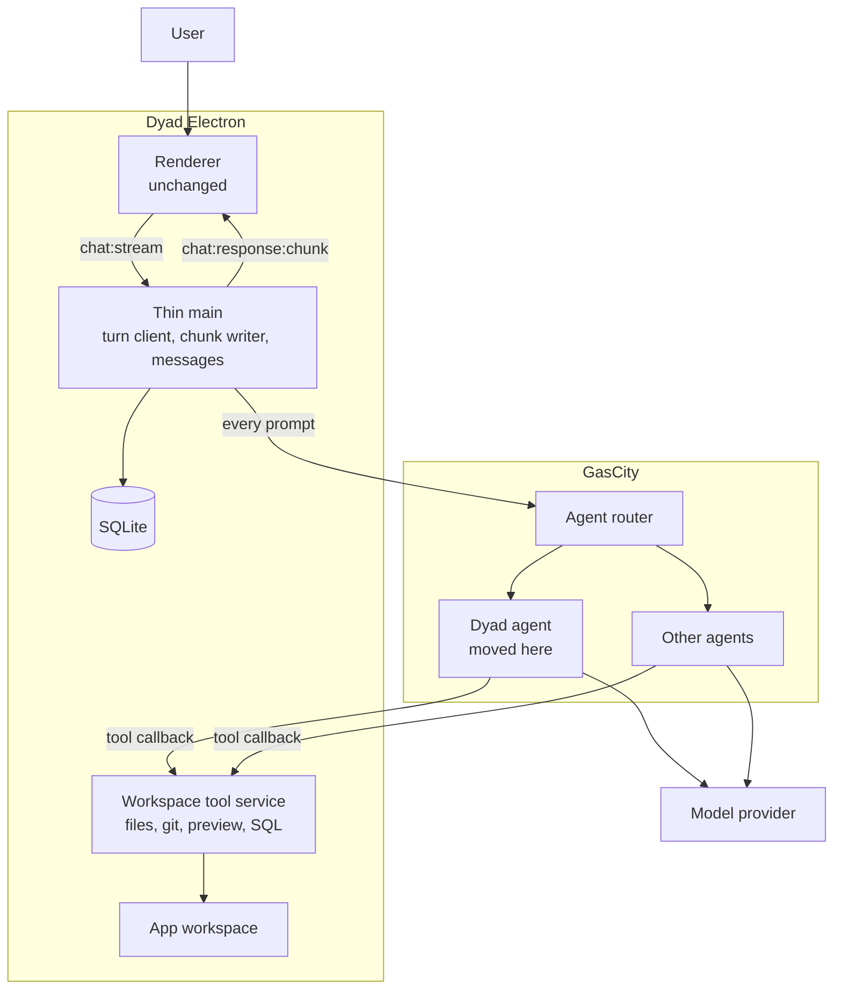

### Container diagram — D, shared chunks, separate executors

The native boxes stay where they are. GasCity is a second producer of
the same chunk IPC. It does not sit on the native prompt path.

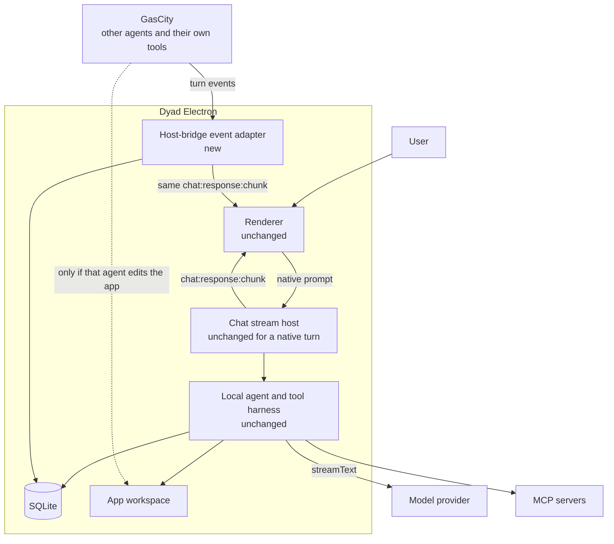

### Component diagram — current

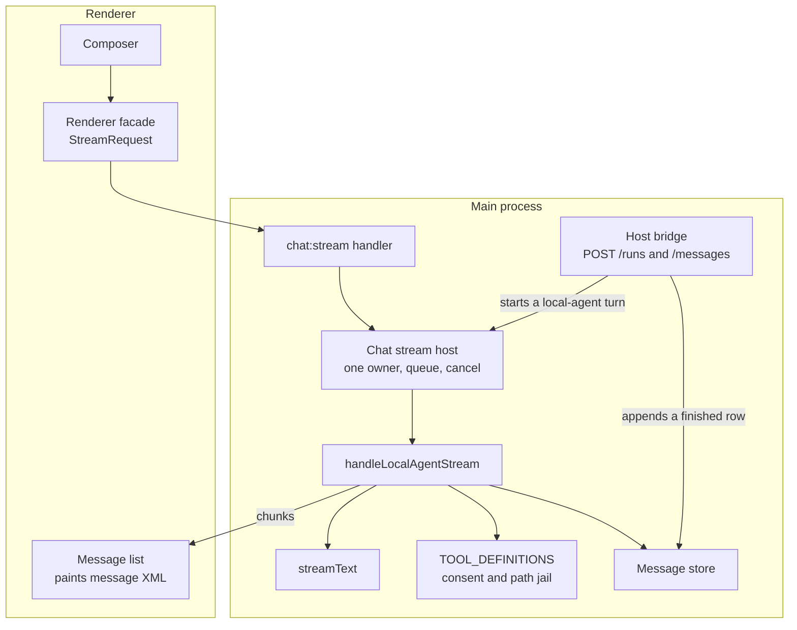

### Component diagram — B

`handleLocalAgentStream` moves behind one implementation. A mapper shared
by both backends is what the message list hears.

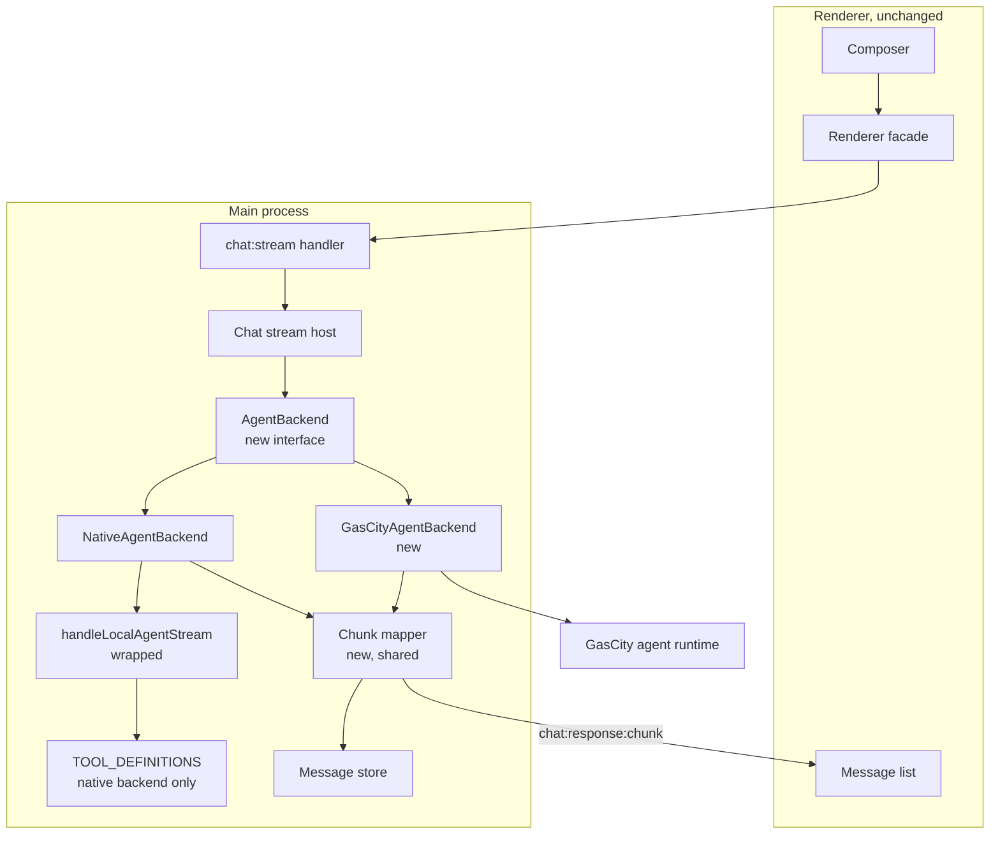

### Component diagram — C

The local-agent function is no longer a component of Dyad's main process.
The tools it used become a service GasCity calls back into.

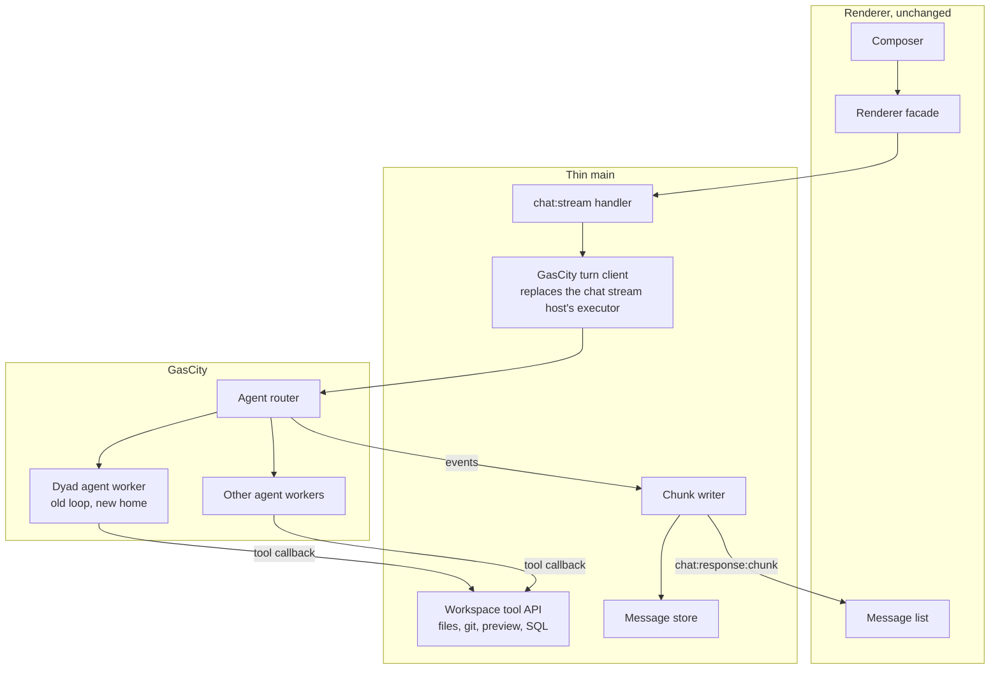

### Component diagram — D

The left column is the current component diagram. The adapter is a new
sibling of the host bridge. It writes chunks and message rows. It does
not call `streamText` or `TOOL_DEFINITIONS`.

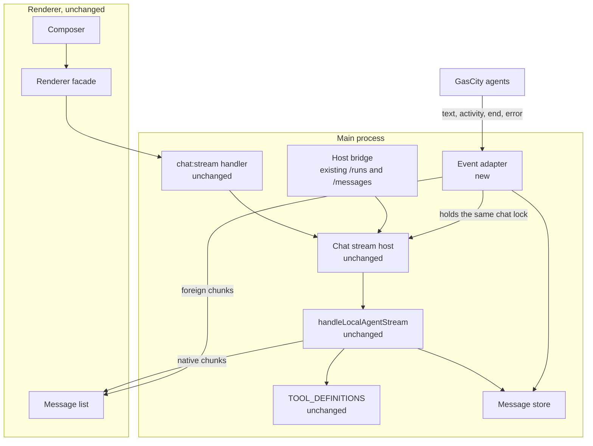

### Sequence diagram — current

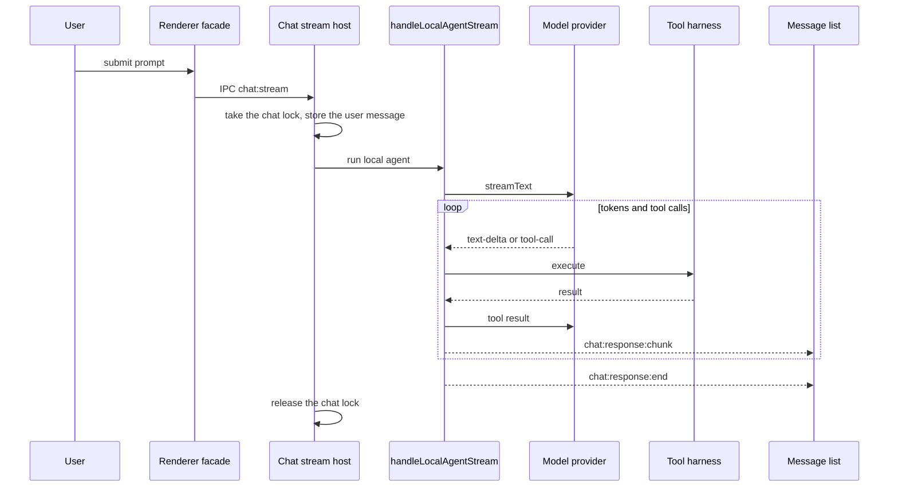

A GasCity `POST /runs` enters at the chat stream host and then follows
this same sequence. A GasCity `POST /messages` skips the loop and inserts
one finished row.

### Sequence diagram — B

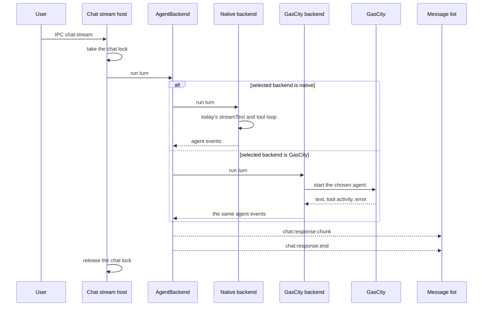

### Sequence diagram — C

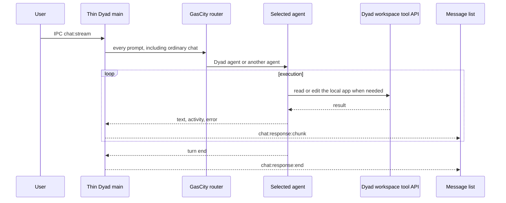

### Sequence diagram — D

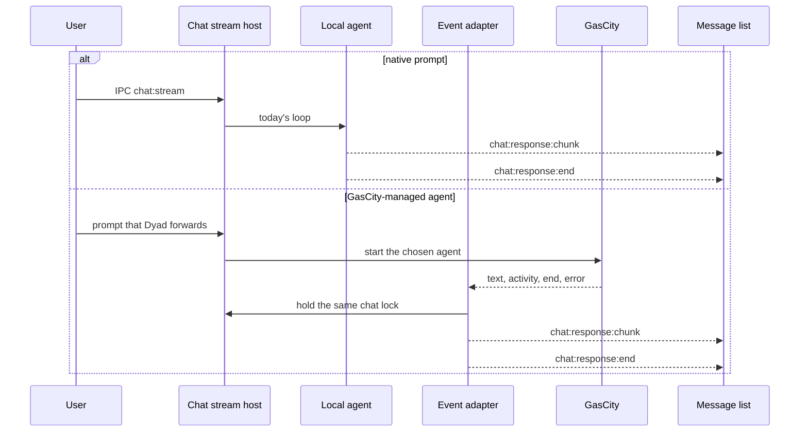

### What moves

| Box | Current | B | C | D |
| --- | --- | --- | --- | --- |
| Renderer and message list | Paints chunks | Same | Same | Same |
| Chat stream host | Owns the turn | Calls `AgentBackend` | Replaced by a GasCity client | Same, plus a lock share with the adapter |
| Local agent | The only executor | Wrapped as the native backend | Moves into GasCity | Stays |
| Tool harness | In the main process | Used by the native backend | Exposed as a callback API | Stays on the native path |
| Model provider | Called by Dyad | Called by the native backend | Called by GasCity | Called by Dyad for native turns |
| Host bridge | Starts Dyad, or appends a finished message | Competes with the new backend client | Replaced by the turn client | Gains the event adapter |
| GasCity | Optional starter of the Dyad agent | Executor when that backend is selected | Executor of every turn | Executor of foreign agents only |

## Verified versus proposed

Verified: the lifecycle, tool list, IPC names, chunk schema, and the fact
that the host bridge starts local-agent or appends finished messages.
The current container, component, and sequence diagrams describe that path.

Proposed: options B, C, and D, the adapter events, agent switching inside
one chat, and any claim that GasCity already emits a compatible stream.
This repository does not contain that GasCity emitter.
