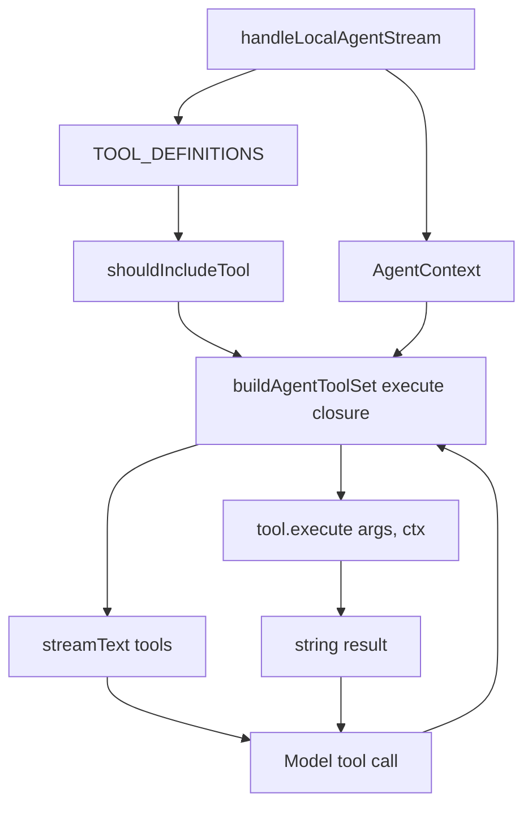
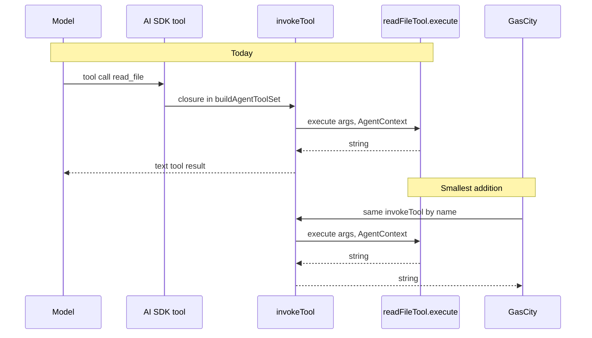

# How Dyad tools are registered and invoked

Status: investigation only. No runtime change.

The tools are not methods on an agent class. Each tool is its own module.
A central list registers them. The agent loop does not call those modules
directly. It receives an AI SDK tool set whose `execute` closure performs
Dyad's checks and then calls the module.

That is the hybrid pattern. The functions are independent. The context
they close over is Dyad's.

## 1. Where the pieces live

| Piece          | File                                                    | Role                                              |
| -------------- | ------------------------------------------------------- | ------------------------------------------------- |
| One tool       | `src/pro/main/ipc/handlers/local_agent/tools/<name>.ts` | Schema, description, `execute`                    |
| Tool contract  | `ToolDefinition` and `AgentContext` in `tools/types.ts` | What every tool must satisfy                      |
| Registry       | `TOOL_DEFINITIONS` in `tool_definitions.ts`             | The only list the agent knows                     |
| Filter         | `shouldIncludeTool`                                     | Ask, Plan, Build, consent "never", Pro, blueprint |
| Adapter        | `buildAgentToolSet`                                     | Turns a `ToolDefinition` into an AI SDK tool      |
| Loop           | `handleLocalAgentStream` in `local_agent_handler.ts`    | Builds the context, calls `streamText({ tools })` |
| User MCP tools | `getMcpTools` in the same handler                       | Merged into the same `ToolSet` after the registry |

`read_file` is the shape of the rest. `readFileTool` is a const object.
Its `execute` is `(args, ctx: AgentContext) => Promise<string>`. It is
exported from its module and named once in `TOOL_DEFINITIONS`. There is
no agent class and no per-agent subclass.

## 2. Calling path

`buildAgentToolSet` is the invocation boundary. For one call it:

1. Rejects the tool if `shouldIncludeTool` says it is not in this turn.
2. Validates args with the Zod schema.
3. Checks the app-blueprint gate for mutating tools.
4. Runs `requireToolConsentOrThrow`.
5. Aborts if the turn's `AbortSignal` has fired.
6. Calls `tool.execute(args, ctx)`.
7. Updates mutation counts.
8. Returns `convertToolResultForAiSdk`, which is `{ type: "text", value: result }`.

The AI SDK puts that text back into the model transcript as the tool
result. The next model step sees it. The UI does not read that return
value. The same closure writes Dyad XML through `ctx.onXmlStream`,
`ctx.onXmlComplete`, and `ctx.onToolActivity`. Those callbacks are how
the message list paints the tool card.

MCP tools skip `ToolDefinition`. `getMcpTools` asks each enabled MCP
server for `client.tools()` and copies them into the same `ToolSet`
under a `server__tool` name. When the sandbox is on, those MCP tools
become host functions inside `execute_sandbox_script` instead of model
tools.

## 3. What a tool depends on

`ToolResult` is a string. That part is generic.

`AgentContext` is not. It carries the Electron event, `appId`,
`appPath`, `chatId`, `messageId`, Supabase and Neon ids, the todo list,
the abort signal, consent, XML callbacks, sub-agent ids, and the
mutation counters. A tool such as `read_file` uses `appPath` and the
path jail. A tool such as `restart_app` uses the app-run actor. A tool
such as `execute_sql` uses the linked database and SQL consent.

Two ways exist to call `execute`:

| Caller                           | What it skips                                                |
| -------------------------------- | ------------------------------------------------------------ |
| `buildAgentToolSet`              | Nothing in the list above                                    |
| A test, or any other direct call | Consent, blueprint gate, mode filter, mutation tracking, XML |

`read_file.spec.ts` calls `readFileTool.execute(args, mockContext)` with
a hand-built context and a temp directory. The function runs. The
consent callback on that stub is never consulted, because consent lives
in the wrapper, not in `read_file`.

## 4. What GasCity can and cannot reuse

| Piece                                    | Reusable as it is                                                          | Why                                              |
| ---------------------------------------- | -------------------------------------------------------------------------- | ------------------------------------------------ |
| `TOOL_DEFINITIONS` names and Zod schemas | Yes, inside this process                                                   | Plain data plus Zod                              |
| `tool.execute`                           | Yes, if the caller builds an `AgentContext` and accepts the skipped checks | Tests already do this                            |
| `buildAgentToolSet`                      | Only from the Electron main process                                        | Closes over consent, DB, and the chat turn       |
| `handleLocalAgentStream`                 | No                                                                         | That is the agent loop                           |
| The string result                        | Yes                                                                        | A caller can show it or pass it to another model |
| The XML card                             | Only if the caller drives `onXmlComplete`                                  | The message list parses those tags               |

What blocks a direct call from GasCity:

- The functions live in the Electron main process. GasCity is another process. It cannot import `readFileTool`.
- A correct call still needs the wrapper, or consent and the path jail are skipped.
- `AgentContext` mentions chats, messages, IPC, and Dyad Pro. Most fields are irrelevant to a file read, but the type requires them.
- File tools assume the app directory is on this machine.

The smallest change that lets GasCity use the same tools is to expose
the wrapper, not the agent loop and not a rewritten tool. A host-bridge
route can look up a name in `TOOL_DEFINITIONS`, build the context for
that app, run the closure that already validates, asks consent, and
calls `execute`, and return the string. `streamText` keeps using the
same closure. The tools stay where they are.

An MCP server in front of that same closure is the standard-shaped
version of the same seam. It is larger than one route, and it is the
same split: MCP is the tool protocol, the agent loop stays behind
whoever calls the tool.

## 5. How this compares with the usual patterns

| Pattern                           | What it standardizes                                         | What Dyad does                                                                      |
| --------------------------------- | ------------------------------------------------------------ | ----------------------------------------------------------------------------------- |
| Methods on an agent class         | The tool exists only on that object                          | Not this. Tools are module-level objects.                                           |
| A registry of functions           | Discovery and a callable list                                | `TOOL_DEFINITIONS`, then filtered per turn.                                         |
| AI SDK / function calling         | Name, description, JSON schema, result back to the model     | `buildAgentToolSet` is this adapter. Schemas are Zod until `asSchema().jsonSchema`. |
| MCP `tools/list` and `tools/call` | A process boundary. The caller does not import the function. | Dyad is an MCP client. It is not an MCP server for its own tools.                   |
| A2A tasks                         | Agent-to-agent lifecycle                                     | Does not describe tools.                                                            |

Dyad already has the registry and the function-calling adapter. It does
not have a process boundary in front of its own tools. That boundary is
the portability gap. Replacing `ToolDefinition` with MCP types would
move every tool file and would not, by itself, let GasCity call them.

## 6. Target split

Leave these in place:

- Each file under `tools/` and its `execute`.
- `TOOL_DEFINITIONS`.
- `handleLocalAgentStream` for ordinary chat.

Extract one function that today is trapped inside the `buildAgentToolSet`
closure: given a tool name, args, and an `AgentContext`, run the checks
and return the string. `buildAgentToolSet` calls it. A factory route
calls it. Nothing else in the tool files has to move.

`AgentContext` stays Dyad-specific. GasCity does not construct IPC
callbacks. The route does. Consent still appears in the Dyad window,
because that is where the user is.

## Verified versus proposed

Verified: the registry, the `ToolDefinition` signature, the wrapper
steps in `buildAgentToolSet`, the string result, the MCP merge, and
direct `execute` calls in `read_file.spec.ts`.

Proposed: extracting `invokeTool` and a bridge route that calls it.
This repo does not contain that route.
