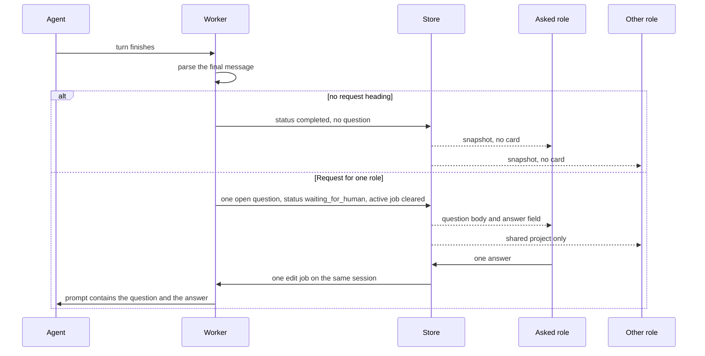

# Forma agent-driven HITL

> Generated by swarm planning session on 2026-10-11

## Summary

Forma becomes a web builder for one organization with two signed-in people and one shared app project. The agent works until a turn finishes. A turn with no request completes. A turn that names Project Manager or Developer pauses, shows that question only to that role, and continues the same agent session after the answer. There are no Discovery, Implementation, or Delivery phases.

## Problem Statement

A Project Manager and a Developer need to share one Forma project and one agent session. Forma on `main` has one shared password and one owner. The unmerged Clerk branch (forma pull request 3) signs both roles in, then stores the Clerk user id as `owner_id`, so each person sees a different project list. Nothing in Forma can pause for one role, hide that question from the other role, and resume the same session.

## Scope

### In Scope (MVP)

- One organization, the existing Wewebplus Project Manager and Developer, one shared project, one OpenAI Agents session.
- Auth from forma pull request 3: Clerk Development session and `wewebplus.memberships`. Projects belong to the organization, not the user id.
- Stop rule from Dyad pull request 97: the last `## Request for project-manager` or `## Request for developer` outside a code fence and outside a thinking block. No heading means the task completed.
- A missing or unknown role stays paused and is shown only to the Project Manager, marked uncertain.
- The other role does not see the question, the answer field, or a waiting line.
- One answer starts one follow-up edit on the same session. The shared chat does not contain the question or the answer.
- Three fixture proofs: a Project Manager question, a Developer question, and a clean completion.
- Deploy only on the non-production Forma preview.

### Out of Scope (Follow-up)

- Discovery, Implementation, Delivery, a phases tab, and the three gate ids `plan-approve`, `review-approve-dev`, and `review-approve-pm`.
- Electron, the host bridge, Gas City, beads, and the gate closer.
- A status line for the person who was not asked.
- Keyword routing. The keyword table is recorded beside real questions later. It does not assign the role.
- More organizations, roles, projects, or concurrent questions.
- Computer Use sign-in. Playwright and the existing Clerk ticket job open the two browsers.
- Production Neon, production EC2, Doppler `dyad/prd`, and merging forma pull request 3 as it stands.
- Closing the public generated-app preview URL.

## User Stories

- As a Project Manager, I want the project to belong to our organization so that the Developer and I open the same agent session.
- As a Project Manager, I want a finished turn headed `## Request for project-manager` to show me the question and hide it from the Developer, so that my answer continues that session.
- As a Developer, I want a finished turn headed `## Request for developer` to show me the question and hide it from the Project Manager, so that I can answer a technical question the other role does not see.
- As either role, I want a finished turn with no request heading to complete, so that neither of us is left with a question.

## UX Design

### User Flow

Both people sign in with Clerk and open the one shared project. The studio stays the composer, the shared chat, one project status, and the preview iframe. There is no phases tab.

1. Either person sends a prompt. The agent runs. The existing SSE snapshot refreshes chat and preview.
2. If the turn finishes with no request heading, both browsers show status Completed and the preview. No card.
3. If the turn names one role, only that browser shows a card above the composer: the question as a heading, a field named "Your answer", and Submit.
4. The other browser keeps the shared chat and the preview. It does not show the question, the field, a waiting line, or a status that names the other role.
5. Submit stays off until the field has non-whitespace text. A successful submit removes the card. The next snapshot shows the agent continuing. The shared transcript does not gain the question or the answer.
6. This repeats until a turn finishes with no request.

### Key States

- **Default**: Signed in, shared project, composer, chat, preview. No card.
- **Loading**: Status In progress while a job is running. The card area renders nothing. No "No questions" line.
- **Empty**: No open question. The card area renders nothing.
- **Answering**: Only the asked role sees the card. Focus moves to "Your answer" in that browser only.
- **Uncertain**: Same card, only for the Project Manager, with the word Uncertain on the card. The Developer sees no card.
- **Completed**: Both browsers show status Completed and the preview. No card.
- **Error**: A failed submit keeps the card, the typed text, and the alert "Couldn't send your answer. Try again." An errored agent turn is status Stopped in the shared chat for both, with no question card. The preview stays on the last good frame.

### Interaction Details

The other browser does not scroll or move focus when a question opens. The iframe reloads only when the preview URL changes. A long question scrolls inside the card. The field and Submit stay visible. Enter submits from the field. The composer does not send a new edit while a question is open, and the other role gets no extra sentence explaining why.

### Accessibility

The answer field's accessible name is "Your answer". The question is a heading. The button's accessible name is Submit. A failed submit is an alert on the form. Tab reaches the field.

### What stays out of the screen

Do not copy Dyad's phase bar, phase locks, "Approve and continue", or the status-only card ("Waiting on Project Manager for plan-approve. Status: open.").

## Technical Design

### Architecture

Forma keeps its web loop: one OpenAI Agents session per project, follow-up work as a new edit job, Neon for rows, and the SSE snapshot. The pause is not a parked model socket and not the sandbox stop button. A turn runs to completion. The worker then classifies the saved final message with a pure parser. "Paused" means the project has one open question and will not accept another edit until that question is answered.

The parser stays outside the OpenAI SDK. The heading is the contract, so a later model provider can emit the same text.



Clerk Development proves the session. `wewebplus.memberships` proves the role. Forma's database owns the project, the question, and the answer. A caller from another organization gets not-found.

### Components Affected

- `lib/sign-in.ts` on forma pull request 3 — keep session and role resolution. Change project ownership off the Clerk user id.
- `lib/projects.ts` — list and lock projects by `organization_id`. Refuse a new edit while `waiting_for_human`.
- `lib/worker.ts` — after a completed root turn, classify and either finish ready or open one question.
- `lib/request-marker.ts` — new parser, same rules as Dyad `src/lib/factoryRequest.ts` on pull request 97.
- `app/api/projects/[id]/answers/route.ts` — new. One answer, one follow-up job.
- `app/api/projects/[id]/messages/route.ts` — 409 while a question is open.
- `app/api/projects/[id]/events/route.ts` — existing SSE. Add the question only for the asked role.
- `components/studio.tsx` — one card. No phases tab.
- `db/schema.sql` — organization on projects, question and answer tables.
- Dyad `e2e-walkthrough/tests/walkthrough.ts` `signInAs` — reuse for the two browsers. Do not copy it into Forma until the proof job needs it.

### Data Model Changes

`projects` gains `organization_id`. New projects use the caller's Wewebplus organization. Rows still owned by the demo HMAC or by a bare Clerk user id stay unlisted for these sessions.

```sql
CREATE TABLE hitl_questions (
  id uuid PRIMARY KEY,
  organization_id text NOT NULL,
  project_id uuid NOT NULL REFERENCES projects(id),
  job_id uuid NOT NULL,
  target_role text,
  uncertain boolean NOT NULL DEFAULT false,
  body text NOT NULL,
  status text NOT NULL DEFAULT 'open',
  created_at timestamptz NOT NULL DEFAULT now()
);
CREATE UNIQUE INDEX one_open_question ON hitl_questions(project_id) WHERE status = 'open';

CREATE TABLE hitl_answers (
  id uuid PRIMARY KEY,
  question_id uuid NOT NULL UNIQUE REFERENCES hitl_questions(id),
  user_id text NOT NULL,
  body text NOT NULL,
  request_id uuid NOT NULL UNIQUE,
  follow_up_job_id uuid,
  created_at timestamptz NOT NULL DEFAULT now()
);
```

`target_role` is `project-manager`, `developer`, or null when the heading is missing or unknown. `uncertain` is true only in that last case. One open question per project. One answer per question.

The question and the answer are not inserted into `messages`. The follow-up prompt sent to the model contains both. The shared transcript does not, because both browsers read that transcript.

Three columns on `projects` were considered and rejected. Clearing them on answer drops the record, and copying the text into `messages` shows it to the other role.

### API Changes

- `GET /api/auth` stays the forma pull request 3 shape: `signedIn`, `organization`, `role`.
- Project and SSE payloads include `status`. They include `ask` only when the caller is the asked role, or the Project Manager for an uncertain question. `ask` is `{ id, body, uncertain }`.
- `POST /api/projects/:id/answers` with `{ requestId, answer }` returns 202 `{ jobId }`.
- The same `requestId` returns the same job and does not start another.
- Wrong role is 403, with no body in the response.
- Another organization is 404.
- Not waiting, or `active_job_id` already set, is 409.
- `POST /messages` is 409 for the whole `waiting_for_human` status.

### Stop and resume

| Finished turn                                 | Stored result                                                           | Next                         |
| --------------------------------------------- | ----------------------------------------------------------------------- | ---------------------------- |
| Heading for `project-manager` or `developer`  | One open question, that role, `waiting_for_human`, `active_job_id` null | Wait for that role           |
| No heading                                    | `ready`, no question                                                    | Stop                         |
| Unknown role, or a heading with an empty body | One open uncertain question for the Project Manager                     | Wait for the Project Manager |
| Failed or cancelled                           | `error`, no question                                                    | Stop, no card                |

`enqueueJob` returns 409 while `active_job_id` is set. The wait must clear that pointer, or the answer can never enqueue. Clearing it also makes `POST /messages` look idle, so that route rejects `waiting_for_human` itself. Only the answer route enqueues, and only when the pointer is null. The new job uses the existing `session_id`.

Sandbox pause stays a `stop` job. Cron may stop compute. It must leave the open question stored.

### Question classification

The agent assigns the role by the heading. The keyword table (business and product to Project Manager, technical work to Developer) is not the router. After the fixture proof, one real build logs the heading, the keyword guess, and whether a person agreed. That log is the evidence for any later change.

## Implementation Plan

### Phase 1: One organization, one project

- [ ] Branch Forma from `cursor/forma-shared-auth-5014` (forma pull request 3). Do not start from the password-cookie `main`, and do not merge that pull request unchanged.
- [ ] Add `organization_id` and list, get, and create projects for members of that organization.
- [ ] Keep the two existing `+clerk_test` users. Do not create Clerk users. Refuse live Clerk keys.
- [ ] Confirm both browsers open the same project id and the same `session_id` once a project exists.

### Phase 2: Pause and resume

- [ ] Add the parser and unit tests: present, absent, unknown role, empty body, last heading wins, code fence ignored, thinking block ignored.
- [ ] On a completed marked turn, store one question, set `waiting_for_human`, and clear `active_job_id`. Skip the ready path.
- [ ] On a completed unmarked turn, finish ready and store nothing.
- [ ] On a failed turn, store nothing.
- [ ] Reject `POST /messages` while waiting.
- [ ] Accept one answer, enqueue one edit on the same session, and ignore a second submit.

### Phase 3: The card and the three proofs

- [ ] Render the card from the role-filtered SSE snapshot.
- [ ] Fixture Test A: exact `## Request for project-manager`. The Project Manager sees the body and submits. The Developer page does not contain the body. The follow-up uses the same `session_id`.
- [ ] Fixture Test B: the same for `## Request for developer`. The Project Manager page does not contain the body, including no uncertain card.
- [ ] Fixture Test C: no heading. Status is completed for both. The question table has no row. An empty card is not enough, because the other role's card is also empty while a question is open.
- [ ] Run the browsers with the existing Clerk ticket sign-in, in the job that already holds the Development secret.

### Phase 4: Preview, then real questions

- [ ] Publish a new Forma image and run it on the non-production preview. Point membership reads at the Wewebplus store already used by forma pull request 3. Do not point them at production.
- [ ] Run one real app-building prompt. Save heading, keyword guess, and human agreement. Do not change the router from that single run.

## Testing Strategy

- [ ] Parser unit tests cover the heading rules above.
- [ ] Database tests cover the 409 trap, one open question, one answer, same `session_id`, and no question text in `messages`.
- [ ] API tests cover 403 for the wrong role, 404 for another organization, and redaction of `ask` on GET and SSE.
- [ ] Playwright, two contexts, fixture agent: Tests A, B, and C.
- [ ] A live model run is a later log, not the pass rule for A, B, or C.

## Risks & Mitigations

| Risk                                                     | Likelihood | Impact | Mitigation                                                                                                               |
| -------------------------------------------------------- | ---------- | ------ | ------------------------------------------------------------------------------------------------------------------------ |
| A live model writes a loose heading or a prose question  | H          | H      | Tests A–C use fixtures with the exact heading or a true absence. Any other stop stays uncertain for the Project Manager. |
| Projects stay keyed to the Clerk user id                 | H          | H      | Phase 1 is the organization id. The role tests do not start until both sessions open one project id.                     |
| The other role's blank card looks like completion        | M          | H      | Tests assert `waiting_for_human` versus `ready`, not only a missing string on the page.                                  |
| The answer starts a new session                          | M          | H      | The follow-up job reads the stored `session_id` and the test asserts it is unchanged.                                    |
| The question is copied into shared `messages`            | M          | H      | The answer route does not insert that text. A test reads `messages` and fails if the body is there.                      |
| `active_job_id` stays set, so the answer gets 409        | M          | H      | The wait clears the pointer. `POST /messages` rejects the waiting status so the cleared pointer is not a second door.    |
| Cron or sandbox pause deletes the question               | L          | H      | Those paths may stop compute. They do not delete `hitl_questions`.                                                       |
| The ticket or Clerk secret appears in a log or recording | M          | H      | Mint the ticket in the existing Actions job, consume it immediately, and keep it out of URLs, titles, and screenshots.   |

## Open Questions

- Resolved: the other role sees no status line in v1.
- Resolved: the heading assigns the role. The keyword table only scores later runs.
- Resolved: uncertain stops go to the Project Manager and are hidden from the Developer.
- Still open during implementation: the neutral status word the other role sees while a question is open. It must not say Completed, and it must not name a role. The proof asserts the stored status either way.

## Decision Log

- **Reuse forma pull request 3 for sign-in, and replace its owner id.** Product and engineering agreed the Clerk session and memberships are the identity. Keying `owner_id` to the user id fails the shared-project proof.
- **Reuse Dyad pull request 97's heading, not the three gates.** The user's agent-driven stop is that experiment. Dyad pull request 100 and the phase bar stay out. In `plans/hitl-workflow-semantics.md` the letters are reversed: that file's Experiment A is this plan.
- **Hide the question from the other role.** The Dyad journey shows a status line. Tests A and B forbid it for this proof. UX agreed not to copy that card.
- **Keep a question table.** Engineering proposed three columns on `projects`. That either forgets the answer or leaks it into the shared chat. The table is the smaller leak-free record.
- **Clear `active_job_id` during the wait, and reject ordinary edits.** This is the existing 409 rule in `enqueueJob`, applied on purpose.
- **Fixtures prove the architecture. A live model grades the heading later.** An unscripted model can fail Test B and Test C without saying anything about routing.
- **The parser is the provider boundary.** Product principles ask features not to lock to one vendor. Forma still runs the OpenAI Agents session it has. The pause decision reads text, not an SDK tool.
- **The generated app stays a normal sandbox app.** This work does not put a Forma runtime inside the customer's project.
- **The asked person sees the question.** The hidden part is the other role, not the person who must answer.
- **No production systems in this plan.** Preview only. Production Neon, production EC2, and Doppler `dyad/prd` stay untouched.

---

_Generated by dyad:swarm-to-plan_
