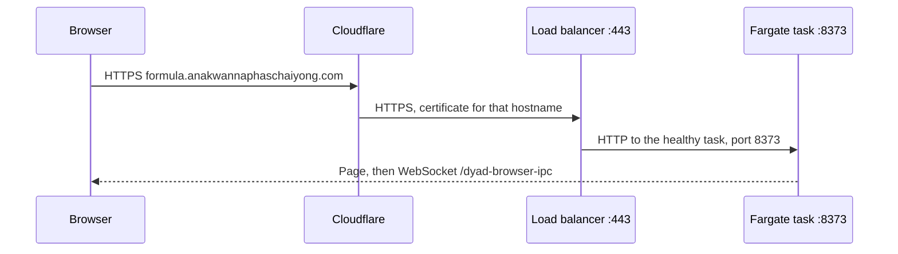

# Serve the formula preview over HTTPS

Safari crashes on the formula preview because the page is plain HTTP. `crypto.randomUUID` exists only in a secure context. The load balancer is already running and already returns the three formula pages. This plan gives that same service a name on `anakwannaphaschaiyong.com` and serves it with TLS. No new domain is purchased.

Checked on 11 October 2026:

| Address | Result |
| --- | --- |
| `http://formula-preview-1770912329.ap-southeast-1.elb.amazonaws.com/formulas/discovery` | HTTP 200, body contains `data-dyad-browser-bridge` |
| `https://formula-preview-1770912329.ap-southeast-1.elb.amazonaws.com` | Connection times out. The load balancer has no listener on 443 |
| `https://pr-79.anakwannaphaschaiyong.com` | Cloudflare answers `Not found`. That name is not the formula service |

Opening the HTTP load-balancer name in Safari shows **Not Secure** and then:

`TypeError: globalThis.crypto.randomUUID is not a function`

Closing the tab loads the same HTTP address again.

## What you can check

1. A push to `cursor/formula-config-ui-55d6`, or a manual run of **Preview formula**, prints `https://formula.anakwannaphaschaiyong.com` and does not print secret values.
2. `/formulas/discovery`, `/formulas/implementation`, and `/formulas/delivery` on that `https://` address return HTTP 200 and the body contains `data-dyad-browser-bridge`.
3. Safari’s address bar shows the lock. The randomUUID dialog does not appear.
4. The load balancer still forwards to the same task on port 8373. Ports 32100 and 6080 stay closed to the internet.
5. `https://pr-79.anakwannaphaschaiyong.com` is unchanged. Production and `gascity-rollout.yml` are unchanged.
6. The log does not cook or sling.

## What is wrong

The browser bridge calls `globalThis.crypto.randomUUID()` while the page loads. On `http://….elb.amazonaws.com`, Safari leaves that function undefined. The server has already returned the page. The crash is in the browser.

`pr-79.anakwannaphaschaiyong.com` is the named-tunnel hostname from `scripts/gascity/preview-tunnel.mjs`. Its Cloudflare answer is the tunnel’s own `Not found`, not the ECS task. Pointing the walkthrough at `pr-79` would also race with that script, which rewrites `pr-<n>` back to `<tunnel-id>.cfargotunnel.com`.

A substitute for `randomUUID` in page script would hide this one throw. The page would still be an insecure context, so `crypto.subtle` stays missing and sign-in still runs over cleartext HTTP. This plan does not add that substitute.

## What this adds

| Piece | Role |
| --- | --- |
| `formula.anakwannaphaschaiyong.com` | The link to open. One hostname on the zone that already exists |
| ACM certificate in `ap-southeast-1` | Covers that hostname. AWS keeps the private key |
| Load balancer listener on 443 | Forwards to the existing target group and port 8373 |
| Proxied Cloudflare CNAME | Sends `formula` to the load balancer DNS name |

The HTTP listener on port 80 stays. Health checks stay `GET /` on port 8373. The idle timeout stays 3600 seconds. Desired count stays 1.

Cloudflare stays in front so the hostname is on the existing zone. The certificate is on the load balancer so the zone’s SSL mode does not have to change. Other names on `anakwannaphaschaiyong.com`, including every `pr-<n>` tunnel, keep their current records.

## Request path

The browser’s secure context is the `https://` address. The task still speaks HTTP on the private hop, which is the hop the load balancer already uses.

## Code and workflow

1. `deploy/preview/formula_ecs.mjs` requests the ACM certificate for `formula.anakwannaphaschaiyong.com` when it is missing, waits until it is issued, then ensures a listener on 443 with that certificate and the existing target group. It opens TCP 443 on `formula-preview-alb` the same way it opens port 80. It prints `url=https://formula.anakwannaphaschaiyong.com`.
2. A small DNS helper upserts two Cloudflare records and does not print their values or the API token:
   - DNS-only CNAME for ACM validation, from the certificate’s validation option.
   - Proxied CNAME `formula` to the load balancer DNS name.
   It refuses any other name. It does not create a tunnel and does not call `preview-tunnel.mjs`.
3. The helper reads `CLOUDFLARE_API_TOKEN`, `CLOUDFLARE_ZONE_ID`, and `CLOUDFLARE_ACCOUNT_ID` from the environment, or from Doppler project `dyad` config `preview` through `DOPPLER_ADMIN_TOKEN`, the same way `deploy/preview/controller.mjs` loads the preview database URL. The log prints `present` or `absent` for each name. If one is absent, the run stops before it changes DNS.
4. `.github/workflows/preview-formula.yml` curls the three phase paths on `https://formula.anakwannaphaschaiyong.com` until each returns 200 and contains `data-dyad-browser-bridge`.
5. `scripts/gascity/setup_formula_role.py` adds `acm:RequestCertificate`, `acm:DescribeCertificate`, and `acm:ListCertificates` in `ap-southeast-1`. `elasticloadbalancing:CreateListener` and the security-group ingress call are already on the role. The trust policy stays the formula-preview subject.

Unit tests cover the certificate hostname, the listener on 443, the two DNS records, the refusal to touch `pr-79`, and the workflow’s `https://formula.anakwannaphaschaiyong.com` check. Tests use a fake Cloudflare client. They do not call AWS or Doppler.

## Clerk

The task already receives `CLERK_PUBLISHABLE_KEY` and `CLERK_SECRET_KEY`. If the page gets past the randomUUID crash and Clerk then rejects the origin, add `https://formula.anakwannaphaschaiyong.com` to that Clerk instance’s allowed origins. That is a dashboard change. The workflow does not call Clerk and does not print the keys.

## What you do

Nothing in the repo holds a Cloudflare token. If the run stops because one of the three unsuffixed Cloudflare names is absent, add that name to Doppler `dyad` / `preview`. Do not paste the token into GitHub Actions or into a file in the repo.

After the run is green, open `https://formula.anakwannaphaschaiyong.com/formulas/discovery` in Safari. The lock in the address bar is the check that this crash is gone.

## Out of scope

- A polyfill for `crypto.randomUUID`.
- Buying a domain, or changing the zone-wide SSL mode.
- Repointing `pr-79.anakwannaphaschaiyong.com`, debugging its tunnel, or waking a Devbox.
- A certificate for the raw `elb.amazonaws.com` name. That name has no stable name we control, and Safari would still be on HTTP if someone opens it.
- Cooking, slinging, `gascity-rollout.yml`, or the production host.
- More than one formula service.
