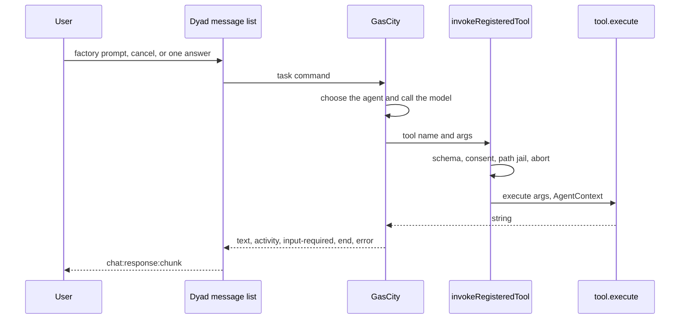
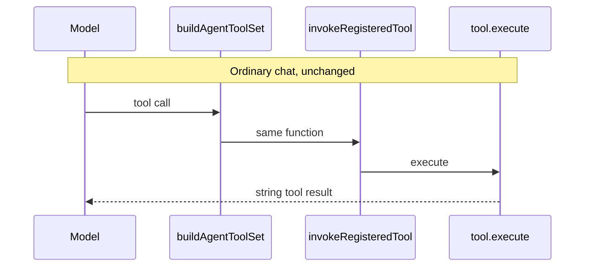

# Option C implementation plan

Status: plan only. No runtime change.

GasCity is the orchestrator for a factory-linked app. It chooses the
agent and calls the model. Dyad keeps the window, the transcript, tool
consent, and the files. The tool functions stay in
`src/pro/main/ipc/handlers/local_agent/tools/`. GasCity does not import
them and does not receive a copy of `TOOL_DEFINITIONS`.

Ordinary chat stays on `handleLocalAgentStream`. An app is factory-linked
when `factoryHostManaged` is set. If GasCity is down, Ask, Build, Agent,
and Plan still stream.

## What is already true

Tools are module-level `ToolDefinition` objects, registered in
`TOOL_DEFINITIONS`, and adapted by `buildAgentToolSet` in
`tool_definitions.ts`. The AI SDK calls the closure at the `execute`
assigned around line 799. That closure validates args, checks the
blueprint gate, runs `requireToolConsentOrThrow`, calls
`tool.execute(args, ctx)`, and returns `{ type: "text", value }`.

`read_file.spec.ts` calls `readFileTool.execute` with a stub context.
That skips the closure. A factory caller must use the closure, not
`execute`.

Factory kickoff in `FactoryPhaseBar.tsx` calls `streamMessage`, which
enters `handleLocalAgentStream`. `POST /runs` on the host bridge starts
that same loop. There is no cancel route and no live event stream.

## End state

## How to read the matrix

Same rule as [PR #129](https://github.com/Awannaphasch2016/dyad/pull/129).
A row is one intention. A column is one place this path stores or decides
state. **Change** means the intention is unfinished until that cell is
edited as written. **Leave** means that place keeps today's behavior.
A row is finished only when every Change cell is true and every Leave
cell still behaves as it does today.

| Column | Where it lives |
| --- | --- |
| Chat lock | `src/chat_stream/` host. One owner per chat. |
| Agent loop | `handleLocalAgentStream`. |
| Tool wrapper | The `execute` closure in `buildAgentToolSet`. |
| Transcript | `messages` and `chat:response:chunk`. |
| Run record | `factoryHostRuns`. |
| Bridge | `factory_host_bridge_server.ts`. |
| HITL | `hitlQuestions` and `answerHitlQuestion`. |
| Phase chrome | `FactoryPhaseBar.tsx`. |
| Workspace | App directory, git, preview process. |
| GasCity task | Supervisor workflow cursor. Not in this repo. |

| Intention | Chat lock | Agent loop | Tool wrapper | Transcript | Run record | Bridge | HITL | Phase chrome | Workspace | GasCity task |
| --- | --- | --- | --- | --- | --- | --- | --- | --- | --- | --- |
| One wrapper runs every Dyad tool | Leave. | Leave. `streamText` still receives the tool set. | Change. Move the closure body into `invokeRegisteredTool`. `buildAgentToolSet` calls it. | Leave. | Leave. | Leave. No route in this row. | Leave. Consent is still the call inside the wrapper. | Leave. | Leave. | Leave. |
| GasCity calls the model for a factory turn | Change. The factory owner is the GasCity task. | Change. A factory prompt does not enter `handleLocalAgentStream`. | Leave. GasCity does not get a second wrapper. | Leave. | Change. Store the GasCity task id. `intentId` is no longer the execution key. | Change. `POST /runs` stops dispatching a local-agent intent. | Leave. | Change. Kickoff calls GasCity instead of `streamMessage`. | Leave. | Change. GasCity stores the cursor and calls the model. |
| The message list shows that turn while it runs | Leave. | Leave. | Leave. | Change. Events write the streaming row through `chat:response:chunk`. The chunk schema stays. | Change. Store the last applied event cursor. | Change. Event route: text, activity, input-required, end, error. | Leave. | Leave. | Leave. | Change. GasCity emits events. It does not write `messages`. |
| A factory tool runs through the wrapper | Leave. The turn already holds the lock. | Leave. | Change. The bridge calls `invokeRegisteredTool` by name. Allowlist: `read_file`, `list_files`, `grep`, `code_search`, `write_file`, `search_replace`, `git_status`, `git_diff`. | Leave. Tool XML still comes from the wrapper callbacks. | Leave. | Change. Tool route. Reject `execute_sandbox_script`, sub-agents, and MCP names. | Leave. Consent still blocks in Dyad. | Leave. | Leave. The same `execute` writes the same directory. | Change. GasCity sends the tool name and args and waits for the string. |
| Cancel and one answer go back to GasCity | Change. Cancel releases the factory owner. | Leave. | Change. The in-flight `execute` sees the task abort signal. | Change. Cancel sets `wasCancelled`. No new message type. | Change. The same task id continues across the answer, or the status becomes canceled. | Change. Cancel route. | Change. One answer resumes that task. The question stays on `hitlQuestions`. | Leave. The reply uses the existing composer. | Leave. | Change. GasCity receives cancel and the answer. |
| Ordinary chat still runs with GasCity down | Leave. | Leave. | Leave. | Leave. | Leave. | Leave. | Leave. | Leave. | Leave. | Leave. |
| Formula and preview stay put | Leave. | Leave. | Leave. | Leave. | Leave. | Leave. | Leave. | Leave. Approval and document download stay. | Leave. | Leave. Do not change `gascity_formula_client.ts`. |

## Slices

### 1. Name the wrapper

Move the body of the `execute` closure in `buildAgentToolSet` into
`invokeRegisteredTool` in `tool_definitions.ts`. The tool set's `execute`
becomes a call to that function. No new route.

Prove it with the existing tool-definition tests plus one test that a
direct `readFileTool.execute` still does not ask for consent, and that
`invokeRegisteredTool` does.

### 2. Factory context and tool route

Add `POST /v1/apps/:appId/tools/:toolName` on the host bridge. The
handler checks the bearer token, `factoryHostManaged`, and the
allowlist, builds an `AgentContext` for that app, and calls
`invokeRegisteredTool`. The context uses the app's real `appPath`, the
phase chat id, the existing consent function, and an abort signal for
the task. It does not start `streamText`.

The route returns the string. A rejected tool, a failed schema, a
denied consent, or a path-jail error comes back as a `DyadError` with
`DyadErrorKind`. GasCity treats that string or error as the tool result.
It does not retry inside Dyad.

### 3. Events, cancel, and the transcript

Add the event route and the cancel route. Map text, activity,
`input-required`, end, and error onto `chat:response:chunk`,
`chat:response:end`, and `chat:response:error`. Store `gasCityTaskId`
and the last event cursor on `factoryHostRuns`. A replayed event does
not append twice.

Cancel aborts the tool signal and tells GasCity. One HITL answer
resumes the same task id.

### 4. Factory prompts leave the local agent

`FactoryPhaseBar` kickoff and later submits on a `factoryHostManaged`
chat go to GasCity. The chat stream host holds the lock for that task.
`POST /runs` no longer calls `dispatchChatIntent`. A test submits one
factory chat and one ordinary chat and checks which executor ran.

### 5. GasCity runs the model

Outside this repo. The supervisor selects the agent, calls its model,
and uses the tool route. This repo's job is to keep `invokeRegisteredTool`
and the event map stable. Widen the allowlist one tool at a time, with
a consent test for each mutating tool. Do not add
`execute_sandbox_script`, `spawn_agent`, or MCP tools.

## Failure behavior

| Failure | Behavior |
| --- | --- |
| GasCity unreachable | The factory send fails in the window. Ordinary chat still streams. |
| Consent denied or path jail | The tool route returns that error. GasCity chooses the next model step. |
| User cancels | Dyad aborts the tool and notifies GasCity. The transcript ends with `wasCancelled`. |
| Dyad quits during a tool | The route dies. GasCity keeps the task cursor. The file edit does not move. |
| Duplicate event or tool call | The idempotency key makes the second call return the first result. |

## Tests

- `tool_definitions` tests: ordinary tool registration is unchanged after the extraction.
- Bridge tests: allowlisted tool returns the `execute` string; a sandbox name is rejected; consent denial does not touch the file.
- Chat tests: a `factoryHostManaged` prompt does not call `handleLocalAgentStream`; a normal prompt does.
- Phase-bar tests: kickoff targets the task client.
- Replay test: the same event cursor does not duplicate the streaming tail.

## Out of scope

- An MCP server for Dyad's own tools. The route is the seam. MCP can sit on `invokeRegisteredTool` later.
- Moving Ask, Build, Agent, or Plan.
- Copying tool files into GasCity.
- Changing formula TOML or the formula preview.
- A new message-list renderer.
- Running file tools after the Electron process has exited.

## Decision log

- Option C means GasCity owns the factory model loop and the task cursor.
- The tool investigation fixed the callback: it is `invokeRegisteredTool`, not `tool.execute` and not a port of `TOOL_DEFINITIONS`.
- Ordinary chat stays local because one external service must not be required for the editor.
- The first allowlist is the read, edit, and git-status set already named in the matrix.
