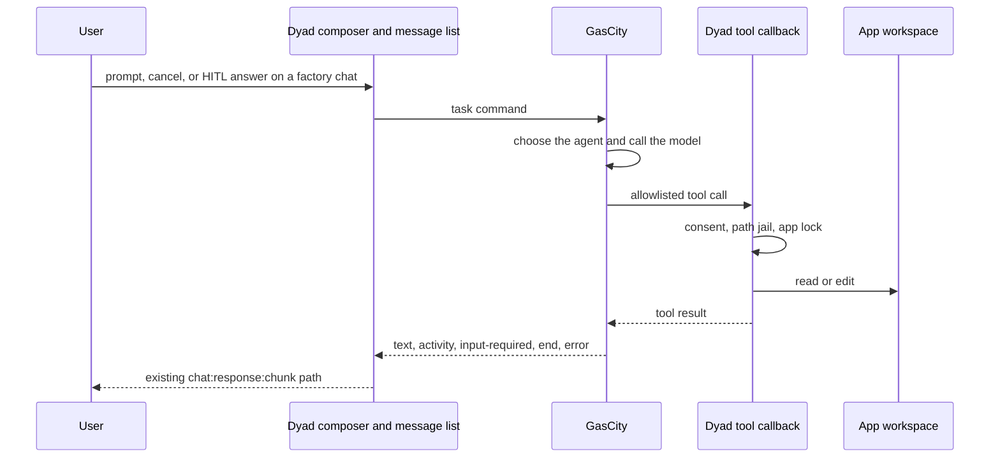

# GasCity orchestrates factory turns (Option C)

Status: plan only. No runtime change.

Option C means GasCity is the caller for factory work. Dyad remains the
window, the transcript, and the only process allowed to touch the app
directory. The model loop for those turns runs in GasCity. The tool
implementations stay in Dyad and are invoked by a callback.

Ordinary chat does not move. A factory-linked app is one whose row has
`factoryHostManaged`. Removing GasCity must not take down the editor.
That is the backend-flexible rule applied to this split.

## End state

GasCity owns which agent runs, the model request, retries, cancel, and
the workflow cursor. Dyad owns the pixels, the message rows, tool
consent, and the files. `ChatResponseChunk` stays the view model. GasCity
does not receive `TOOL_DEFINITIONS` and does not link the AI SDK loop.

## What is true in the code today

| Fact | Where |
| --- | --- |
| A factory phase kickoff calls `streamMessage`, which runs the local agent | `src/components/chat/FactoryPhaseBar.tsx` |
| That turn is `handleLocalAgentStream` inside the Electron main process | `src/ipc/handlers/chat_stream_handlers.ts`, `local_agent_handler.ts` |
| GasCity can also start that same loop | `POST /v1/apps/:id/phases/:phase/runs` in `factory_host_bridge_server.ts` |
| GasCity learns status by polling, then one final message | `readFactoryRun` in `factory_host_service.ts` |
| Finished bubbles can be inserted without a stream | `postFactoryHostMessage` |
| HITL questions and answers exist | bridge question routes, `src/control_plane/hitl_device.ts` |
| There is no bridge cancel route and no live event stream | `createFactoryHostBridgeServer` |
| One chat stream host owns a chat, including cancel | `src/chat_stream/` |
| Tools are in-process functions with consent and a path jail | `tool_definitions.ts`, `tool_invocation.ts`, `path_safety.ts` |

`POST /runs` is the opposite of this end state: GasCity asks Dyad to run
Dyad's agent. Option C retires that as the execution path. The poll can
remain as a compatibility read while tasks are in flight.

## Change impact

Impact words: **None** (behavior stays), **Adapt** (same owner, new
branch or field), **New** (does not exist), **Retire** (factory path
stops using it), **External** (GasCity repo, not this one).

| Surface | Path | Impact | What changes | What stays |
| --- | --- | --- | --- | --- |
| Message list | renderer chat messages | None | Paints the same `chat:response:chunk` XML | Parser, cards, preview overlay |
| Chunk schema | `src/ipc/types/chat.ts` | None | No new wire field in the first slices | `streamingPatch`, `streamingPreview`, end, error |
| Composer, non-factory | `src/chat_stream/renderer_facade.ts` | None | Ordinary prompts still call `chat:stream` | Ask, Build, Agent, Plan |
| Composer, factory chat | renderer facade and `useStreamChat` | Adapt | A factory-managed chat submits a task to GasCity instead of `chat:stream` | The facade remains the only renderer entry |
| Phase bar | `src/components/chat/FactoryPhaseBar.tsx` | Adapt | Kickoff and continue call the task client. The bar shows task state from GasCity | Phase list, approval gate, document download |
| HITL list | `HitlQuestionList`, `hitl_device.ts` | Adapt | An answer resumes the GasCity task (`input-required`), then the existing local answer write | Question rows and the current answer IPC |
| Cancel control | renderer facade `cancel` | Adapt | On a factory turn, cancel is a task command to GasCity and an abort of the in-flight tool callback | Non-factory cancel stays on the chat stream host |
| Chat stream handler | `src/ipc/handlers/chat_stream_handlers.ts` | Adapt | Factory-managed prompts do not call `handleLocalAgentStream` | The four local-agent call sites remain for every other chat |
| Chat stream host | `src/chat_stream/` | Adapt | A GasCity turn takes the same one-owner lock, queue, and cancel record | Lock rules, non-factory transitions |
| Local agent loop | `local_agent_handler.ts` | Retire on factory path only | Factory turns no longer enter `streamText` | The function stays the ordinary-chat executor |
| Tool table | `tool_definitions.ts` | Adapt | An allowlisted invoker calls the existing `execute` functions | Schemas, descriptions, and ordinary-chat registration |
| Consent and mutations | `tool_invocation.ts` | None on the rules | The callback uses the same consent and mutation tracking | Ask / always / never, file-edit tracking |
| Path jail | `path_safety.ts` | None | Callback paths use the same resolver | App-directory restriction |
| App runtime, git, SQL | tool implementations | None inside the tools | They run only when the allowlist names them | Process manager, git helpers, SQL consent |
| Host bridge auth | `factory_host_bridge_server.ts` | Adapt | New routes share the bearer token, loopback bind, and `factoryHostManaged` check | Port 32100, token env, existing link and phase reads |
| Start-run route | `POST …/runs`, `startFactoryRun` | Retire as the executor | The route stops dispatching a local-agent intent. A task id from GasCity replaces `intentId` as the run key | Idempotency key and prompt-hash conflict behavior |
| Run poll | `GET /v1/runs/:id` | Adapt | Status mirrors the GasCity task (`working`, `input-required`, terminal) | The response remains a status document, not a token stream |
| Message append | `POST …/messages` | Adapt | Kept for a committed bubble. Live text uses the new event route instead | Idempotent insert into `messages` |
| Event ingress | bridge, new | New | `text`, `activity`, `input-required`, `end`, `error` map onto chunk, end, and error sends | Renderer consumption |
| Tool callback | bridge, new | New | `POST` tool name plus args. Dyad checks the allowlist, consent, and app lock, then returns the tool result | Tool functions |
| Cancel route | bridge, new | New | GasCity and the UI both abort the active tool call and mark the task canceled | — |
| Run table | `factoryHostRuns` in `src/db/schema.ts` | Adapt | Store the GasCity task id and last event cursor. Migration. | App, phase, chat, idempotency uniqueness |
| Message table | `messages` | None on the schema | Factory turns still persist the transcript the UI reloads | Roles and content |
| Formula editor | `src/pages/formula.tsx`, `gascity_formula_client.ts` | None | TOML still edits phase steps | Compiler version and step metadata |
| Preview and deploy | app runtime, ECS preview | None | Tools that restart or build the app stay local | Preview URL ownership |
| GasCity router and model loop | not in this repo | External | New task runner, agent choice, model client, retry, cursor | Dyad does not vendor that process |
| GasCity tool client | not in this repo | External | Calls the Dyad callback and consumes tool results | Must not reimplement file or git logic |
| Tests, ordinary agent | `local_agent_handler.test.ts` and tool specs | None | They keep covering the in-process loop | — |
| Tests, bridge | `factory_host_bridge_server.test.ts` | Adapt | Cover task events, tool callback, cancel, and the retired `/runs` dispatch | Auth and link rejection cases |
| Tests, factory UI | `FactoryPhaseBar.test.tsx` | Adapt | Kickoff goes to the task client | Approval and lock rules |

### Tool allowlist impact

The callback does not expose the whole harness. The first set is the
smallest set that can change an app and show it:

| Tool | First slice | Reason |
| --- | --- | --- |
| `read_file`, `list_files`, `grep`, `code_search` | Yes | Read-only inspection |
| `write_file`, `search_replace` | Yes | The edits the message list already renders |
| `git_status`, `git_diff` | Yes | Show what changed |
| `run_type_checks` | Follow-up | Slow, process-owning |
| `restart_app`, `run_tests`, `run_build` | Follow-up | Preview and test lifecycle |
| `execute_sql` | Follow-up | Separate consent metadata |
| `execute_sandbox_script` | Not in C | A remote caller must not gain a script runner |
| `spawn_agent` and the other sub-agent tools | Not in C | Nesting stays inside a Dyad-owned loop |
| MCP search and call tools | Not in C | User MCP servers stay on the ordinary agent |
| Web, image, plan, blueprint, integration tools | Later, one at a time | Each has its own consent and side effect |

## Slices

### 1. Contracts in this repo

- Define the task event set and the tool-callback request and result.
- Map events onto the existing chunk, end, and error sends.
- Add `gasCityTaskId` and an event cursor to `factoryHostRuns`.
- Do not divert user prompts yet.

### 2. Callback and projector

- Implement the allowlisted tool route with consent, path jail, and the app lock.
- Implement event ingress that writes the streaming assistant row.
- Implement cancel of the active tool call.
- Drive both with a fake GasCity in the bridge tests.

### 3. Factory chats call GasCity

- Factory phase kickoff and later prompts on a `factoryHostManaged` chat go to GasCity.
- The chat stream host holds the lock for that task.
- HITL answers resume the task.
- `POST /runs` no longer starts `handleLocalAgentStream`.
- Non-factory chats are unchanged. A test submits both and checks which executor ran.

### 4. GasCity runs the model

- Outside this repo: the supervisor selects the agent, calls the model, and uses the callback.
- This repo's job in that slice is to keep the callback and the projector stable.
- Widen the allowlist only after the first set has consent tests.

## Failure behavior

| Failure | Required behavior |
| --- | --- |
| GasCity unreachable | Factory send fails visibly. Ordinary chat still streams. |
| Tool rejected by consent or path jail | The callback returns that rejection. GasCity decides the next step. Dyad does not start a model retry. |
| User cancels | Dyad aborts the tool call and tells GasCity. The transcript ends with `wasCancelled`. |
| Dyad quits mid-tool | The callback dies. GasCity keeps the task cursor and waits until the app is back. File edits do not move to GasCity. |
| Duplicate event or duplicate tool call | Idempotency key. A replay does not append a second copy of the same patch or edit. |
| Stream drops | GasCity resumes from the stored cursor. The UI refetches the message row. |

## Risks

| Risk | Likelihood | Impact | Mitigation |
| --- | --- | --- | --- |
| Factory prompts still enter `handleLocalAgentStream` through a second UI path | Medium | High | One submit function checks `factoryHostManaged`. Test the phase bar and the composer. |
| The callback becomes a general shell | Medium | High | Allowlist. No `execute_sandbox_script`. Same path jail. |
| Consent prompts with no window, because GasCity is the caller | High | High | Consent stays in Dyad and blocks the callback until the user answers. |
| Two writers: a native turn and a GasCity tool call | Medium | High | The chat stream host lock plus the existing per-app mutation lock. |
| Rebuilding the harness in GasCity because the callback feels awkward | High | High | This plan forbids a second tool implementation. Missing tools are added to the allowlist. |
| `POST /runs` clients break | Medium | Medium | Keep the route as a rejected or compatibility response for one slice, with a test. |

## Out of scope

- Option B's `AgentBackend` inside the chat stream host.
- Moving Ask, Build, Agent, or Plan for non-factory chats.
- A copy of `TOOL_DEFINITIONS` in GasCity.
- Changing formula TOML or the formula preview deploy.
- A new message-list renderer.
- Surviving tool execution after the Electron process exits.

## Open questions

Assumed answers are what this plan uses until they are contradicted.

| Question | Assumed answer |
| --- | --- |
| Do all chats move? | No. Only `factoryHostManaged` apps. |
| Does the first slice include every tool? | No. The allowlist above. |
| Who stores the workflow cursor? | GasCity. Dyad stores the task id, the transcript, and the last applied event cursor. |
| Does a factory run continue while Dyad is quit? | The workflow record does. Tool calls wait. |
| Do foreign agents share the phase chat? | Yes. One chat per phase, which the bridge already resolves. |
| Is there a GasCity task schema already? | Not in this repo. Slice 1 writes the Dyad side and treats GasCity's schema as an input to match, not a schema to invent in secret. |

## Decision log

- The user chose Option C with GasCity as the orchestrator.
- The earlier ranking D > C > B measured how little the Dyad loop moves. It is not the goal of this plan.
- Ordinary chat stays local because the product rule is that one external service must not be required for the editor to function.
- The harness is reused by callback. Porting it is the outcome this plan is written to avoid.
