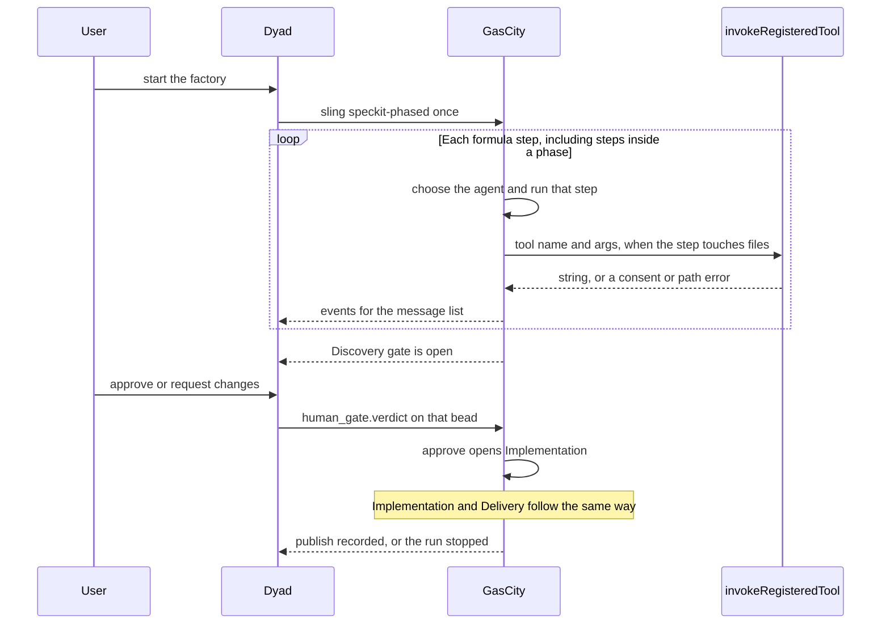

# GasCity as orchestrator: remaining work

Status: plan. No new runtime change in this document.

## What changed, and why

The previous draft of this plan said GasCity orchestrates only the three
chats titled Discovery, Implementation, and Delivery, and that the proof
was a new counter file written through the tool door. That reading is
wrong.

Those three names are human gates on a methodology formula. They are not
the factory. The methodology's own steps (specify, clarify, plan, tasks,
the implement drain, converge, and the rest of that pack's graph) are
also GasCity's work. So are the transitions between phases. Dyad does
not walk that graph and does not start the next phase on its own.

The proof reuses the packs that already describe a complete three-phase
run. It does not invent another demonstration.

| Earlier statement | Correction | Why |
| --- | --- | --- |
| GasCity runs only the three phase chats. | GasCity runs the whole formula, including every methodology step and every gate. | A phase chat is a view of a gate. The chapters inside the phase are formula steps. |
| Delivery is the third chat, and that is the end of orchestration. | Delivery is the last gate on `speckit-phased`, after the final report and before publish. | Publish is still a formula step. GasCity releases it when the Delivery verdict is `approve`. |
| Prove it by writing `src/counter.ts` from a scripted page. | Prove it by slinging `speckit-phased` from the existing packs. | [PR #148](https://github.com/Awannaphasch2016/dyad/pull/148), [PR #154](https://github.com/Awannaphasch2016/dyad/pull/154), [PR #156](https://github.com/Awannaphasch2016/dyad/pull/156), and [PR #159](https://github.com/Awannaphasch2016/dyad/pull/159) already define that run. |
| Formula editing stays out of this work. | The formula page is not the orchestrator. Invoking the formula is the start of the factory. | The app must call GasCity. Editing TOML is still not this plan. |

## Where orchestration begins and ends

GasCity's job starts when the application slings one formula, and it
ends when that formula reaches its terminal step or stops on an open
gate or an error.

For the validation run the formula is `speckit-phased` from
[PR #154](https://github.com/Awannaphasch2016/dyad/pull/154). GasCity
walks this order. Dyad does not.

| Step | Kind | Who advances it |
| --- | --- | --- |
| `requirements` | Specify. Writes `spec.md`. | GasCity |
| `clarify` | At most five questions, only while `spec.md` contains `NEEDS CLARIFICATION`. | GasCity. Dyad shows the question and returns the answer. |
| `plan`, `plan-review`, `decompose` | Plan and tasks. | GasCity |
| `accept-discovery` | Discovery gate, after tasks and before the implement drain. | GasCity holds the bead. Dyad records `human_gate.verdict`. |
| `implement` or `implement-same-session` | Task drain. | GasCity |
| `review` | Converge. | GasCity |
| `accept-implementation` | Implementation gate, after converge and before the final report. | Same split as Discovery. |
| `finalize` | Final report. | GasCity |
| `accept-delivery` | Delivery gate, after the report and before publish. | Same split as Discovery. |
| `publish` | Push or an explicit no-op. | GasCity, after the Delivery verdict is `approve`. |

`request-changes` reruns that gate's revision child. Silence leaves the
bead open. The phase changes because the formula's `needs` edge is
satisfied, not because the phase bar starts another chat.

The same boundary applies to the other packs in PR #154 (`openspec-phased`,
`bmad-phased`, `superpowers-phased`, `gstack-phased`, `compound-phased`,
`build-basic-phased`). Each pack keeps its own step order. The three
gates sit on that order. This validation run slings Spec Kit only, as
[PR #159](https://github.com/Awannaphasch2016/dyad/pull/159) already froze.

Outside a factory formula, Ask, Build, Agent, and Plan stay on Dyad's
local agent. Those chats are not chapters of the factory. If GasCity is
down, they still stream.

## Who owns what

| Responsibility | GasCity | Dyad |
| --- | --- | --- |
| Which formula runs, and the step order inside it | Owns. The graph is the formula TOML. | Invokes it once. Does not reorder steps. |
| Which agent runs a step, drains, and fan-out | Owns. | Does not choose the agent. |
| Phase transition | Owns. `accept-discovery` releases `implement`. | Displays the phase. Does not start the next one. |
| Human gate | Owns the confirmation bead and reads `human_gate.verdict`. | Shows the question and writes the verdict from the person's answer. |
| Files in the user's app | Calls the existing tool route and waits. | `invokeRegisteredTool`: schema, consent, path jail, then `tool.execute`. |
| Transcript in the window | Posts events. | Paints `chat:response:chunk` on the message list. |
| Ordinary non-factory chat | Not involved. | `handleLocalAgentStream`. |
| Formula source | Executes the pack already written. | Does not copy `TOOL_DEFINITIONS` into the pack, and does not rewrite the pack for this proof. |

[PR #146](https://github.com/Awannaphasch2016/dyad/pull/146) is the file
and transcript door only. A factory phase chat currently notifies
GasCity with a per-phase prompt, and `POST /runs` records a task without
starting the local agent. That door stays. It is not yet a formula sling,
so it is not yet evidence that GasCity is running the factory.

A side page that posts tool and event calls in a fixed order is a
simulation. It does not count. A phase bar that submits the next chat
when the previous chat looks finished is Dyad managing the cursor. That
does not count either.

## References to reuse

Do not add a new methodology and do not script a counter module.

| Reference | Use it for |
| --- | --- |
| [PR #148](https://github.com/Awannaphasch2016/dyad/pull/148) `formulas/speckit` | `speckit-build`: specify, clarify, plan, tasks, implement, converge. Extends `build-base`. Does not run `specify workflow`. |
| [PR #154](https://github.com/Awannaphasch2016/dyad/pull/154) `speckit-phased` | The same sequence plus `accept-discovery`, `accept-implementation`, and `accept-delivery`. `src/lib/methodologyPacks.test.ts` already checks those `needs` edges. |
| [PR #156](https://github.com/Awannaphasch2016/dyad/pull/156) | The frozen GIT Conference input. Native skills and ungated `speckit-build` stay there. This proof does not start them. |
| [PR #159](https://github.com/Awannaphasch2016/dyad/pull/159) `plans/speckit-full-run.md` | The one execution: repository `Awannaphasch2016/sdd-gitcon-impl` at `baseline/speckit-1.1.2` (`a41476e8d1330c90e49eb2dacf8b729ebb3a16f5`), specification `gitcon-v1`, then the existing AC-01 through AC-20 verifier. The executor is `gc sling`, not `experiments/sdd/bin/start-worker.mjs`. |

Import `gascity` from `gastownhall/gascity-packs` so `extends` can resolve
`build-base`. Put this repo's `formulas/speckit` on the formula path.
If `gc` cannot resolve `speckit-phased`, stop. Do not imitate the graph
inside Dyad.

## Slices

### 1. Invoke one formula

The application starts the factory by slinging `speckit-phased` with
`artifact_root` set, as the Spec Kit README already shows. One task id
covers the run. Dyad does not send a fresh prompt to open Implementation
or Delivery.

The tool route, event route, and cancel route from PR #146 stay the way
a step touches files and the way text reaches the message list. Do not
add a second protocol and do not copy `TOOL_DEFINITIONS`.

### 2. GasCity walks the existing graph

On that sling, GasCity runs the steps in the table above. File edits go
through `POST /v1/apps/:appId/tools/:toolName` and wait for the string.
Text for the window goes through the event route, cursor starting at 1.
A human gate posts `input-required` and waits. The answer writes
`human_gate.verdict` on that bead (`approve` or `request-changes`).
GasCity then continues the same task. Cancel stops the model and stops
waiting on tools.

Discovery's steps are specify through tasks. Implementation's steps are
the drain and converge. Delivery's steps are the final report and
publish. All of those steps are GasCity's.

### 3. Show the real run

Use the input frozen in PR #159. Record the Dyad window and the GasCity
step log together.

The log must show `requirements`, `clarify`, `plan`, `decompose`,
`accept-discovery`, the implement drain, `review`, `accept-implementation`,
`finalize`, `accept-delivery`, and `publish`, in that order. The window
must show the user the gate question and the assistant text while the
step runs. Implementation's files must appear because a formula step
called `write_file` or `search_replace`, and the Discovery verdict must
be what released that step. An ordinary chat in the same app, whose title
is not part of this run, must still use the local agent.

Replace the bridge-page recording. A script that calls the tool route in
a fixed order, or a phase bar that starts the next chat itself, is not
this proof.

### 4. Keep the failures visible

| Failure | What the user sees |
| --- | --- |
| Orchestrator URL unset or GasCity down | The factory sling fails in the window. Ask, Build, Agent, and Plan still stream. |
| `speckit-phased` does not resolve | The run stops. Dyad does not play the steps locally. |
| Consent denied or path jail | The tool route returns the error. The file is unchanged. GasCity decides the next model step. |
| Gate left unanswered | The bead stays open. The next phase does not start. |
| User cancels | The tool aborts. The transcript ends cancelled. GasCity receives `type: cancel`. |
| Dyad quits during a tool | The route dies. GasCity keeps the task. The file edit does not move. |

## Out of scope

- Rewriting `handleLocalAgentStream` or moving Ask, Build, Agent, or Plan.
- A new methodology pack, or a counter-file demonstration.
- Starting the native Spec Kit skill run or ungated `speckit-build` from PR #156.
- An MCP server for Dyad's tools.
- Editing formula TOML as the feature under proof.
- A new message-list renderer.
- File tools after the Electron process has exited.
- `execute_sandbox_script`, `spawn_agent`, and MCP tools on the factory callback.

## Important points

1. GasCity orchestrates the whole factory formula, not only the three phase chats.
2. Discovery, Implementation, and Delivery are human gates on that formula. The methodology steps inside them are GasCity's too.
3. Dyad invokes the formula once, shows the window, runs local tools, and writes the gate verdict. It does not choose the next step or the next phase.
4. The proof slings `speckit-phased` from PR #148, PR #154, and PR #159. It does not build another demo.
5. PR #146 is the file and transcript door. A per-phase prompt is not yet a formula run.
6. Ordinary Ask, Build, Agent, and Plan stay on Dyad when they are not part of the factory.
