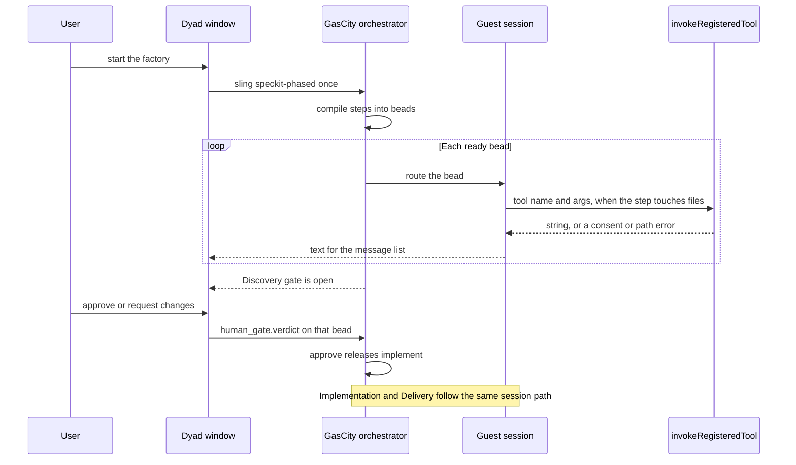

# GasCity as orchestrator: remaining work

Status: Dyad now slings `speckit-phased` once and the phase bar follows that bead. GasCity itself is not running in this repo, and non-factory chats still enter `handleLocalAgentStream` until a city is available to receive them.

## Important points

1. GasCity orchestrates the whole factory formula. Discovery, Implementation, and Delivery are gates on that formula, not the whole job.
2. A prompt is not a formula run. The run is one sling of `speckit-phased`, which materializes the beads.
3. The agent runs in a GasCity guest session. `handleLocalAgentStream` is legacy, and there is no native fallback.
4. The phase bar follows the open bead. **Approve and continue** writes `human_gate.verdict`. It does not unlock the next phase.
5. The next phase opens only when that gate bead closes. Request changes stays in the same phase. Delivery is not finished until publish closes.
6. The proof is `speckit-phased` from PR #148, PR #154, and PR #159. The Dyad window matches the bead, beside the guest session log.

## Implementation

Do these in order. Do not start a later slice while an earlier one is still a prompt or a local approval row.

1. **One session path.** New turns, including Ask, Build, Agent, and Plan, open or continue a GasCity session. They do not enter `handleLocalAgentStream`. If the city is down, the send fails.
2. **One formula.** The factory slings `speckit-phased` once, using the packs in PR #148 and PR #154 and the input in PR #159. Retire `{ type: "prompt", phase }` as the handoff. One workflow id covers Discovery through publish.
3. **Beads do the work.** GasCity routes each ready bead to that session. File edits use the existing tool route. Text for the window is that bead's events. A gate writes `human_gate.verdict` and waits.
4. **The bar follows the bead.** The lock, the shade, the step title, and the open chat read the open bead. **Approve and continue** writes the verdict and stays on that phase. The next phase unlocks only when the gate bead closes. Delivery stays unfinished until the publish bead closes. The matrix below is this slice.
5. **Record the Dyad window.** Show the message list and the phase bar beside `gc session logs` and the bead closures. The agent UI walk in [PR #162](https://github.com/Awannaphasch2016/dyad/pull/162) is the recording shape. It is not built yet, and the scripted videos on [PR #160](https://github.com/Awannaphasch2016/dyad/pull/160) are not this run.

[PR #146](https://github.com/Awannaphasch2016/dyad/pull/146) already has the tool route, the event route, and a factory chat that does not start the local agent. That is the door. It is not slice 2, 3, or 4.

## Change impact matrix

The phase bar and the formula bead are different state. Clicking **Approve and continue** inserts `factoryPhaseApprovals` and switches to the next chat. It does not write `human_gate.verdict`, so the bead stays blocked. This matrix is the edit that makes the bar follow the formula.

Same rule as [PR #129](https://github.com/Awannaphasch2016/dyad/pull/129). A row is one intention. A column is one place this path stores or decides state. **Change** means the intention is unfinished until that cell is edited as written. **Leave** means that place keeps today's behavior. A row is finished only when every Change cell is true and every Leave cell still behaves as it does today.

| Column        | Where it lives                                                                         |
| ------------- | -------------------------------------------------------------------------------------- |
| Approval row  | `factoryPhaseApprovals`, returned as `approvedPhases` by `readFactoryState`.           |
| Phase rules   | `src/lib/factoryPhase.ts`. Unlock, shade, show-approval, and the summary heading.      |
| Phase bar     | `FactoryPhaseBar.tsx`. The three buttons, **Approve and continue**, and the prefill.   |
| Open chat     | `selectChat` and the chat whose title is Discovery, Implementation, or Delivery.       |
| Transcript    | `messages` in that chat, painted by `chat:response:chunk`.                             |
| Questions     | `hitlQuestions` and `HitlQuestionList` on the bar.                                     |
| Run row       | `factoryHostRuns`: task id, status, event cursor.                                      |
| Formula beads | The GasCity workflow. Step beads, `needs`, and `human_gate.verdict`. Not a Dyad table. |
| Guest session | The GasCity session that executes the open bead.                                       |

| Intention                                                        | Approval row                                                                                                               | Phase rules                                                                                                                                                                       | Phase bar                                                                                                                | Open chat                                                                               | Transcript                                                                                             | Questions                                                                                           | Run row                                                                                                   | Formula beads                                                                          | Guest session                                          |
| ---------------------------------------------------------------- | -------------------------------------------------------------------------------------------------------------------------- | --------------------------------------------------------------------------------------------------------------------------------------------------------------------------------- | ------------------------------------------------------------------------------------------------------------------------ | --------------------------------------------------------------------------------------- | ------------------------------------------------------------------------------------------------------ | --------------------------------------------------------------------------------------------------- | --------------------------------------------------------------------------------------------------------- | -------------------------------------------------------------------------------------- | ------------------------------------------------------ |
| The bar shows the phase the formula is in                        | Change. This row is not the unlock. A stored approval must not paint Implementation open while `accept-discovery` is open. | Change. Unlock and shade read the open bead's phase. A chat that merely has messages is not "started."                                                                            | Change. The lock, the shade, and the selected button read that cursor.                                                   | Change. The open chat is the phase of the open bead.                                    | Leave. The chunk schema stays.                                                                         | Leave.                                                                                              | Change. One workflow id and the current step id. The bar polls that, not one prompt row per phase.        | Change. Dyad reads the open bead. GasCity remains the writer.                          | Leave. The bead picks the phase. The session does not. |
| Approve writes the gate verdict and does not open the next phase | Change. The click does not insert `factoryPhaseApprovals` to mean the phase is done.                                       | Change. The button is enabled when the matching gate bead is waiting. A `## Discovery summary` heading is not the enablement.                                                     | Change. **Approve and continue** does not call `selectChat` and does not prefill the next chat.                          | Change. The click stays on the gate's phase.                                            | Leave.                                                                                                 | Leave. Clarify still uses a question. The verdict is `human_gate.verdict`, not a second answer row. | Leave. GasCity's events still set the status. The click does not mark the run completed.                  | Change. The click writes `approve` or `request-changes` on the open confirmation bead. | Leave. The same session waits, then continues.         |
| The window shows the step inside the phase                       | Leave.                                                                                                                     | Change. In progress means a bead in that phase is open.                                                                                                                           | Change. The open phase shows the step title: specify, clarify, plan, tasks, implement, converge, the report, or publish. | Change. Discovery steps stay on Discovery. Implementation steps stay on Implementation. | Change. The text is the open bead's events. The bar does not kick off a local prompt to fill the chat. | Change. The list shows a question only when the open bead asked one.                                | Change. The current step id is on the run row the bar polls.                                              | Change. The bar reads that bead's id and title.                                        | Change. The text is that session's output.             |
| The next phase unlocks only when the gate bead closes            | Change. `approvedPhases` is not the lock.                                                                                  | Change. Implementation unlocks only after `accept-discovery` is `approve`. "The next chat has messages" is not approval. The same rule binds Delivery to `accept-implementation`. | Change. The next button stays disabled until that bead closes.                                                           | Change. The next chat is not selected on the click.                                     | Leave.                                                                                                 | Leave.                                                                                              | Change. Status stays `input-required` while the gate is open, and `running` when the next bead is routed. | Change. The `needs` edge releases the next step. The bar observes the closed bead.     | Leave.                                                 |
| Request changes stays in the same phase                          | Change. The click does not insert an approval.                                                                             | Change. The shade stays in progress.                                                                                                                                              | Change. The same phase stays selected. There is no continue.                                                             | Leave. It is already that phase's chat.                                                 | Change. The revision child's text appends in that chat.                                                | Leave.                                                                                              | Change. The same workflow id returns to `running` on the revision bead.                                   | Change. `request-changes` reruns the revision child. The gate bead stays open.         | Leave.                                                 |
| Delivery approval does not finish the run before publish         | Change. The click does not mark Delivery finished.                                                                         | Change. The finished shade waits until the publish bead has closed. A delivery summary heading is not finished.                                                                   | Change. **Approve delivery** writes the verdict. Publish is the next step the bar shows.                                 | Leave. The chat stays Delivery through publish.                                         | Change. Publish's result is shown in the Delivery chat.                                                | Leave.                                                                                              | Change. The run is completed only when the workflow's terminal step closes.                               | Change. `publish` needs `accept-delivery`. The bar reads the publish bead.             | Leave.                                                 |

## What changed, and why

Two corrections landed on the previous draft.

The first draft limited GasCity to the three phase chats and proposed a
counter-file demo. Those three names are human gates on a methodology
formula. The proof reuses `speckit-phased`.

This revision corrects the execution path. A prompt that names the
methodology is still a prompt. A formula run is GasCity compiling that
formula into beads and routing each bead to a guest session. Dyad's
native agent loop is legacy. It is not a second supported way to run an
agent.

| Earlier statement                                                  | Correction                                                                                        | Why                                                                                                                                                                                                                                                                                 |
| ------------------------------------------------------------------ | ------------------------------------------------------------------------------------------------- | ----------------------------------------------------------------------------------------------------------------------------------------------------------------------------------------------------------------------------------------------------------------------------------- |
| GasCity runs only the three phase chats.                           | GasCity runs the whole formula, including every methodology step and every gate.                  | A phase chat is a view of a gate. The chapters inside the phase are formula steps.                                                                                                                                                                                                  |
| Prove it by writing `src/counter.ts`.                              | Sling `speckit-phased` from the existing packs.                                                   | [PR #148](https://github.com/Awannaphasch2016/dyad/pull/148), [PR #154](https://github.com/Awannaphasch2016/dyad/pull/154), [PR #156](https://github.com/Awannaphasch2016/dyad/pull/156), and [PR #159](https://github.com/Awannaphasch2016/dyad/pull/159) already define that run. |
| A per-phase prompt is close enough if the text describes Spec Kit. | The prompt payload does not name a formula and does not create a bead graph.                      | Today's `type: prompt` can be followed or ignored by whoever receives it. A formula run cannot skip a `needs` edge.                                                                                                                                                                 |
| Ask, Build, Agent, and Plan stay on `handleLocalAgentStream`.      | That loop is legacy. Every agent turn runs in a GasCity guest session.                            | Two agent loops means two orchestrators. Dyad keeps the window, the files, and the verdict.                                                                                                                                                                                         |
| **Approve and continue** unlocks the next phase.                   | The click writes `human_gate.verdict` on the open gate bead. The bar moves when that bead closes. | Today the click inserts `factoryPhaseApprovals` and switches chats. The bead never sees it.                                                                                                                                                                                         |

## Prompt versus formula

Today a factory chat does not execute a formula. After `chat:stream:start`,
`chat_stream_handlers.ts` calls `runFactoryOrchestratedTurn` when the chat
title is Discovery, Implementation, or Delivery.
`factory_orchestrator.ts` then POSTs:

```json
{
  "type": "prompt",
  "appId": 1,
  "chatId": 2,
  "phase": "discovery",
  "prompt": "...",
  "taskId": "gas-city-run:..."
}
```

That payload is a string plus a phase name. It does not name
`speckit-phased`. GasCity does not compile a graph, open step beads, or
hold `implement` until `accept-discovery` closes. A listener can hand the
string to a model and hope the model follows Spec Kit. The model can skip
clarify, reorder tasks, or walk past a gate. Nothing in the city rejects
that. That is prompting an agent. It is not a formula run.

A genuine formula run has all four of these:

1. Dyad invokes the formula by name, once: sling `speckit-phased` with
   `artifact_root` set. The user's words are the work item. They are not
   the method.
2. GasCity compiles the formula. `gc formula show speckit-phased` shows
   the steps and the `needs` edges already checked by
   `src/lib/methodologyPacks.test.ts` in
   [PR #154](https://github.com/Awannaphasch2016/dyad/pull/154). Cook or
   sling materializes one bead per step.
3. GasCity's orchestrator routes a bead only when every bead it `needs`
   is closed. `accept-discovery` stays open until `human_gate.verdict` is
   `approve`. The implement drain cannot start before that.
4. The agent that executes a bead runs inside a GasCity guest session.
   Dyad does not call the model for that bead.

|                                | Prompt                              | Formula run                       |
| ------------------------------ | ----------------------------------- | --------------------------------- |
| What Dyad sends                | `type: prompt` and the user's text  | One sling of `speckit-phased`     |
| What GasCity stores            | A task id, if anything is listening | A workflow of step beads          |
| Who decides the next chapter   | Whoever reads the prompt            | The formula's `needs` edges       |
| What a skipped gate looks like | The model continues                 | The downstream bead stays blocked |

## Guest session

A guest session is the GasCity session that owns the agent process. Gas
City creates one when work is slung: an on-demand session by default, the
live process `gc session list` shows. The model runs there. Dyad does not
start a second one.

`FactorySession` in `factory_orchestrator.ts` is not that. It is a window
subscription: which chat should receive `chat:response:chunk`. It holds no
model call.

| Piece                | Owns                                                                         | Does not own                                                 |
| -------------------- | ---------------------------------------------------------------------------- | ------------------------------------------------------------ |
| Dyad window          | Composer, message list, cancel button, gate question                         | The agent process, the formula graph, the next step          |
| Dyad tool route      | `invokeRegisteredTool` for files on this machine: schema, consent, path jail | Choosing the tool, calling the model                         |
| GasCity orchestrator | Compile `speckit-phased`, route ready beads, run checks, open the next step  | The user's files, the pixels                                 |
| Guest session        | The agent process for one bead, or the operator session the formula targets  | A private copy of the methodology, a second loop inside Dyad |

`handleLocalAgentStream` is the legacy path. It calls the model from
Electron. New turns do not enter it, including Ask, Build, Agent, and
Plan. There is no fallback when GasCity is down: the send fails in the
window. Leaving the function in the tree until its call sites are gone is
deletion work. It is not a supported execution option.

File tools stay behind the existing wrapper because the files are on the
user's machine. That wrapper is not an agent loop. GasCity decides the
call. Dyad executes the one tool and returns the string.



A side page that posts tool calls in a fixed order is a simulation. A
phase bar that submits the next chat is Dyad sequencing work. A prompt
that says "follow Spec Kit" is still a prompt. None of those is this
architecture.

## Where orchestration begins and ends

GasCity's job starts when Dyad slings one formula, and it ends when that
formula reaches its terminal step or stops on an open gate or an error.

For the validation run the formula is `speckit-phased` from
[PR #154](https://github.com/Awannaphasch2016/dyad/pull/154). The guest
session executes the bead GasCity routes. It does not choose the next
row.

| Step                                    | Kind                                                                         | Who advances it                                                         |
| --------------------------------------- | ---------------------------------------------------------------------------- | ----------------------------------------------------------------------- |
| `requirements`                          | Specify. Writes `spec.md`.                                                   | GasCity routes the bead. The guest session executes it.                 |
| `clarify`                               | At most five questions, only while `spec.md` contains `NEEDS CLARIFICATION`. | GasCity holds the step. Dyad shows the question and returns the answer. |
| `plan`, `plan-review`, `decompose`      | Plan and tasks.                                                              | GasCity                                                                 |
| `accept-discovery`                      | Discovery gate, after tasks and before the implement drain.                  | GasCity holds the bead. Dyad records `human_gate.verdict`.              |
| `implement` or `implement-same-session` | Task drain.                                                                  | GasCity, only after Discovery is approved.                              |
| `review`                                | Converge.                                                                    | GasCity                                                                 |
| `accept-implementation`                 | Implementation gate, after converge and before the final report.             | Same split as Discovery.                                                |
| `finalize`                              | Final report.                                                                | GasCity                                                                 |
| `accept-delivery`                       | Delivery gate, after the report and before publish.                          | Same split as Discovery.                                                |
| `publish`                               | Push or an explicit no-op.                                                   | GasCity, after the Delivery verdict is `approve`.                       |

`request-changes` reruns that gate's revision child. Silence leaves the
bead open. The phase changes because the formula's `needs` edge is
satisfied.

The same boundary applies to the other packs in PR #154. This validation
run slings Spec Kit only, as
[PR #159](https://github.com/Awannaphasch2016/dyad/pull/159) already froze.

A chat that is not this factory still uses a guest session. It does not
use `handleLocalAgentStream`. If that chat has no formula, GasCity still
owns the agent process. Dyad still only displays it and serves tools.

## References to reuse

Do not add a new methodology and do not script a counter module.

| Reference                                                                                | Use it for                                                                                                                                                                                                                                                                      |
| ---------------------------------------------------------------------------------------- | ------------------------------------------------------------------------------------------------------------------------------------------------------------------------------------------------------------------------------------------------------------------------------- |
| [PR #148](https://github.com/Awannaphasch2016/dyad/pull/148) `formulas/speckit`          | `speckit-build`: specify, clarify, plan, tasks, implement, converge. Extends `build-base`. Does not run `specify workflow`.                                                                                                                                                     |
| [PR #154](https://github.com/Awannaphasch2016/dyad/pull/154) `speckit-phased`            | The same sequence plus the three gates. `src/lib/methodologyPacks.test.ts` checks the `needs` edges.                                                                                                                                                                            |
| [PR #156](https://github.com/Awannaphasch2016/dyad/pull/156)                             | The frozen GIT Conference input. Native skills and ungated `speckit-build` stay there. This proof does not start them.                                                                                                                                                          |
| [PR #159](https://github.com/Awannaphasch2016/dyad/pull/159) `plans/speckit-full-run.md` | One `gc sling` of `speckit-phased` on `Awannaphasch2016/sdd-gitcon-impl` at `baseline/speckit-1.1.2` (`a41476e8d1330c90e49eb2dacf8b729ebb3a16f5`), specification `gitcon-v1`, then AC-01 through AC-20. The executor is `gc sling`, not `experiments/sdd/bin/start-worker.mjs`. |
| [PR #146](https://github.com/Awannaphasch2016/dyad/pull/146)                             | The file and transcript door. Its `type: prompt` path is the legacy handoff this plan replaces for factory runs.                                                                                                                                                                |

Import `gascity` from `gastownhall/gascity-packs` so `extends` can resolve
`build-base`. Put this repo's `formulas/speckit` on the formula path.
If `gc` cannot resolve `speckit-phased`, stop. Do not imitate the graph
inside Dyad, and do not fall back to the native agent.

## Evidence

The run counts only when all of these are true together:

- `gc formula show speckit-phased` lists the steps above, and the workflow
  beads close in that order.
- `gc session list` shows the guest session that executed the bead, and
  `gc session logs` for that id shows the agent doing the step.
- The Dyad message list shows the same text and the gate question while
  the bead is open. The Discovery verdict is what releases `implement`.
- The main-process log for that turn does not enter
  `handleLocalAgentStream`.
- Implementation's files appear because the guest session called the tool
  route. A second prompt from the phase bar is not what started
  Implementation.

## Slices

### 1. One agent path

Stop sending new turns to `handleLocalAgentStream`. Every send opens or
continues a GasCity guest session and paints that session's replies on
the message list. Ask, Build, Agent, and Plan use this path. A missing
city fails the send. Do not keep a native fallback.

The tool route from PR #146 stays the way a guest session touches files.
Do not copy `TOOL_DEFINITIONS` into the session.

### 2. Invoke one formula

The factory starts by slinging `speckit-phased` with `artifact_root` set.
One workflow id covers the run. Dyad does not send a fresh prompt to open
Implementation or Delivery. Retire `type: prompt` as the factory handoff.

### 3. GasCity walks the existing graph

On that sling, GasCity runs the steps in the table above inside guest
sessions. File edits go through `POST /v1/apps/:appId/tools/:toolName`
and wait for the string. Text for the window goes through the event
route, cursor starting at 1. A human gate posts `input-required` and
waits. The answer writes `human_gate.verdict` on that bead. GasCity then
continues the same workflow. Cancel stops the guest session and stops
waiting on tools.

### 4. The phase bar follows the bead

The bar reads the workflow's open bead. The lock, the shade, the step title, and the selected phase come from that bead. **Approve and continue** writes `approve` or `request-changes` on the confirmation bead and stays on that phase. It does not insert `factoryPhaseApprovals` as the unlock, and it does not call `selectChat` or prefill the next chat. Implementation stays locked until `accept-discovery` closes. Delivery stays locked until `accept-implementation` closes. The finished shade waits until the publish bead closes.

### 5. Show the real run

Use the input frozen in PR #159. Record the Dyad window beside
`gc session logs` and the bead closures.

Replace the bridge-page recording. A script that calls the tool route in
a fixed order, a phase bar that starts the next chat, or a prompt that
describes Spec Kit, is not this proof.

### 6. Keep the failures visible

| Failure                                          | What the user sees                                                                                      |
| ------------------------------------------------ | ------------------------------------------------------------------------------------------------------- |
| GasCity down or the guest session does not start | The send fails in the window. Dyad does not start its legacy agent.                                     |
| `speckit-phased` does not resolve                | The run stops. Dyad does not play the steps locally.                                                    |
| Consent denied or path jail                      | The tool route returns the error. The file is unchanged. The guest session decides the next model step. |
| Gate left unanswered                             | The bead stays open. The next phase does not start.                                                     |
| User cancels                                     | The tool aborts. The transcript ends cancelled. The guest session stops.                                |
| Dyad quits during a tool                         | The route dies. GasCity keeps the workflow. The file edit does not move.                                |

## Out of scope

- Keeping `handleLocalAgentStream` as a supported path beside guest sessions.
- A new methodology pack, or a counter-file demonstration.
- Starting the native Spec Kit skill run or ungated `speckit-build` from PR #156.
- An MCP server for Dyad's tools.
- Editing formula TOML as the feature under proof.
- A new message-list renderer.
- File tools after the Electron process has exited.
- `execute_sandbox_script`, `spawn_agent`, and MCP tools on the factory callback.
