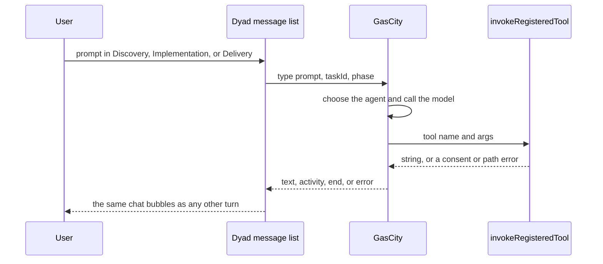

# GasCity as orchestrator: remaining work

Status: plan. No new runtime change in this document.

Option C is the decision. GasCity chooses the agent and calls the model
for a factory app. Dyad keeps the window, the transcript, tool consent,
and the files. Ordinary Ask, Build, Agent, and Plan stay on Dyad's local
agent when GasCity is down.

Delivery here is the third factory chat, after Discovery and
Implementation. It is not a product release.

## Where this stands

[PR #146](https://github.com/Awannaphasch2016/dyad/pull/146) opened the
door on the Dyad side. A factory-linked app is one with
`factoryHostManaged` set and three chats titled Discovery, Implementation,
and Delivery.

Already in that PR:

- `invokeRegisteredTool` is the one wrapper. The local agent and the
  factory bridge both use it. Calling `tool.execute` directly still skips
  consent.
- After `chat:stream:start`, a factory phase chat calls
  `runFactoryOrchestratedTurn` and returns. It does not call
  `handleLocalAgentStream`.
- `POST /v1/apps/:appId/phases/:phase/runs` records a running task. It
  does not start the local agent.
- `POST /v1/apps/:appId/tools/:toolName` runs the allowlist:
  `read_file`, `list_files`, `grep`, `code_search`, `write_file`,
  `search_replace`, `git_status`, `git_diff`. Sandbox, sub-agents, and
  MCP names are rejected.
- `POST .../events` appends text onto the assistant row. A repeated
  cursor does not append twice. Cancel aborts the in-flight tool.
- If `GAS_CITY_ORCHESTRATOR_URL` is unset, the factory send fails in the
  window.

Not done:

- No GasCity process receives that prompt, calls a model, or calls the
  tool and event routes.
- Nothing has shown this turn in the Dyad message list. The recording on
  PR #146 is a temporary browser page over the bridge. It is not the
  product UI.
- `FactoryPhaseBar` still calls `streamMessage`. That is the right door,
  because the split happens inside `chat:stream`, but the window has not
  been exercised.

## End state



The proof is that window. A side page does not count.

## Contract GasCity must speak

Dyad already sends these POSTs to `GAS_CITY_ORCHESTRATOR_URL`. GasCity
answers by calling the host bridge on `127.0.0.1` with
`GAS_CITY_HOST_BRIDGE_TOKEN`.

Prompt, from Dyad:

```json
{ "type": "prompt", "appId": 1, "chatId": 2, "phase": "discovery", "prompt": "...", "taskId": "gas-city-run:..." }
```

Cancel, from Dyad:

```json
{ "type": "cancel", "taskId": "gas-city-run:..." }
```

One HITL answer, from Dyad, only when the orchestrator URL is set:

```json
{ "type": "answer", "taskId": "...", "questionId": "...", "body": "..." }
```

GasCity then calls:

- `POST /v1/apps/:appId/tools/:toolName` with `{ args, taskId, idempotencyKey }`. The body returns `{ result }`. A 409 is consent, a missing blueprint, or a bad precondition. GasCity shows that string to the model. Dyad does not retry it.
- `POST /v1/apps/:appId/phases/:phase/events` with `{ taskId, cursor, type, content }`. `cursor` starts at 1. The next event is `cursor + 1`. A replay of an older cursor returns the current transcript and does not append. `type` is `text`, `activity`, `input-required`, `end`, or `error`.
- `POST /v1/runs/:taskId/cancel` when GasCity stops the task itself.

`input-required` pauses the Dyad stream on the same task id. The answer
POST resumes that id. `end` completes the turn. `error` fails it in the
window.

## Slices

### 1. Freeze the contract

Add the three payloads and the three routes above to the GasCity client
notes in this repo, next to the bridge. Do not add a second protocol.
Do not copy `TOOL_DEFINITIONS`.

### 2. GasCity runs one factory turn

In the GasCity repo, on `type: prompt`:

- Store the task id and the phase.
- Call the model with only the eight tool names.
- For each tool call, POST the Dyad tool route and wait for the string.
- POST events as text arrives. End with `type: end`.
- On `type: cancel`, stop the model and stop waiting on tools.
- On `type: answer`, continue the same task id.

Discovery reads. Implementation may write. Delivery reads the result and
writes the handoff note. GasCity does not write the user's files except
through the tool route.

### 3. Show that turn in the Dyad window

Run Dyad with `GAS_CITY_ORCHESTRATOR_URL` pointed at a local GasCity, or
at a test double that speaks the contract. Open one factory-linked app.
Send one prompt in Discovery, one in Implementation, one in Delivery.

The message list must show the user line and the assistant text while
the turn runs. Implementation must show `src/counter.ts` created by
`write_file`. Cancel in the window must end that turn with `wasCancelled`.
An ordinary chat in the same app, titled anything other than those three
names, must still use the local agent.

Record that window. Replace the bridge-page recording as the proof.

### 4. Keep the failures visible

| Failure | What the user sees |
| --- | --- |
| Orchestrator URL unset or GasCity down | The factory send fails in the window. Ask, Build, Agent, and Plan still stream. |
| Consent denied or path jail | The tool route returns the error. The file is unchanged. GasCity decides the next model step. |
| User cancels | The tool aborts. The transcript ends cancelled. GasCity receives `type: cancel`. |
| Dyad quits during a tool | The route dies. GasCity keeps the task. The file edit does not move. |

## Out of scope

- Rewriting `handleLocalAgentStream` or moving Ask, Build, Agent, or Plan.
- An MCP server for Dyad's tools.
- Formula editing and formula preview deploy.
- A new message-list renderer.
- File tools after the Electron process has exited.
- `execute_sandbox_script`, `spawn_agent`, and MCP tools on the factory callback.

## Important points

1. GasCity orchestrates only a factory app. Dyad still runs every other chat.
2. Delivery is the third factory chat, after Discovery and Implementation.
3. Dyad's door is already in PR #146: one tool wrapper, one event stream, no local agent on those three chats.
4. GasCity still has to call the model and call that door. That work is not in this repo yet.
5. The last recording checked the door from a temporary page. The finished proof is the Dyad message list for all three chats.
6. Formula and preview stay as they are.
