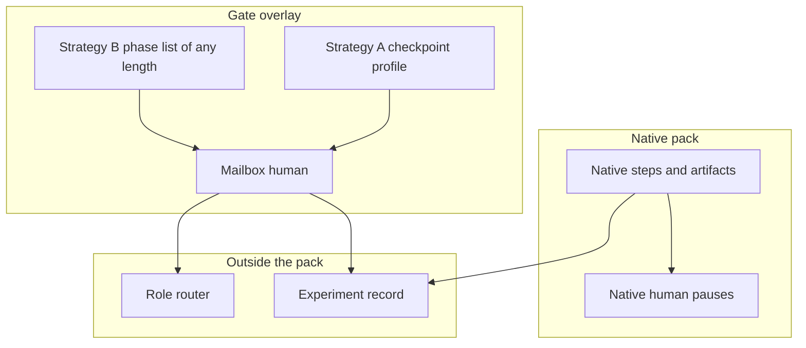
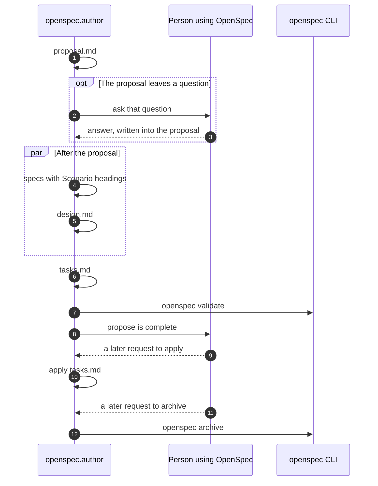
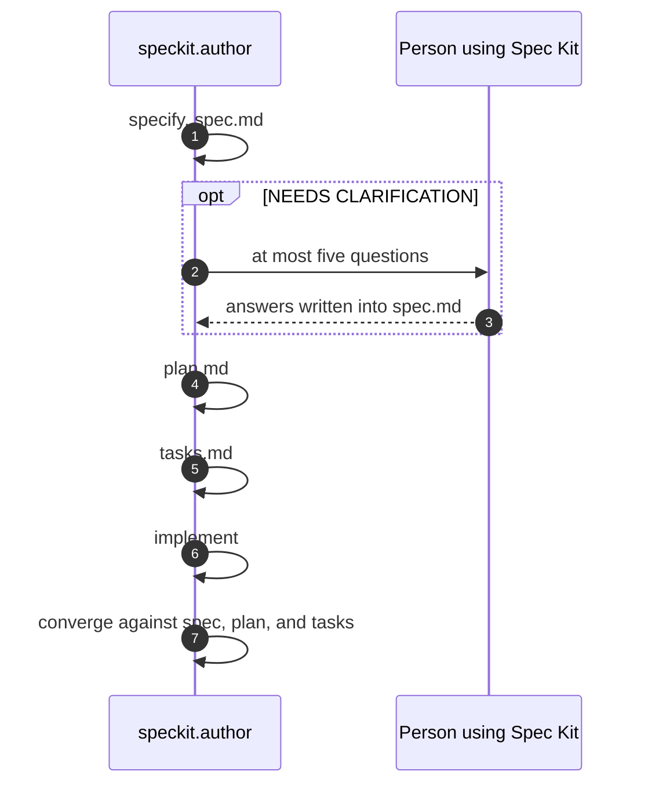

# Methodology packs: native execution and human-gate overlays

Architecture for running existing methodologies under Gas City. No pack code in this change.

OpenSpec and Spec Kit are the first native packs. BMAD and Superpowers already exist as native packs in `gastownhall/gascity-packs`. The same overlay attaches to all four. A custom methodology waits until those native runs have results.

`plans/openspec-speckit-packs.md` put factory phase gates inside the packs. That placement is dropped. The native formula is the baseline. Human gates are a second layer that can be left off.

## Architecture

Four layers. Each one has a single job.

| Layer | Owns | Does not own |
| --- | --- | --- |
| Native pack | The methodology's order, artifacts, agents, checks, and its own human pauses | Organization roles, factory phases, extra approval gates |
| Gate overlay | Which boundaries pause for a person, and the pause itself | The methodology's steps and artifacts |
| Role router | Which person receives mail sent to `human` | When a pause exists |
| Experiment record | The same task, model, budget, and metrics across packs and overlays | A standing winner |



A run is one native formula plus one gating value:

| Configuration | Gating value | What runs |
| --- | --- | --- |
| Native baseline | `none` | The native formula, including only the pauses that methodology already has |
| Native optimized | `profile` | The same formula, plus gates at the checkpoint ids in that methodology's profile |
| Phase constrained | `phases` | The same formula, plus one gate at the end of each externally named phase |

The native formula file is the same in all three. The overlay is a generated formula that attaches at bond points. It is generated because a Gas City formula variable is a string, and one static graph cannot grow to two, four, or five phase steps from a list. The generator reads the profile or the phase list and writes the overlay. Cooking that overlay does not edit the native pack.

Attachment uses bond points and compose hooks. Extending the native formula and adding aspects does not work: `extends` drops `advice` and `pointcuts`, and a compose merge drops `gate` and `aspects`. Bond points and hooks survive. The working pause is the Superpowers mail-and-wait pattern: one `gc mail send human`, then `gc session wait --sleep --on-beads`, then a verdict the check script reads. `[steps.gate]` type `human` has no watcher.

The pause writes `artifact_root/.gates/<id>.md`, mails `human`, and records `human_gate.verdict` as `approve` or `request-changes`. `request-changes` reruns the native step that bond point follows, with the reply text. Silence leaves the bead open. The mail, the gate file, and the bead id are the router contract. The pack never names a role.

Every native boundary is a bond point, including boundaries where the baseline attaches nothing. Strategy A and Strategy B choose ids from that list. They do not invent a stop in the middle of a native step.

## Native sequences

These are the baselines. The diagrams contain only pauses the methodology already has.

### OpenSpec

The spec-driven schema is the order. `proposal` has no dependency. `specs` and `design` each depend only on `proposal`, so they run together. `tasks` depends on both. `apply` depends on `tasks`. The propose workflow stops when tasks exist and waits for a new request before apply. Archive is a separate command. `openspec validate` checks the change. The CLI does not route work.

The stop before apply is OpenSpec's own continuation. It is a native pause, not a Discovery or Delivery approval.



Bond points on the baseline, with nothing attached: `after-proposal`, `after-specs`, `after-design`, `after-tasks`, `after-apply`, `after-archive`.

### Spec Kit

The command sequence is specify, clarify, plan, tasks, implement, converge. Clarify asks at most five questions and writes the answers into `spec.md`. When nothing is marked `NEEDS CLARIFICATION`, clarify records that and continues. The pack does not start `specify workflow`. Constitution, analyze, checklist, and taskstoissues stay available as skills and are not required stages.



Bond points: `after-specify`, `after-clarify`, `after-plan`, `after-tasks`, `after-implement`, `after-converge`.

### BMAD and Superpowers

These packs already preserve their own sequences. The first milestone does not rewrite them. It adds the same bond points so the overlay can attach later.

BMAD, as `bmad-build`: PRD, architecture, architecture handoff, epics and stories, implementation readiness, story drain, adversarial review. Elicitation inside the PRD skill stays in that skill. The published pack does not mail `human`.

Superpowers, as `superpowers-build`: brainstorm, design approval, written-spec approval, plan, plan review, task convoy, per-task failing test then implementation, spec-compliance review, code-quality review, code-review fanout, finish. Design approval and spec approval are Superpowers' own gates. The published default approval mode is `autonomous`, so a stock run can approve itself. Setting `brainstorming_approval_mode=interactive` uses the human gate Superpowers already defined. That switch is native behavior. Adding Discovery, Implementation, and Delivery on top of it is not.

## Two gating strategies

Strategy A is a profile: a list of bond-point ids for one methodology. OpenSpec's list and Spec Kit's list are allowed to differ. The first profiles are hypotheses for the experiment grid. They are not a claim about the best checkpoint.

Starting hypotheses, to be kept or dropped by the measurements below:

| Pack | Hypothesis checkpoints | Why they are the first cuts to try |
| --- | --- | --- |
| OpenSpec | `after-tasks`, `after-apply` | Tasks are the last planning artifact. Apply is the last change to the code before archive. |
| Spec Kit | `after-plan`, `after-converge` | The plan is the last design artifact before tasks. Converge is the method's own completion check. |
| BMAD | `after-readiness`, `after-review` | Readiness is already a native checkpoint. Review is the last fanout. |
| Superpowers | none beyond its own approval loops | The methodology already stops for design and spec approval. |

Strategy B is a phase list of any length. Each entry has an id and a bond point. Names come from the organization. Discovery, Implementation, and Delivery are one example of a three-entry list, not a structure the pack knows.

```toml
[[phases]]
id = "discovery"
after = "after-tasks"

[[phases]]
id = "implementation"
after = "after-apply"

[[phases]]
id = "delivery"
after = "after-archive"
```

A two-phase list and a five-phase list use the same generator. A phase whose `after` is not a bond point on that pack is a forced cut. The experiment counts those. A methodology accommodates a phase list when every phase lands on a bond point and the quality change against its own baseline stays inside the budget.

The role router is unchanged by either strategy. It only sees mail to `human`.

## Experimental design

Two questions, kept separate so gate placement does not get credited as a methodology win.

### Question 1 — which methodology for this objective

Compare native baselines only (`gating = none`). Same task, same model, same harness, same fixture commit, same token cap, same wall-clock cap.

First task set, three frozen fixtures, because the factory builds websites:

| Id | Task | What "done" means |
| --- | --- | --- |
| W1 | Greenfield one-page site with a named section list | The sections render |
| W2 | Add a validated contact form to an existing page | The form submits and the existing page still renders |
| W3 | Change one interaction that already has a test | The new test passes and the old tests still pass |

Later task classes (backend-only change, bugfix, document-only change) are more rows. They are not part of the first run. BMAD and Superpowers join as additional columns after the OpenSpec and Spec Kit baselines complete. They use the published packs.

| Metric | How it is recorded |
| --- | --- |
| Completion | The native terminal artifact exists: OpenSpec archive, or Spec Kit converge with no appended tasks left open |
| Correctness | Fixture checks pass, including `openspec validate` when the pack is OpenSpec |
| Rework | Native steps that ran more than once |
| Cost | Model tokens and wall-clock time |
| Human effort | Native questions asked and minutes until the reply |

One fixture cannot crown a method. A method leads on a task class when it wins completion and correctness inside the budget on that class, across a repeated run of the same fixture. The result is a row: task class, pack, those five numbers. The selector later reads rows. It does not assume one pack wins every row.

### Question 2 — where gates help, and which pack fits a required phase list

Hold the pack, the task, and the model fixed. Change only the overlay.

Screening for Strategy A, one bond point at a time against that pack's baseline. Keep a checkpoint when the correctness gain or the rework drop is larger than the added human waits, inside the same token cap. Then try the kept checkpoints together. That is the optimized profile for that pack and task class. A full subset search waits until the one-at-a-time screen has removed the useless cuts.

Strategy B uses three lists at first:

| List | Phases | Purpose |
| --- | --- | --- |
| P2 | build, ship | A short audit |
| P3 | discovery, implementation, delivery | The current factory |
| P5 | requirements, design, tasks, build, release | A finer audit |

For each pack, record how many phases land on bond points, the same five metrics as question 1, and the delta against that pack's native baseline. The compatible pack for a list is the one whose forced-cut count is lowest and whose correctness stays within an agreed band of its baseline. If two packs tie, the lower human-wait count wins. This comparison is per phase list. A pack can fit P3 and fit P5 poorly.

Human replies in question 2 follow one written rubric, so the gate position is the thing that changes. The rubric is part of the fixture. Role identity stays outside the pack: the router delivers the mail, and the reply is scored the same way regardless of which person was chosen.

## What the first implementation builds

1. Replace the OpenSpec and Spec Kit sketches with native packs. Vendor the upstream instructions, pin the commit in `upstream.toml`, call `openspec validate` and `openspec status --json` from checks, and follow Spec Kit's command files. Declare the bond points. Attach no overlay. Pack-local agents are `openspec.author`, `openspec.applier`, `speckit.author`, and `speckit.implementer`.
2. Verify each native path on W1. The OpenSpec run produces `proposal.md`, delta specs, `design.md`, and `tasks.md`, validates, and stops before apply until a second request. The Spec Kit run produces `spec.md`, `plan.md`, and `tasks.md`, pauses only when clarify has a question, then implements and converges. No step metadata names a role or a factory phase.
3. Add the `human-gate` expansion and the overlay generator. `gating = none` emits no extra steps. `gating = profile` and `gating = phases` emit steps only at the requested bond points.
4. Run the question 1 baseline on W1–W3 for both packs. Store the metric rows.
5. Run the question 2 screen on those rows' bond points, then P2, P3, and P5.
6. Leave BMAD and Superpowers on their published formulas until the overlay has run once against a bond point on OpenSpec. Then add bond points to those packs without changing their step order.
7. Leave the selector unbuilt until the metric rows exist.

The sketches in `formulas/openspec` and `formulas/speckit` are not the baseline. They name organization roles and they add phase gates. The native packs replace them.

## Later selection

When the rows exist, a selector takes a task class, a budget, a quality bar, and either no audit policy, a checkpoint profile, or a phase list. It returns the pack and the gating value whose row meets the bar at the lowest human-wait count, then the lowest token cost. Empty cells stay empty. The selector does not fill them in by declaring a universal winner.
