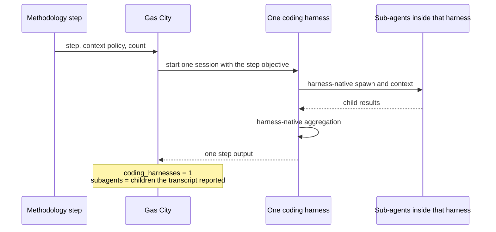
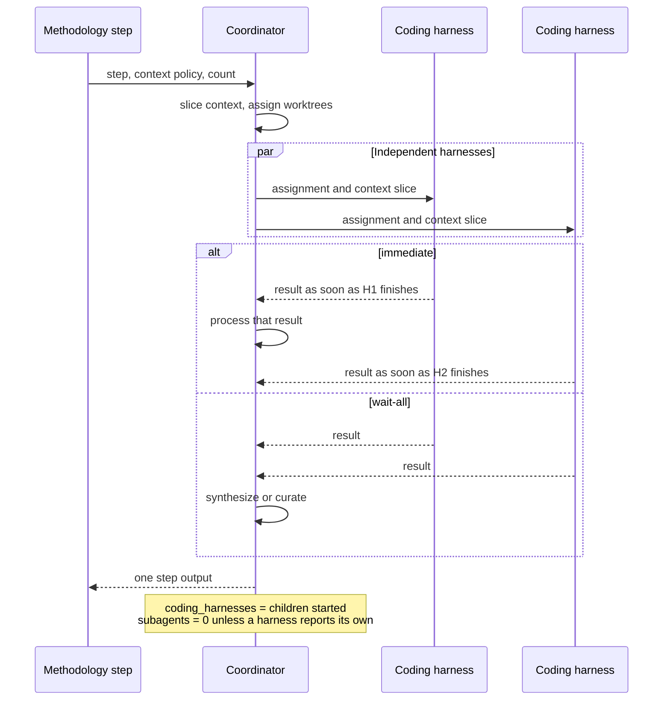

# Multi-agent harness: counting, fan-out, and context

Investigation before any coordinator code. The methodology pack stays the logical step. A later execution policy chooses who spawns the agents.

## What the four methodologies actually do

| Pack | Who fans out today | Parallel or sequential | Agent count |
| --- | --- | --- | --- |
| OpenSpec | Nobody. The CLI does not route tasks. One author writes proposal, specs, design, and tasks. | Specs and design may be written together. Apply walks tasks in one request. | Unspecified. Default one coding harness per command. |
| Spec Kit | The command sequence is one author. The workflow engine can fan out, and this program does not run that engine. | Specify, clarify, plan, tasks, implement, converge are ordered commands. | Unspecified. Default one coding harness per command. Task count is known only after `tasks.md` exists. |
| BMAD pack | Gas City expansion lanes. `bmad-code-review-flow` gathers context, then runs blind-hunter, edge-case, acceptance, and gap analysis with no `needs` between them, then one synthesizer, then one implementer to apply findings. Story development is a drain: one story, then self-check, then acceptance, then apply. | Reviewers are parallel. The story lane is sequential. The review loop repeats up to six times. | Reviewers: 4, declared by the expansion. Stories: the convoy size, known at runtime. |
| Superpowers pack | Gas City lanes. The upstream skill spawns sub-agents inside the coding harness. The pack says provider-native sub-agents are not used. Per-task review is spec compliance, then apply, then code quality, then apply. The change-level review runs code review and gap analysis together, then one process step. Implementation is a drain, one task per session, or one shared session when `drain_policy` is `same-session`. | Task review is sequential. Change review is parallel. TDD steps share `gc.continuation_group`, so they are one coding session per task, not one session per step. | Tasks: convoy size, runtime. Change review: 2 parallel reviewers, declared. |

The simplified model covers the parallel lanes. BMAD's four reviewers and Superpowers' two change-level reviewers are one fan-out, a wait for all of them, and a synthesis step. OpenSpec and Spec Kit add no fan-out of their own. Their agent counts stay variables, defaulting to one, until an execution policy drains tasks.

Sequential handoffs are already separate steps in the packs: spec review before the quality review, self-check before the acceptance audit. Those stay dependent steps. They are not a second workflow engine inside the coordinator.

## Two counts, never one sum

A coding harness is a provider session Gas City started: one Claude Code, Cursor, or other coding agent process bound to a bead. A sub-agent is a child that process spawned with its own tool, such as a Task call. A coordinator session is `gc.run-operator` preparing context or closing a bead without calling a coding provider.

Count a parent when it is one of those sessions. Keep the three numbers apart.

| Metric | What it counts | What it excludes |
| --- | --- | --- |
| `coding_harnesses` | Distinct provider sessions that edited or reviewed code | Coordinator sessions, and every sub-agent inside a session |
| `coordinator_sessions` | Operator sessions that only prepared, waited, or closed | Coding sessions |
| `subagents` | Children reported by a coding harness | The parent session that spawned them |
| `subagents_unobserved` | Harnesses whose transcript did not report children | A claim that the count is zero |

`coding_harnesses + subagents` is not a headline metric. A Strategy A run with one parent and four Task children is 1 harness and 4 sub-agents. A Strategy B run with four beads is 4 harnesses and 0 sub-agents. Adding them would make those runs look alike.

Continuation groups collapse steps. Superpowers' failing-test, implement, and verify steps share one group and one `run_target` per task, so the expected harness count is one per task, not one per TDD step. The recorded count is the number of provider sessions the runtime actually started. If a restart opens a second session for the same task, the metric shows two. The formula's expected count and the runtime count are both stored.

Static declarations are the expansion children with no `needs` between them: BMAD's four reviewers, Superpowers' two change reviewers, gstack's four plan reviewers. Dynamic declarations are drain width and any later fan-out over a step's output: story count, task count, and a follow-up spawned because a result asked for one. OpenSpec and Spec Kit declare neither, so the variable stays unbound until the policy sets it. Unbound means one harness.

## Strategy A and Strategy B

Strategy A: Gas City starts one coding harness for the step. That harness spawns its own sub-agents, passes context with its own tools, and returns one result. This matches upstream Superpowers `subagent-driven-development`, which the Gas City pack deliberately flattened into lanes.

Strategy B: Gas City starts one coordinator, then one coding harness per child bead. The coordinator copies context in and resolves outputs. This is what `bmad-code-review-flow` and `superpowers-code-review` already are. The custom layer is the part those expansions do by hand: choose the slice of context, wait, and synthesize. It does not replace the coding harness.

A methodology step names the logical requirement. The execution policy picks A or B when they can produce the same artifact. They are the same requirement when the children do not need to talk to each other before the fan-in, and when each child has a worktree of its own if it writes files. Parallel apply on one worktree is a different method, because the children overwrite each other. `member_access = exclusive` in the existing drains is that isolation. The coordinator passes a worktree path with the context. Isolation is part of the assignment, not a third strategy.





Context mode is per step.

| Mode | What each child receives |
| --- | --- |
| `full` | The parent's step context, unchanged |
| `shared-subset` | The same listed artifacts, for example the diff and the story |
| `partitioned` | A slice named on that child, plus any shared keys |

BMAD's gather step is the shared subset. Each reviewer prompt is the partition. Superpowers' two change reviewers can share the diff and receive different review instructions. OpenSpec specs and design, if ever run as two harnesses, are a partition of the proposal.

Collection mode is per step. `immediate` hands each result to the parent as that child finishes. `wait-all` holds them. Resolution applies to the set the parent has chosen to combine: `synthesize` writes a new consolidated artifact, which is BMAD's synthesizer and Superpowers' process step; `curate` appends non-overlapping outputs, which fits independent spec files. Further resolvers can be added beside those two names.

## What the coordinator config needs

One block on the execution policy for a step. The methodology file lists the logical children and the artifact. This block says how to run them.

```toml
[execution.review]
strategy = "gascity"          # or "harness-native"
count = "declared"            # or "1", or "{convoy_size}"
parent = "coordinator"        # or "coding-harness" when the parent itself codes

[execution.review.context]
mode = "partitioned"          # full | shared-subset | partitioned
shared = ["diff", "story"]

[execution.review.collect]
mode = "wait-all"             # or "immediate"
resolve = "synthesize"        # synthesize | curate, used when results are combined
isolation = "exclusive-worktree"

[[execution.review.children]]
id = "blind-hunter"
role = "bmad.blind-hunter-reviewer"
context = ["diff"]

[[execution.review.children]]
id = "edge-case"
role = "bmad.edge-case-reviewer"
context = ["diff", "story"]
```

`strategy = "harness-native"` ignores `children` as Gas City beads and passes the same child list to the one harness as its spawn instruction. `count = "declared"` means the children listed on the step. `count = "{convoy_size}"` is bound when the convoy exists. `parent = "coding-harness"` counts that parent in `coding_harnesses`. `parent = "coordinator"` counts it in `coordinator_sessions`.

The coordinator's runtime duties are spawn through the existing harness session interface, copy the selected context, collect immediate or wait-all, run synthesize or curate, and write the three counts plus failures. Tool use, the model's session, and edits inside a worktree stay in the coding harness.

## Observability of native sub-agents

Gas City can count Strategy B exactly: one provider session per dispatched bead. Strategy A is only as visible as the harness transcript.

Claude Code records a Task spawn in the parent transcript. Gas City does not currently read that into a bead field. Cursor's cloud run status, as this program already consumes it, is a terminal state for one run. It does not include a sub-agent tree. Until a harness writes a count the coordinator can read, `subagents` stays unset and `subagents_unobserved` increments. An unobserved spawn is not recorded as zero.

So a fair A-versus-B comparison on Superpowers' upstream sub-agent skill needs a transcript parser for the harness under test, or an explicit count the harness is instructed to write at the end of the step. The pack formulas cannot supply that number, because they refuse provider sub-agents.

## Patterns the first coordinator does not contain

These stay outside the fan-out step. They already have a place, or they are a different mechanism.

| Pattern | Where it lives |
| --- | --- |
| Spec review before quality review | Two methodology steps with `needs` |
| Review loop until the verdict passes | The formula `check` around the fan-out, already on BMAD and Superpowers, up to six attempts |
| Human mail gate | The session-wait and `human` mailbox on the bead that must stay open |
| One shared session for every task | `drain_policy = same-session`, one harness, tasks in order |
| A child that talks to another child before both finish | Not in these packs. A later step can read both outputs. Mid-flight mail between children is not part of the coordinator. |
| A second wave spawned from a result | Another step, fed by the first step's output |
| Several personas debating across rounds | Upstream BMAD party mode. The published pack already replaced that with one parallel fan-out and one synthesis. The coordinator does not add the debate. |
| Nested sub-agents inside a Strategy B child | Counted only if that child's transcript reports them. The coordinator does not spawn a second level. |

Write isolation is the requirement that sits beside context. Two coding harnesses that share a worktree are not the parallel step this model describes.

## First use

Leave OpenSpec and Spec Kit at one harness per command. Put the config on one existing parallel step, BMAD's four reviewers or Superpowers' two change reviewers, and run it once as `gascity` and once as `harness-native` on the same diff. Record `coding_harnesses`, `coordinator_sessions`, `subagents`, and `subagents_unobserved`. The methodology artifacts stay the review report either way. That pair shows whether the two strategies are equivalent for a fan-out the packs already express.
