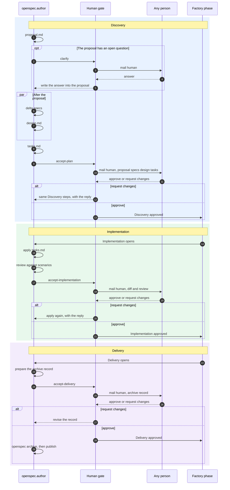
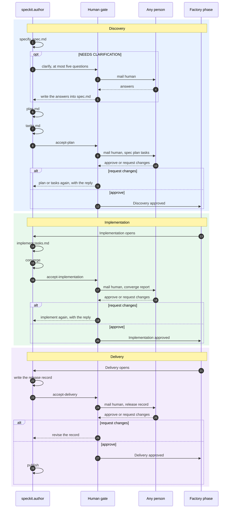
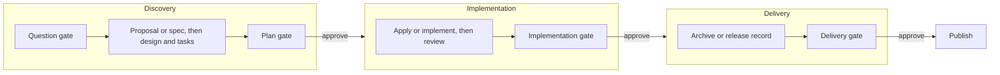

# OpenSpec and Spec Kit packs, with human gates on the factory phases

Superseded by [methodology-pack-architecture.md](methodology-pack-architecture.md). Native packs do not embed Discovery, Implementation, and Delivery. Those phases are one optional overlay, and the overlay accepts any number of phases. This file remains as the earlier gate sketch.

Plan for the first Gas City packs. No pack code in this change.

The factory phases stay Discovery, Implementation, and Delivery (`src/lib/factoryPhase.ts`). The plan gate is the human approval that ends Discovery and opens Implementation. Delivery is the last approval, after the build has its own acceptance.

The packs do not name a project manager or a developer. Each gate mails the mailbox `human` and waits. A later routing layer reads that mail and chooses the person from the organization's membership.

## What this replaces

`formulas/openspec` and `formulas/speckit` on this branch are sketches. They put `gc.hitl.role` on steps and they paraphrase the methods. The pack work replaces those sketches.

Superpowers, BMAD, and gstack in `gastownhall/gascity-packs` are the pattern to follow: schema 2 `pack.toml`, import `gascity` as `gc`, extend `build-base`, keep the anchor ids, put step text in `description_file`, vendor the upstream instructions, and use pack-local agent names such as `openspec.author`. Superpowers' interactive approval is the gate mechanism to copy: `gc mail send human`, `gc session wait --sleep --on-beads`, then a verdict the check script reads. The formula spec's `[steps.gate]` type `human` has no watcher.

`interaction_mode` does not skip a gate. Superpowers' default self-approval mode stays out.

## Where the gates sit

A question gate pauses inside Discovery and does not approve a phase. A phase gate records a verdict and is the only thing that opens the next factory phase.

| Gate | Kind | Opens when | Verdict | Factory effect |
| --- | --- | --- | --- | --- |
| `clarify` | Question | The proposal or spec still has an open question | The answer text | Stays in Discovery. The producing step writes the answer back. |
| `accept-plan` | Phase | Design and tasks exist, and OpenSpec `validate` passes when the method is OpenSpec | `approve` or `request-changes` | Approves Discovery. Opens Implementation. This is the plan gate. |
| `accept-implementation` | Phase | Apply or implement has finished and the review or converge report exists | `approve` or `request-changes` | Approves Implementation. Opens Delivery. |
| `accept-delivery` | Phase | The archive or release record is ready to publish | `approve` or `request-changes` | Approves Delivery. Publish runs only after this. |

`request-changes` returns to the producing step with the reply text. The phase does not advance. Silence leaves the bead open.

The later role layer can route these three phase gates to the approvers the factory already uses: project manager for Discovery, developer for Implementation, project manager for Delivery (`plans/phase-completion-machine.md`). The packs do not encode that.

## OpenSpec

Native dependencies stay. Specs and design both need only the proposal, so they run together. Tasks wait for both. `openspec validate` is the check before the plan gate. `openspec archive` runs only after the delivery gate.



## Spec Kit

The pack runs the commands. It does not start `specify workflow`. Clarify asks at most five questions, and only when `spec.md` still contains `NEEDS CLARIFICATION`. An unambiguous spec records that and continues.



Spec Kit's own command list has no acceptance step after implement. `accept-implementation` and `accept-delivery` are the factory phase gates around that command list. They mail `human`. They do not add a Spec Kit role.

## Alignment



| Factory phase | OpenSpec inside it | Spec Kit inside it | Gate that closes it |
| --- | --- | --- | --- |
| Discovery | Proposal, optional question, specs and design together, tasks | Specify, optional clarify, plan, tasks | Plan gate, `accept-plan` |
| Implementation | Apply the tasks, review the scenarios | Implement, converge | Implementation gate, `accept-implementation` |
| Delivery | Archive record, then `openspec archive` | Release record | Delivery gate, `accept-delivery` |

Design and tasks are the plan. They are written before the plan gate, still inside Discovery. Implementation does not start while the plan is unapproved.

## Pack shape

```
formulas/human-gate/     mailbox human, verdict human_gate.verdict
formulas/openspec/       extends build-base, vendors the OpenSpec schema and workflows
formulas/speckit/        extends build-base, vendors the Spec Kit command templates
```

`human-gate` is an expansion both packs attach. The step routes to `gc.run-operator`, writes `artifact_root/.gates/<step-id>.md`, sends one mail to `human`, and parks on the bead. The check script exits 0 on `approve`. On `request-changes` it exits 1 and the producing step runs again. The role layer's contract is the mail, the gate file, and the bead id.

Each methodology pack vendors upstream text and pins the commit in `upstream.toml`. Agent steps follow those files. OpenSpec checks call `openspec validate` and `openspec status --json`. The `build-base` summary file is still written so the existing continuation formulas can resume. Spec Kit's check is that `spec.md`, `plan.md`, and `tasks.md` exist and the task checkboxes parse.

Pack-local agents are `openspec.author`, `openspec.applier`, `speckit.author`, and `speckit.implementer`. Gates stay on `gc.run-operator`.

The packs live in this repository and import by local path until a push to `gascity-packs` is possible.

## Order of work

1. Add `human-gate` and prove one bead stays open until a mail reply sets `approve`.
2. Replace the OpenSpec sketch. A cooked graph shows specs and design waiting only on the proposal, tasks waiting on both, and `accept-plan` waiting on tasks. No step metadata names a role.
3. Replace the Spec Kit sketch. The cooked graph is specify, clarify, plan, tasks, `accept-plan`, implement, converge, `accept-implementation`, release record, `accept-delivery`. `specify workflow` is not invoked.
4. Leave role routing unbuilt.

The first run cooks both graphs, pauses one gate, and resumes it from a mail reply. A rejection returns to the producing step with the reply text, and the factory phase does not change.
