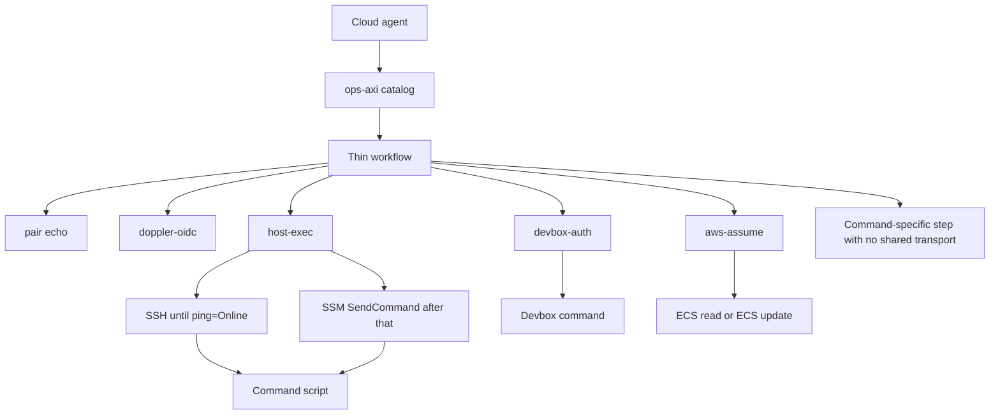
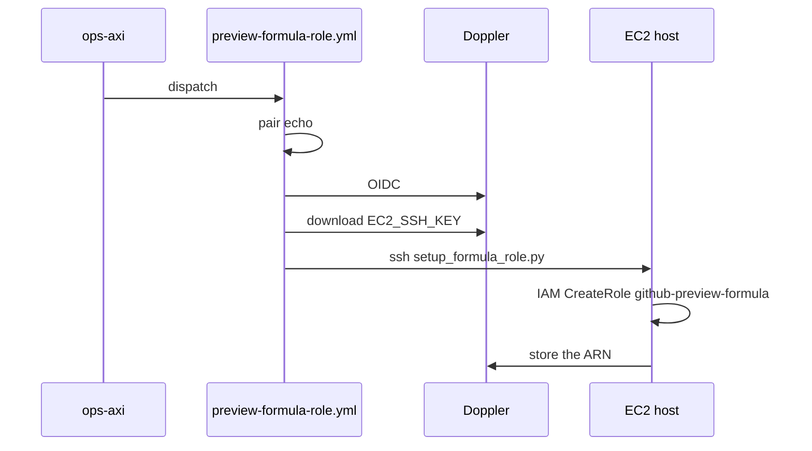
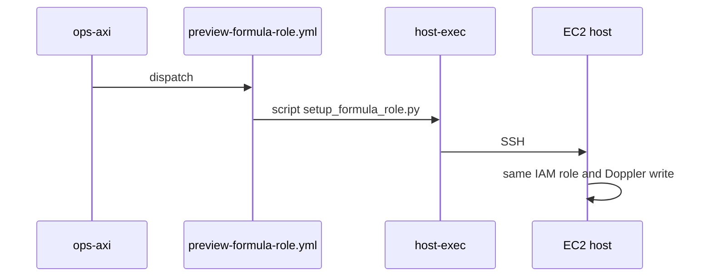

# ops-axi horizontal layers

Status: analysis only. No workflow is rewritten here. `session prepare` is not a command yet. Do not copy `preview-formula-role.yml` into a second SSH workflow. Derived from `packages/ops-axi/lib/catalog.js` and the workflow files on `cursor/ops-axi-commands-f1a5` (`/tmp/axi-work` at catalog commit `a9c0b411` plus the workflow files that branch contains).

The client is already one layer. `packages/ops-axi/bin/ops-axi.js` calls `lib/cli.js`, which calls `lib/run.js` for a workflow, `startLabel` for a pull-request label, or `lib/toolbox.js` for a local image copy. `lib/gh.js` classifies GitHub errors. A refused dispatch fails and does not rerun. That part is shared. The workflows behind it are not.

## 1. Command inventory

Twenty-seven catalog operations, plus `run`, which starts a workflow file by name and is not a business command. `session prepare`, `session status`, and `session run echo-ok` are not in the catalog.

| Command | Responsibility | Workflow | Entry | Ref the catalog names |
| --- | --- | --- | --- | --- |
| `ec2 check` | Prove the runner can SSH to the Gas City host and that the host's Doppler token files answer | `ec2-access-check.yml` | `scripts/gascity/check_host_access.py` over SSH | `cursor/axi-toolbox-image-plan-531e` |
| `formula role` | Create IAM role `github-preview-formula` and store `AWS_PREVIEW_FORMULA_ROLE_ARN` in Doppler | `preview-formula-role.yml` | `scripts/gascity/setup_formula_role.py` over SSH | `cursor/formula-config-ui-55d6` |
| `formula verify` | Require that ARN to be present | same file as `ec2 check` | same SSH check; CLI also requires the result line | same as `ec2 check` |
| `formula deploy` | Publish the formula image and update ECS service `formula-preview` | `preview-formula.yml` | `deploy/preview/formula_ecs.mjs` | `cursor/formula-config-ui-55d6` |
| `formula status` | Read that ECS service and its load balancer | `formula-status.yml` | `aws ecs describe-services`, `aws elbv2 describe-load-balancers` | `cursor/ops-axi-commands-f1a5` |
| `doppler status` | Compare project `dyad` with `deploy/doppler/manifest.json` | `doppler-organize.yml` | `scripts/doppler/migrate.mjs status` | axi branch |
| `doppler phase1` | Copy manifest names into `ci` and `prd` | same file | `migrate.mjs phase1` | axi branch |
| `doppler verify` | Check that copy | same file | `migrate.mjs verify` | axi branch |
| `rollout <sha>` | Move the Gas City host checkout to a commit after CI is green | `gascity-rollout.yml` | host rollout script over SSH | `cursor/browser-dyad-ui-bbea` |
| `host status` | Print the commit that checkout is on | `host-status.yml` | `git rev-parse` over SSH | commands branch |
| `preview image` | Build the Dyad image and update the shared Devbox preview | `preview-image.yml` | Docker, Neon attach, Devbox `Wewebplus-ci` | axi branch |
| `preview up <pr>` | Add the `preview` label | `preview.yml` starts from the label, not from `workflow_dispatch` | `gh pr edit --add-label` in `lib/cli.js` | — |
| `preview down <pr>` | Remove that label | same | `gh pr edit --remove-label` | — |
| `preview exec` | Run one preview command on the Devbox | `preview-exec.yml` | Devbox exec | axi branch |
| `preview wake` | Start preview containers after cloudflared stops | `preview-wake.yml` | Devbox exec | axi branch |
| `preview secrets` | Seal the Devbox controller key | `preview-secrets.yml` | Devbox exec | axi branch |
| `preview status <pr>` | Container state | `preview-control.yml` `action=status` | `scripts/gascity/preview-control.sh` on the Devbox | commands branch |
| `preview logs <pr>` | Recent logs | same file, `action=logs` | same script | commands branch |
| `preview db-status <pr>` | Neon branch presence | same file, `action=db-status` | same script | commands branch |
| `vibe status <pr>` | HTTP status of the Vibe worker | `vibe-status.yml` | `curl` | commands branch |
| `bolt status` | HTTP status of the Bolt worker | `bolt-status.yml` | `curl` | commands branch |
| `forma status` | Latest public deployment | `packages/ops-axi/workflows/forma-status.yml` | `curl` to the public GitHub deployments API | `main` of `Awannaphasch2016/forma`; the file is not on that repo |
| `toolbox image` | Build and push `ghcr.io/awannaphasch2016/axi-toolbox` | `axi-toolbox-image.yml` | Docker Buildx | commands branch |
| `toolbox status` | Print the published digest | `toolbox-status.yml` | `gh api` on the GHCR package | commands branch |
| `toolbox use <digest>` | Copy `ops-axi` and `gh-axi` onto this machine | none | `lib/toolbox.js` runs `docker create` locally | — |
| `cursor probe` | `GET /v1/me`, one plan-mode agent, then delete it | `hitl-cursor-probe.yml` | Doppler fetch, then `api.cursor.com` | `cursor/gascity-consolidation-step-f1a5` |
| `pr open` | Push a branch and open a pull request. Does not merge | `pr-open.yml` | `actions/create-github-app-token`, `gh pr create` | commands branch |

`formula verify` and `ec2 check` are two commands and one workflow. The three Doppler commands are one workflow selected by `command`. The three preview read commands are one workflow selected by `action`. `preview up` and `preview down` do not dispatch; they edit a label, and `preview.yml` has no `workflow_dispatch`.

## 2. Vertical slices

Types below are names for steps the files actually contain. A type is reused only when the step is the same kind of work.

| Type | What the code does |
| --- | --- |
| `client` | `cli.js` / `run.js` dispatch, or the label and toolbox-use branches |
| `pair` | The "Name the Doppler pair" step. Prints `project=` and `config=`. Reads no secret |
| `doppler-oidc` | `.github/actions/doppler-oidc` |
| `ssh-key` | Write `EC2_SSH_KEY` to a mode-600 file, from the GitHub secret or a Doppler download |
| `ssh` | `ssh -i` to `ubuntu@13.251.216.187` with `.github/gascity_known_hosts` |
| `host-script` | The script that then runs on that host |
| `devbox-auth` | Namespace login, install the Devbox CLI, point it at the federated token |
| `devbox-exec` | A command on Devbox `Wewebplus-ci` |
| `aws-assume` | `aws-actions/configure-aws-credentials` with a role ARN |
| `ecs` | ECS or ELB API calls |
| `image` | Docker build, GHCR push, or digest resolve |
| `neon` | Attach or delete a Neon preview branch |
| `http` | `curl` a public URL |
| `github-read` | `gh api` read |
| `github-app` | App token, git push, `gh pr create` |
| `cursor-api` | `https://api.cursor.com` |
| `migrate` | `scripts/doppler/migrate.mjs` |
| `ci-wait` | Poll `ci.yml` for the commit |
| `label` | `gh pr edit` labels |
| `local` | `docker create` / `docker cp` on the agent machine |
| `verify` | `run.js` keeps `key=value` lines and applies the catalog `verify` rules |

Sequences, from the step lists in those files:

| Command | Sequence |
| --- | --- |
| `ec2 check` | `client` → `pair` → `doppler-oidc` → `ssh-key` → `ssh` → `host-script` (`check_host_access.py`) → `verify` |
| `formula role` | `client` → `pair` → `doppler-oidc` → `ssh-key` → `ssh` → `host-script` (`setup_formula_role.py`: STS, IAM OIDC provider, IAM role, Doppler write) → `verify` |
| `formula verify` | same as `ec2 check`, then the CLI requires `AWS_PREVIEW_FORMULA_ROLE_ARN=present` |
| `formula deploy` | `client` → `pair` → `image` → `neon` → `aws-assume` → `ecs` (copy to ECR, update service) → `verify` |
| `formula status` | `client` → `pair` → `aws-assume` → `ecs` (describe only) → `verify` |
| `doppler status` | `client` → `pair` → `doppler-oidc` → `migrate` status → `verify` |
| `doppler phase1` | `client` → `pair` → `doppler-oidc` → `migrate` phase1 → `verify` |
| `doppler verify` | `client` → `pair` → `doppler-oidc` → `migrate` verify → `verify` |
| `rollout` | `client` → `pair` → `ci-wait` → `doppler-oidc` → `ssh-key` → `ssh` → `host-script` → `verify` |
| `host status` | `client` → `pair` → `doppler-oidc` → `ssh-key` → `ssh` → `host-script` (`git rev-parse`) → `verify` |
| `preview image` | `client` → `pair` → `image` → `neon` → `devbox-auth` → `devbox-exec` → `verify` |
| `preview up` / `preview down` | `client` → `label`. `preview.yml` then does `image` resolve → `neon` → `devbox-auth` → `devbox-exec` |
| `preview exec` | `client` → `pair` → `devbox-auth` → `devbox-exec` → `verify` |
| `preview wake` | `client` → `pair` → `devbox-auth` → `devbox-exec` → `verify` |
| `preview secrets` | `client` → `pair` → `devbox-auth` → `devbox-exec` → `verify` |
| `preview status` / `logs` / `db-status` | `client` → `pair` → `devbox-auth` → `devbox-exec` (`preview-control.sh`) → `verify` |
| `vibe status` | `client` → `http` → `verify`. The catalog Doppler pair is printed by the CLI, not by a Doppler read in the workflow |
| `bolt status` | `client` → `http` → `verify`. Same |
| `forma status` | `client` → `http` → `verify`. No Doppler call in the workflow file |
| `toolbox image` | `client` → `image` → `verify` |
| `toolbox status` | `client` → `github-read` → `verify` |
| `toolbox use` | `local`. No workflow |
| `cursor probe` | `client` → `pair` → Doppler fetch action (not the OIDC composite; `dopplerhq/secrets-fetch-action`) → `cursor-api` → `verify` |
| `pr open` | `client` → `github-app` → `verify` |

`formula role`'s business step is the IAM role and the Doppler write inside `setup_formula_role.py`. Everything before `host-script` is transport. The script then uses the host's `aws` / `dev` keys. It does not call ECS or SSM.

`formula deploy` never SSHes. Its business steps are the image and the ECS update. `aws-assume` uses the role `formula role` stored. That is a different transport from SSH.

Planned `session prepare`, not in the tree: the plan in `plans/ops-axi-session-prepare.md` would repeat `formula role`'s `pair` → `doppler-oidc` → `ssh-key` → `ssh` prefix, then a new host script that attaches `AmazonSSMManagedInstanceCore` and creates `gascity-agent-exec`. Planned `session status` and `session run echo-ok` would be `aws-assume` → SSM `SendCommand`, with no SSH. They are not built, so they are not rows in the matrix.

## 3. Comparison matrix

A mark means that command's workflow contains that step. `preview up` marks `label` only; the Devbox steps belong to `preview.yml`, which the label starts.

| Command | pair | oidc | ssh | devbox | aws-assume | ecs | image | neon | http | other business |
| --- | --- | --- | --- | --- | --- | --- | --- | --- | --- | --- |
| `ec2 check` | yes | yes | yes | | | | | | | host token check |
| `formula role` | yes | yes | yes | | | | | | | IAM role |
| `formula verify` | yes | yes | yes | | | | | | | ARN line |
| `formula deploy` | yes | | | | yes | yes | yes | yes | | ECS update |
| `formula status` | yes | | | | yes | yes | | | | describe |
| `doppler status` | yes | yes | | | | | | | | migrate read |
| `doppler phase1` | yes | yes | | | | | | | | migrate write |
| `doppler verify` | yes | yes | | | | | | | | migrate read |
| `rollout` | yes | yes | yes | | | | | | | CI wait, host rollout |
| `host status` | yes | yes | yes | | | | | | | `git rev-parse` |
| `preview image` | yes | | yes* | yes | | | yes | yes | | Devbox update |
| `preview up` / `down` | | | | yes, inside `preview.yml` | | | yes | yes | | label edit |
| `preview exec` | yes | | | yes | | | | | | one remote command |
| `preview wake` | yes | | | yes | | | | | | start containers |
| `preview secrets` | yes | | | yes | | | | | | seal a key |
| `preview status` / `logs` / `db-status` | yes | | | yes | | | | | | control script |
| `vibe status` | | | | | | | | | yes | |
| `bolt status` | | | | | | | | | yes | |
| `forma status` | | | | | | | | | yes | |
| `toolbox image` | | | | | | | yes | | | GHCR |
| `toolbox status` | | | | | | | | | | `gh api` |
| `toolbox use` | | | | | | | | | | local docker |
| `cursor probe` | yes | fetch action | | | | | | | | Cursor API |
| `pr open` | | | | | | | | | | GitHub App |

`preview image` is marked ssh because the file mentions the SSH key path while staging Cloudflare material. It does not open an SSH session to `13.251.216.187`. The four workflows that do are `ec2-access-check.yml`, `preview-formula-role.yml`, `gascity-rollout.yml`, and `host-status.yml`. Each inlines the key fetch and the same `ssh` arguments.

Devbox login (Namespace token, install CLI, federated token) is inlined in `preview-image.yml`, `preview.yml`, `preview-exec.yml`, `preview-wake.yml`, `preview-secrets.yml`, and `preview-control.yml`.

No catalog workflow calls SSM. ECS appears only in `formula deploy` and `formula status`.

## 4. Horizontal capabilities

These are the repetitions the files support. Each one says what stays specific.

| Capability | Who has it | Same responsibility? | Shared form | Stays specific |
| --- | --- | --- | --- | --- |
| Dispatch and `key=value` results | Every workflow command | Yes. Already one implementation in `cli.js` and `run.js` | Keep it. Do not reimplement it in workflows | Catalog `verify` rules and positional args |
| Doppler pair echo | Most workflows on the commands branch | Yes. The shell is the same eight-line fallback | A composite, or leave it. It is too small to justify a framework | The default pair, which differs per command |
| Doppler OIDC | `ec2 check`, `formula role`, `formula verify`, the three Doppler commands, `rollout`, `host status` | Yes. Already `.github/actions/doppler-oidc` | Keep the composite | Which config the next step reads |
| Doppler fetch of secret values | `cursor probe` uses `dopplerhq/secrets-fetch-action`. The SSH workflows download `EC2_SSH_KEY` with curl | Same vendor, different calls. The fetch action injects a whole config. The curl reads one name | Do not merge them | `cursor probe` must keep masking the Cursor key |
| Host SSH | The four workflows named above | Yes. Same host, same key file, same known_hosts, same flag set | One composite, `host-exec`, whose input is the script body | `check_host_access.py`, `setup_formula_role.py`, the rollout script, `git rev-parse` |
| Devbox login | The six preview workflows | Yes. Same three steps and the same Devbox name | One composite, `devbox-auth` | The command `devbox-exec` runs afterward |
| GHCR build and digest | `toolbox image`, `preview image`, `preview.yml`, `formula deploy` | Related, not the same. Different Dockerfiles, tags, and registries (GHCR vs ECR copy) | Leave them. A shared "build an image" action would hide those differences | Each Dockerfile and tag |
| AWS role assume | `formula status`, `formula deploy` | Yes, both call `configure-aws-credentials`. They assume the formula preview role, not a general role | Keep the action. Callers pass the ARN | ECS read vs ECS write |
| Public HTTP probe | `vibe status`, `bolt status`, `forma status` | The curl is the same shape. The URLs and the parsed fields are not | A four-line step can stay copied. A shared action is optional and not the first extraction | Each URL |
| Result redaction | `run.js` | Yes | Already shared | — |

`formula role` and a future `session prepare` share the host transport. They do not share a business operation. Role setup creates `github-preview-formula` and writes Doppler. Session preparation attaches one managed policy to the instance role and creates `gascity-agent-exec`. Those scripts stay separate. Only the SSH preamble is shared.

SSM, ECS, and Devbox are three transports.

| Transport | What it runs | Who uses it | Not the same as |
| --- | --- | --- | --- |
| SSH to the EC2 host | A script on `13.251.216.187`, using keys that already live on that host | `ec2 check`, `formula role`, `formula verify`, `rollout`, `host status` | ECS API calls, Devbox exec |
| SSM `SendCommand` | Not implemented. Would run a script on that same instance after the instance profile allows it | Planned replacement for the SSH cell above | ECS, Devbox, and the IAM change that installs SSM |
| ECS API | Update or describe `formula-preview` from the GitHub runner, after `aws-assume` | `formula deploy`, `formula status` | A shell on the EC2 host |
| Devbox exec | A command on `Wewebplus-ci` | The preview commands | The Gas City host |

Moving the host scripts to SSM does not move `formula deploy` or the Devbox commands. Those never open a shell on the EC2 instance.

The first SSM install cannot itself use SSM. The instance profile is what makes SSM answer. Until `ping=Online`, `host-exec` still uses SSH for that one bootstrap script. After `ping=Online`, the same composite runs the other host scripts through SSM. Callers keep passing a script. They do not learn which transport ran.

## 5. Target architecture

A workflow names the composite and the command script. It does not paste the SSH flags or the Devbox login.

`formula role` becomes `pair`, `doppler-oidc`, `host-exec(setup_formula_role.py)`.

`host status` becomes `pair`, `doppler-oidc`, `host-exec(git rev-parse)`.

`formula deploy` stays `pair`, `image`, `neon`, `aws-assume`, `ecs`. It does not go through `host-exec`.

`preview exec` becomes `pair`, `devbox-auth`, then its existing remote command.

`session prepare`, when it is added, is `host-exec(setup_host_ssm.py)` on the SSH side of the composite. `session status` is `aws-assume(gascity-agent-exec)` and an SSM describe. It is not a second copy of the formula-role workflow.

`vibe status`, `bolt status`, `forma status`, `toolbox status`, `toolbox use`, `pr open`, and `cursor probe` stay specific. They do not gain a host or Devbox layer they do not use.

## 6. Migration

Order. Each step preserves the `key=value` lines the CLI already verifies. No step slings a formula, and no step adds ECS permissions to the host role.

1. Add the composite `host-exec` by moving the key-file step and the `ssh` invocation out of the four host workflows. Each workflow passes the script it passes today. Behavior is the same SSH session.
2. Add the composite `devbox-auth` by moving the three Devbox login steps out of the six preview workflows. Each workflow keeps its own remote command.
3. Switch `host-exec` to SSM only after a bootstrap run has printed `ping=Online`. The bootstrap is the one `host-exec` call that still uses SSH, and its script is `setup_host_ssm.py`. If AWS returns `AccessDenied`, the composite prints `aws=denied` and leaves SSH in place. It does not replace an existing instance profile. It attaches `AmazonSSMManagedInstanceCore` to the role the instance already has, or creates `gascity-host-ssm` when the instance has no profile.
4. Point `ec2 check`, `formula verify`, `rollout`, and `host status` at the SSM side of `host-exec`. `formula role` moves with them. The script `setup_formula_role.py` stays the business step. Its IAM policy does not gain `ssm:` and does not gain the instance-profile actions.
5. Add `session status` and `session run echo-ok` as callers of `aws-assume` plus SSM, not as callers of `host-exec`, once the role `gascity-agent-exec` exists. `echo-ok` sends `echo ok` and no other document argument.
6. Leave `formula deploy`, the image builds, the Cursor probe, and `pr open` on their current steps.

Dependencies. `host-exec` can be extracted before SSM exists. SSM depends on the instance profile, which depends on the host AWS keys that `formula role` already uses. `formula deploy` depends on `formula role` having stored the ARN, and that dependency does not change. Catalog `defaultRef` stays on the branch that contains the workflow until that file is on the default branch. A refused dispatch still fails.

Compatibility. The CLI command names and the result lines stay. `formula verify` keeps reading `AWS_PREVIEW_FORMULA_ROLE_ARN` from the `ec2 check` log. Rollout still waits for CI before it touches the host. Devbox previews are not part of the SSM cutover.

## 7. Before and after

`formula role` today:

`formula role` after the extraction, still on SSH:

`formula role` after SSM is online uses the same diagram with `host-exec` calling SSM `SendCommand` instead of SSH. The role script is unchanged.

`host status` today inlines the same SSH preamble and then runs `git rev-parse`. Afterward it is `host-exec` with that git command. It does not create a role.

`formula deploy` is unchanged in all three stages. It never enters `host-exec`.

## What this analysis refuses

- A shared "remote execution" type that includes ECS, Devbox, and SSM.
- Building `session prepare` by copying `preview-formula-role.yml`.
- Changing command results as part of the extraction.
- Starting the PR #177 cherry-pick or a formula sling from this analysis.
