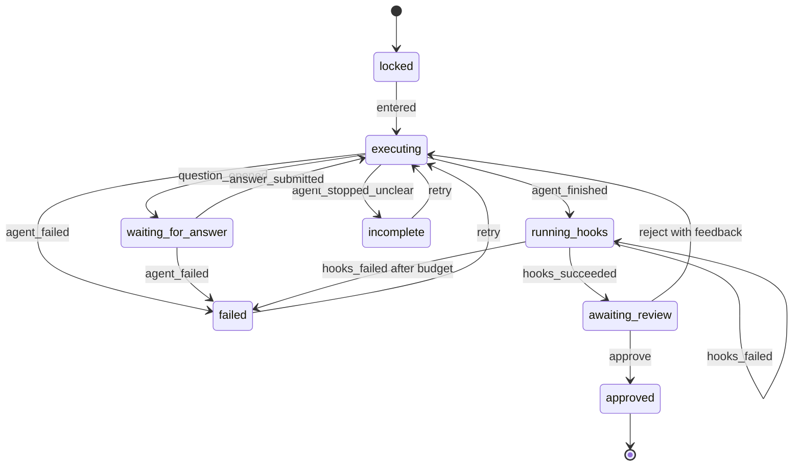

# Phase completion machine

> Generated by swarm planning session on 2026-10-13

## Summary

A factory phase is finished when the agent says it has no more questions and no question is still open. The phase summary and the human approval are hooks that run after that finish. Discovery, Implementation, and Delivery use one state machine, configured by the work prompt, the approver role, and those hooks. Approve starts the next phase. Reject with feedback starts another iteration of the same phase.

## Problem Statement

Today a phase becomes reviewable when the last assistant message contains `## <Phase> summary` plus a bullet list. That heading is both the completion check and the text people read. The last recorded Discovery run posted that heading without a `## Request for <role>` card, so the walk treated a finished-looking reply as a failure (`Discovery reached a summary before a role request`).

The same check also hides the Delivery approve button once the summary exists, marks Delivery finished before anyone approves it, and can offer download at that moment. Implementation is approved by the project manager, while the intended reviewer for that phase is the developer. Rejecting a phase has no path: the only control is Continue, and it opens the next phase.

People need one visible lifecycle. The agent works, stops with a question or with an explicit finish, hooks write the summary, and the configured reviewer approves or sends the same phase around again.

## Scope

### In Scope (MVP)

- One pure phase machine, three configured instances (Discovery, Implementation, Delivery).
- Explicit finish signal. A summary heading is not completion. Zero questions is a valid finish.
- A request marker in the same reply beats a finish marker. An open question blocks `agent_finished`.
- Summary hook after finish. Review controls appear only after that hook succeeds.
- Approve records the phase and starts the next phase. Delivery approve makes download available to both roles.
- Reject with non-empty feedback starts the next iteration of the same phase in the same chat.
- Approver map: project manager for Discovery, developer for Implementation, project manager for Delivery.
- The same events from the Cursor poll path and the Dyad chat-stream path.
- Status line, approve, reject, retry, and download driven by the machine snapshot.
- Unit coverage of the full state × event matrix, plus updates to the phase-bar, stop, permission, and bridge-walk tests.

### Out of Scope (Follow-up)

- Switching the Cursor client from poll to the public SSE stream (`GET /v1/agents/{id}/runs/{runId}/stream`).
- Changing the 10 second Cursor poll, the 150 minute Playwright ceiling, or the 180 minute job cap.
- Fixing the Electron shutdown hang after a failed bridge walk.
- Browser-bridge sign-in, Clerk tickets, per-connection tokens, or SQLite versus Neon.
- Re-running the two-browser GitHub Actions walk. That walk still has not shown steps 1–9 on video.
- Showing the chat composer or the phase comment box on factory chats.
- Building the page as a completion hook. Building stays inside Implementation `executing`.
- A distributed or remote machine. One Dyad process owns the snapshot.

## User Stories

- As a project manager, I want Discovery to stop when the agent has no more questions, so that I review a summary the app wrote instead of guessing from a chat heading.
- As a developer, I want to approve Implementation, so that the person who reviewed the build is the one who opens Delivery.
- As a project manager, I want to approve Delivery and then download the documentation, and I want the developer to download it too once I have approved.
- As either role, I want to reject a phase with feedback and see the same phase run again, so that approval is not the only way out of review.
- As the person who is not the reviewer, I want the approve and reject controls visible but disabled, with a line that names who the phase is waiting on.
- As either role, I want a question to stay on the existing card: the target sees the body and the form, and the other role sees only the waiting line.
- As either role, I want to leave the app without stopping the run, and see the same phase state when I come back.

## UX Design

### User Flow

1. Discovery is unlocked. Implementation and Delivery stay locked until the previous phase is `approved`.
2. Opening Discovery sends `entered`. The phase prompt starts the agent. Nobody presses Send. The composer stays hidden.
3. If the agent writes `## Request for <role>`, the machine opens the existing question card and waits. The target submits. The same agent continues with that answer. The other role never sees the question body.
4. When the agent writes `## Phase finished` and no request is open, hooks run. The summary hook posts `## <Phase> summary` into that phase chat. The status line says the summary is being written.
5. After the hook succeeds, the phase is `awaiting_review`. The approver sees Approve and Reject. The other role sees both disabled.
6. Approve records the approval, unlocks the next phase, and that phase's `entered` starts its agent with the hook summary as context. Nobody presses Send.
7. Reject requires a non-empty feedback field. The same phase chat starts another iteration. The feedback is context for that iteration. The previous summary stays in the chat as history. Review controls hide until the new iteration finishes and its hook succeeds.
8. An empty reject does nothing. The phase stays in review.
9. If the turn ends with neither a request nor `## Phase finished`, the phase is `incomplete`. If the run errors, it is `failed`. Neither state shows Approve. Both show Retry, which starts another iteration of the same phase.
10. Delivery approval sets the phase to `approved` and shows Download documentation to both roles. Download stays hidden until that approval.

### Key States

- **Locked**: phase tab disabled, lock icon, title `Approve <previous> first`. No agent, no review controls.
- **Executing**: status `Working in <phase>`. No approve, no reject, no composer. Question card hidden.
- **Waiting for answer**: existing card. Target sees body, form, and Submit answer. Other role sees `Waiting on <role> for <step>.` Status line repeats who the question is for.
- **Running hooks**: status `Writing the <phase> summary.` No review controls. A failed hook stays here and retries the hook. The agent is not started again.
- **Awaiting review**: summary bubble is visible. Approver can Approve and Reject. Other role sees both disabled and `Waiting on <role> to approve <phase>.`
- **Approved**: phase tab uses the finished shade. Approve and Reject are gone. The next phase, if any, unlocks and starts itself.
- **Incomplete**: status `Stopped before it finished. No question is open.` Retry is available to both roles. Approve stays hidden.
- **Failed**: status `The run failed.` Retry is available to both roles. Approve stays hidden. The error text is the run message, not a question card.

### Interaction Details

- Approve on Discovery or Implementation is one button, `Approve and continue to <next>`. It records approval and selects the next phase chat. The next kickoff is the machine's `entered` command, not a prefilled composer.
- Approve on Delivery is `Approve delivery`. It does not navigate away.
- Reject sits beside Approve. The feedback field is a single text area, labeled `What should change?`, associated by `id`. Submit is `Send back`. It stays disabled while the field is empty or while a mutation is pending.
- Retry is a separate button, shown only in `incomplete` and `failed`. It does not require feedback.
- Two browsers read one snapshot for the selected app. Role changes which controls are enabled. Switching apps refetches that app only and does not dispatch a stop.
- The summary remains an assistant message in the phase chat. It is the hook's output. The bar does not treat "the last message has a summary heading" as the unlock.
- Phase questions use the request marker. Plain-text questions are not questions to the machine. The prompt tells the agent to use the marker for every question in the phase, including questions for the person in this chat.

### Accessibility

- Approve, Reject, Send back, and Retry are real buttons with accessible names. Disabled buttons stay in the tab order so the waiting reason can be read from the status line.
- The status line is a live region (`aria-live="polite"`) that updates when the snapshot status changes. It does not announce every refetch.
- The reject field has a visible label and `aria-invalid` when a submit is attempted empty. The error text is `Add feedback before sending this phase back.`
- The lock icon on a locked tab is `aria-hidden`. The button's accessible name stays the phase label, and `title` remains the reason it is locked.
- Color is not the only finished signal. The status line and the absence of Approve say whether a phase is approved.
- No new motion. The bar keeps the existing shade classes.

## Technical Design

### Architecture

The machine is local to one Dyad process. `state.ts` and `transition.ts` are pure. The main-process controller is the only writer. Both browsers receive the snapshot through the existing factory IPC and the 1 second refetch while that app is selected.

This is not a distributed machine. Do not register it with `defineFrameworkCoveredRemoteMachine`. App-run and image generation stay the framework-covered surfaces.

Cursor and Dyad stay outside the machine. Each transport ends a turn and the classifier emits one event. The controller applies that event once.



Ignored events do not change state and do not emit commands. Use shared `ignore(state, reason)`.

| From               | Event                           | To                 | Command                                                                      |
| ------------------ | ------------------------------- | ------------------ | ---------------------------------------------------------------------------- |
| locked             | entered                         | executing          | Start the phase agent with the work prompt                                   |
| executing          | question_opened                 | waiting_for_answer | Open the HITL card for that question id                                      |
| executing          | agent_finished                  | running_hooks      | Run the summary hook. Do not open review yet                                 |
| executing          | agent_stopped_unclear           | incomplete         | Post a system line that the turn ended without a finish                      |
| executing          | agent_failed                    | failed             | Post the run error. Do not open a question                                   |
| waiting_for_answer | answer_submitted                | executing          | Resume the same agent with the question and the answer                       |
| waiting_for_answer | agent_failed                    | failed             | The open question cannot be delivered                                        |
| running_hooks      | hooks_succeeded                 | awaiting_review    | Summary message is already posted                                            |
| running_hooks      | hooks_failed, attempt &lt; 3    | running_hooks      | Retry the hook only                                                          |
| running_hooks      | hooks_failed, attempt = 3       | failed             | Stop retrying. Agent is not restarted                                        |
| awaiting_review    | approve                         | approved           | Record approval. `entered` on the next phase, or enable download on Delivery |
| awaiting_review    | reject with non-empty feedback  | executing          | Next iteration of this phase. Feedback is context                            |
| incomplete         | retry                           | executing          | Next iteration of this phase                                                 |
| failed             | retry                           | executing          | Next iteration of this phase                                                 |
| any                | event not listed for that state | same               | `ignore`                                                                     |

`agent_finished` while `waiting_for_answer` is ignored. `approve` and `reject` while waiting are ignored. `question_opened` during `awaiting_review` is ignored. Every event after `approved` is ignored. `answer_submitted` whose question id is not the open id is ignored, including an answer from an older iteration.

`hooks_failed` does not return to `executing`. The work agent is not asked to rebuild the page or rediscover the brief.

Completion detection:

- A turn ending is not a phase ending. Cursor `FINISHED` and a Dyad stream `finish` only mean the turn ended.
- Classifier output, in order: a `## Request for project-manager` or `## Request for developer` outside a code fence emits `question_opened`. Else `## Phase finished` emits `agent_finished`. Else a clean stop emits `agent_stopped_unclear`. An errored run emits `agent_failed`. Cancelled, expired, and rejected runs emit `agent_stopped_unclear` (incomplete), not a human request.
- The request marker wins when both markers are in the same reply.
- Silence, a summary heading, and a transport-level finished status are not `agent_finished`.

Finish message shape the prompt requires:

```markdown
## Phase finished

- **Page name:** <name>
```

The bullets are input to the summary hook. The predicate is the heading plus no open request. The hook posts a new assistant message whose heading is still `## <Phase> summary`, so the existing summary renderer keeps working. The hook copies and normalizes the bullets. It does not ask the model to decide that the phase is done.

If `## Phase finished` has no bullets, the hook fails. The controller retries it up to 3 attempts by one follow-up whose only job is to supply the bullets. That follow-up stays inside `running_hooks` and does not increment the work iteration. The fourth failure emits the terminal `hooks_failed` and lands in `failed`.

### Components Affected

- `src/factory_phase/state.ts` — new. Domain state, events, phase config, iteration and hook-attempt counters.
- `src/factory_phase/transition.ts` — new. Total pure transition and `ignore`.
- `src/factory_phase/transition.test.ts` — new. Full state × event matrix, including ignores and the hook budget.
- `src/factory_phase/controller.ts` — new. Main-process writer. Loads the snapshot, applies one event, runs the reserved commands after commit.
- `src/lib/factoryStop.ts` — stop class becomes an event: `question_opened`, `agent_finished`, `agent_stopped_unclear`, `agent_failed`. Remove `ready-for-approval`.
- `src/lib/factoryPhase.ts` — summary extract stays for display and for the next-phase prompt. It is no longer the approval gate. Remove the Delivery special case from `showFactoryPhaseApproval` and `factoryPhaseShade`. `canContinueFactoryPhase` becomes "snapshot is `awaiting_review`". Hints become snapshot status copy.
- `src/lib/factoryRequest.ts` — keep the request parser. Add a finish-marker parser beside it, or in `factoryStop.ts`. Request wins over finish.
- `src/prompts/factory_phase_prompt.ts` — every phase question uses `## Request for <role>`, including questions for the person in this chat. The agent stops with `## Phase finished` and does not write the summary heading. The hook owns that heading.
- `src/main/cursor_factory_host.ts` — `settleCursorFactoryRun` emits machine events instead of posting the final text as the reviewable summary. Pending Cursor statuses dispatch nothing.
- `src/chat_stream/definition.ts` — the factory-host intent completion path emits the same events. Token streaming is unchanged.
- `src/main/factory_host_request.ts` — question open only as the `question_opened` command. A summary does not open a question.
- `src/main/factory_host_service.ts` — summary post and status post stay idempotent on `(chatId, idempotencyKey)`. Keys include phase, iteration, and hook attempt.
- `src/ipc/handlers/factory_handlers.ts` and `src/ipc/handlers/factory_host_handlers.ts` — approve, reject, retry, and answer call the controller. Answer still resumes the same Cursor agent when a sender exists.
- `src/db/schema.ts` plus a generated migration — one snapshot row per app and phase.
- `src/components/chat/FactoryPhaseBar.tsx` — render from the snapshot. Approve only in `awaiting_review`. Add Reject, feedback, and Retry. Download only when Delivery is `approved`.
- `src/components/chat/HitlQuestionList.tsx` — unchanged card behavior. The bar passes questions only while the snapshot is `waiting_for_answer`.
- `src/lib/adminAccess.ts` — developer gains `approve-implementation`. Project manager loses it.
- `src/auth/permissions.ts` — `approvalPermissionForPhase` stays phase → `approve-<phase>`. The role table is what changes.
- `src/lib/factoryDocuments.ts` — `canDownloadFactoryDocument` is true only when Delivery is `approved`, not when the shade is `finished` for any other reason.
- `e2e-bridge/two-roles.spec.ts` — a summary without a question is not an automatic failure. Assert the finish signal, the hook summary, review controls, the developer as the Implementation approver, and a reject iteration.
- `scripts/dyad-bridge-signin.test.mjs` — update only the assertions that encode the old "summary before a question" rule.
- Existing tests: `src/lib/factoryPhase.test.ts`, `src/lib/factoryStop.test.ts`, `src/auth/permissions.test.ts`, `src/components/chat/FactoryPhaseBar.test.tsx`, factory host tests that expect `ready-for-approval`.

Phase-bar copy stays in `factoryPhase.ts`. Do not add `chat.json` keys unless a chat tool card is added. `rules/i18n.md` applies only in that case.

### Data Model Changes

Add `factory_phase_machines` in `src/db/schema.ts` and generate the migration with `npm run db:generate`. Do not hand-write the SQL.

| Column             | Purpose                                                                                         |
| ------------------ | ----------------------------------------------------------------------------------------------- |
| `app_id`, `phase`  | Primary identity. One row per phase of one app. Cascade on app delete.                          |
| `status`           | The eight states above.                                                                         |
| `iteration`        | Starts at 1. Increments on reject and on retry.                                                 |
| `open_question_id` | Null unless `waiting_for_answer`.                                                               |
| `hook_attempt`     | Starts at 0. Increments on `hooks_failed`. Resets when hooks succeed or a new iteration starts. |
| `summary`          | Last hook summary text. Null until the hook succeeds.                                           |
| `feedback`         | Last reject feedback. Null after the next iteration consumes it into the prompt.                |
| `failure_reason`   | Set in `incomplete` and `failed`. Cleared on retry.                                             |
| `updated_at`       | Ordering for the refetch. Not used by the pure transition.                                      |

`factory_phase_approvals` stays the approval record. The machine `approved` state and that row are written in the same controller command. A phase is approved only when both exist. Do not infer approval from "the next chat has messages".

`hitl_questions` stays the question store. The snapshot's `open_question_id` points at the question the machine is waiting on. A new iteration does not revive an old question id.

The snapshot is SQLite in the one Dyad process. Do not write it to Neon. Do not set `WEWEBPLUS_DATABASE_URL` for this work.

### API Changes

Renderer IPC, all scoped by `appId`:

- `factory.getPhaseMachine({ appId })` returns the three snapshots. The bar refetches with the existing selected-app interval.
- `factory.rejectPhase({ appId, phase, feedback })` dispatches `reject`. Empty feedback throws `DyadError` (`validation`) and does not transition.
- `factory.retryPhase({ appId, phase })` dispatches `retry`. Allowed only from `incomplete` and `failed`.
- `factory.approve` dispatches `approve` only from `awaiting_review`. Approving from any other state throws `DyadError` (`conflict`) rather than a bare `Error`.
- `factory.answerQuestion` dispatches `answer_submitted` only when the question id matches `open_question_id`.

No new public HTTP API. Cursor's client stays create, poll, and follow-up.

Phase config, constant, not stored per row:

| Phase          | Approver        | Work prompt                                                                                    | Hooks                                                              |
| -------------- | --------------- | ---------------------------------------------------------------------------------------------- | ------------------------------------------------------------------ |
| Discovery      | project-manager | Discovery brief. Ask with the request marker. Finish with `## Phase finished`.                 | Write the Discovery summary                                        |
| Implementation | developer       | Build the one-page site from the approved Discovery summary. Questions use the request marker. | Write the Implementation summary                                   |
| Delivery       | project-manager | Recap from the approved Implementation summary. Do not edit code.                              | Write the Delivery summary. On approve, download becomes available |

`factoryPhaseKickoff` reads the previous phase's hook `summary`, not `latestFactoryPhaseSummary` of an arbitrary assistant message.

## Implementation Plan

### Phase 1: Pure machine

- [ ] Add `src/factory_phase/state.ts` with the eight states, the events, the phase config, and the counters. No React, Electron, Jotai, TanStack Query, zod, timers, `Date`, or randomness.
- [ ] Add `src/factory_phase/transition.ts` as a total function. Exhaustive switches. Unhandled pairs call `ignore(state, reason)`.
- [ ] Cover every state × event cell in `transition.test.ts`, including stale answers, empty reject, the request-beats-finish rule at the classifier boundary, hook attempts 1–3, and events after `approved`.
- [ ] Keep the transition free of SQLite and IPC. Commands are data on the transition result. The test asserts the command list without running it.

### Phase 2: Finish signal and classifier

- [ ] Add `## Phase finished` parsing. A request in the same text returns `question_opened` and does not return `agent_finished`.
- [ ] Change `classifyFactoryStop` so `ready-for-approval` is gone. A summary heading alone is `agent_stopped_unclear`.
- [ ] Update `factory_phase_prompt.ts` for all three phases. Questions always use `## Request for project-manager` or `## Request for developer`. The model does not write `## <Phase> summary`.
- [ ] Update `factoryStop` tests and the prompt snapshot tests.

### Phase 3: Hook runner and persistence

- [ ] Add the snapshot table through `schema.ts` and `npm run db:generate`.
- [ ] Implement the controller: load row, transition once, commit the row, then run commands. Ignored events do not write.
- [ ] Summary command posts one assistant message through `postFactoryHostMessage`, idempotent on phase + iteration + hook attempt.
- [ ] Missing bullets fail the hook. Retries stay in `running_hooks` and do not call the work kickoff.
- [ ] Approval command writes `factory_phase_approvals` and then dispatches `entered` on the next phase. Delivery approval sets download eligibility on the Delivery row and does not start another phase.

### Phase 4: Wire both transports

- [ ] `settleCursorFactoryRun` maps a non-terminal Cursor status to no event, and a terminal status through the classifier into the controller.
- [ ] The Dyad chat-stream factory completion path emits the same events. Streaming tokens stay on the existing IPC stream.
- [ ] `answerQuestion` resumes the same Cursor agent when `cursorAgentId` is set, and resumes the Dyad stream otherwise. The follow-up body is the question plus the answer. The Cursor API key stays in the Dyad process.
- [ ] A second poll of the same finished run does not apply `agent_finished` twice. Idempotency key is run id + iteration.

### Phase 5: UI

- [ ] `FactoryPhaseBar` reads the snapshot. Status line is the live region described above.
- [ ] Show Approve only in `awaiting_review`, enabled only when `approvalGate` allows the configured role.
- [ ] Add Reject and the feedback field. Empty feedback does not call IPC.
- [ ] Show Retry only in `incomplete` and `failed`, for both roles.
- [ ] Remove the Delivery summary special case. A Delivery tab is finished only when the snapshot is `approved`.
- [ ] Download renders only when Delivery is `approved`, for both roles.
- [ ] Keep the composer and the comment box hidden on factory phase chats.
- [ ] Keep phase tabs unlocking from the previous phase's `approved` state.
- [ ] Rewrite the Implementation hint. It no longer says to press Send on a prefilled prompt.

### Phase 6: Permissions and walk assertions

- [ ] Grant the developer `approve-implementation`. Remove that permission from the project manager.
- [ ] Update `permissions.test.ts`. The developer gate for Implementation becomes allowed. The project manager gate for Implementation becomes denied.
- [ ] Change `e2e-bridge/two-roles.spec.ts` so a finish with zero questions is success for that beat. Assert the hook summary, then the review controls. Implementation's enabled Approve is the developer window. Discovery and Delivery stay the project manager window.
- [ ] Add a reject beat: project manager sends feedback on Discovery, the same Discovery chat starts another iteration, and Implementation stays locked.
- [ ] Do not dispatch the two-browser workflow as part of landing this plan.

## Testing Strategy

- [ ] `npm test -- src/factory_phase/transition.test.ts` proves the matrix, the hook budget, stale answers, and empty reject.
- [ ] `npm test -- src/lib/factoryStop.test.ts` proves request beats finish, summary-only is unclear, and errors are never questions.
- [ ] `npm test -- src/components/chat/FactoryPhaseBar.test.tsx` proves Approve hidden outside review, Reject disabled for the other role, Retry on incomplete and failed, and download hidden until Delivery is approved.
- [ ] `npm test -- src/auth/permissions.test.ts` proves the new approver map.
- [ ] Factory host tests prove one settle posts the summary only after `agent_finished`, and a second settle does not post it again.
- [ ] `node --test scripts/dyad-bridge-signin.test.mjs` stays green after the walk assertion change.
- [ ] `npm run fmt`, `npm run lint`, and `npm run ts` on the implementation branch. Format with `./node_modules/.bin/oxfmt` on touched files only.
- [ ] The bridge walk is a later acceptance run, not a unit-test substitute. This plan does not mark steps 1–9 complete.

## Risks & Mitigations

| Risk                                                                                                       | Likelihood | Impact | Mitigation                                                                                                                                     |
| ---------------------------------------------------------------------------------------------------------- | ---------- | ------ | ---------------------------------------------------------------------------------------------------------------------------------------------- |
| The model keeps writing `## Discovery summary` or a plain-text question, so the phase sits in `incomplete` | H          | H      | Prompt forbids the summary heading and requires the request marker. Summary-only classifies as unclear, with Retry. Tests lock the classifier. |
| Both browsers apply the transition and diverge                                                             | M          | H      | Only the main-process controller writes. Renderers refetch the snapshot.                                                                       |
| Hook retry restarts Implementation and rebuilds the page                                                   | M          | H      | `hooks_failed` never returns to the work kickoff. The follow-up prompt asks only for the finish bullets.                                       |
| A stale answer from the previous iteration resumes the new run                                             | M          | H      | `answer_submitted` is ignored unless the question id equals `open_question_id`.                                                                |
| Developer approval surprises a flow that still expects the project manager on Implementation               | H          | M      | Decision log records the permission change. Tests flip the current `false` expectation on purpose.                                             |
| Download appears before Delivery approval, as it can today                                                 | M          | M      | Delete the shade special case. Download checks Delivery `approved` only.                                                                       |
| The bridge walk still fails the old "question before summary" assertion                                    | H          | M      | That assertion is removed in Phase 6. Do not run the walk until that lands.                                                                    |
| Migration numbers collide on rebase                                                                        | M          | L      | Generate with `npm run db:generate`. On rebase, follow `rules/database-drizzle.md` and regenerate rather than hand-editing snapshots.          |

## Open Questions

None that block implementation. The approver map, the reject path, the finish predicate, and the download rule are decided below.

During implementation, keep these defaults if a case shows up that the table does not name:

- Hook budget is 3 failed attempts, then `failed`.
- Cancelled, expired, and rejected runs are `incomplete`, not `failed`, because Retry is the useful next step and there is no error text.
- `agent_failed` while a question is open moves to `failed` and drops the card. The answer can no longer be delivered.
- Both roles may press Retry. Only the configured approver may Approve or Reject.

## Decision Log

- One machine, three configs. The work prompt, the approver role, and the hooks are the only phase differences. Decided so Discovery, Implementation, and Delivery cannot drift into separate gates.
- Finish means an explicit `## Phase finished` and no open request. A summary heading is a hook output. Decided because the last Discovery run posted a summary the machine could not distinguish from a question, and because zero questions must be a valid finish.
- A request marker beats a finish marker in the same reply. An open question blocks `agent_finished`. Decided so the agent cannot skip a person who was just asked something.
- Reject with non-empty feedback starts another iteration of the same phase. It does not open the next phase. Empty feedback stays in `awaiting_review`. Decided so review has a real negative path.
- Approvers are project manager, developer, project manager. This grants the developer `approve-implementation` and removes it from the project manager. The current code and `permissions.test.ts` do the opposite. Decided by the requested review map.
- Download is a Delivery-approve command for both roles. It is not a shade check. Decided so a summary cannot unlock the file before approval.
- Building the page stays inside Implementation `executing`. It is not a completion hook. Decided so a hook failure cannot be mistaken for a rebuild.
- Cursor versus Dyad is transport only. Both emit the same events. The Cursor API key stays in the Dyad process. Streaming Cursor's SSE endpoint is out of scope.
- The machine follows `rules/state-machines.md` for a local workflow: pure `state.ts` and `transition.ts`, side effects in the main-process controller, exhaustive switches, `ignore` for no-ops. It is not a remote distributed machine.
- Product principles used: backend-flexible (the machine does not know which agent transport finished the turn), transparent (status line names waiting, writing, review, and failure), bridge don't replace (questions stay on the existing card; the summary stays a chat message), productionizable (approval and download are explicit records, not inferred from chat text).

---

_Generated by dyad:swarm-to-plan_
