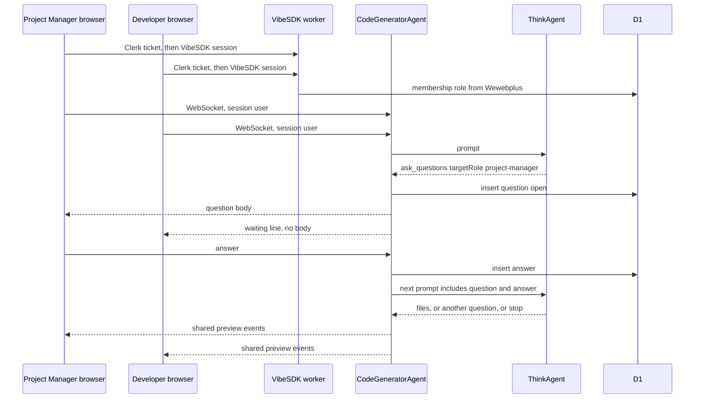

# VibeSDK agent-driven HITL

> Generated by swarm planning session on 2026-10-11

## Summary

VibeSDK becomes a second web builder, next to Dyad, Bolt, and Forma, where one organization has a Project Manager and a Developer on the same app. The agent works until it finishes or until it asks a person. The question goes to one role. That person answers. The agent continues. There is no Discovery, Implementation, or Delivery strip.

This is a plan. No VibeSDK behavior changes until it is reviewed.

## Problem Statement

The organization already knows how a Project Manager and a Developer share one build and see different questions. That behavior is proven on Dyad and on the Bolt walkthrough, and both of those still stop at three fixed phases. VibeSDK is a web app with its own users, sessions, and agent loop, and it already asks the signed-in person clarifying questions. It does not know organizations, it does not hide a question from the other role, and it does not treat “waiting for a person” as a record the agent can resume from after a refresh.

## Scope

### In Scope (MVP)

- One VibeSDK preview worker, one Wewebplus organization, two Clerk users (Project Manager and Developer), two browser sessions, one shared app.
- The Think agent behavior. It already runs an open-ended loop and already has `ask_questions`.
- A durable question with a target role, hidden from the other role, answered in the builder, then fed back as the next agent prompt.
- A scripted agent for the first proof, so routing does not depend on a model remembering a format.
- A later sample of real model questions, recorded so the role rule can be judged from evidence.

### Out of Scope (Follow-up)

- Discovery, Implementation, and Delivery, the phase strip, Continue, and phase-documentation downloads.
- Electron, the loopback host bridge, Gas City beads, and `bd gate resolve`.
- A second HITL website (`hitl-web`).
- More than one organization, org switching, invitation UI, and a private-versus-org account switcher.
- Reassignment, a question that both roles must answer, and a learned classifier.
- Bolt’s shared project, and any reset of `bolt-walkthrough`.
- Copying Clerk keys into the Doppler `vibesdk` / `dev` config. Changing shared Cloudflare tokens. Adding the lab host to Clerk origins.

## User Stories

- As a Project Manager, I want a requirements question to appear in my VibeSDK session, so I can answer it without the Developer reading it.
- As a Developer, I want a technical question to appear only in my session, so I can answer it and the agent can continue.
- As either member, I want the same app, files, and preview, so we are building one project.
- As either member, I want the run to end with no extra question when the agent is finished.

## UX Design

### User Flow

1. Both people sign in with Clerk on the VibeSDK preview. Each browser keeps its own VibeSDK session cookie. The header shows the role.
2. One of them starts an app. The other opens the same app from the organization list.
3. The agent writes and deploys until it calls `ask_questions` with `targetRole`.
4. The matching role sees the existing clarifying-question popup and submits. The other role sees a waiting line and no question text, no options, and no answer box.
5. The answer is stored. The agent’s next prompt contains the question and the answer. Building continues. The preview updates for both.
6. When the agent finishes and no question is open, both see the completed app. No popup appears.

### Key States

- **Default**: Shared chat and preview. No open question.
- **Waiting on you**: Popup with the question, options, and a free-text answer. Submit is enabled once an answer exists.
- **Waiting on the other role**: One line, “Waiting on the Project Manager.” or “Waiting on the Developer.” The question text is absent.
- **Answered**: The waiting line clears. The agent’s next messages appear for both. The answer text stays with the role that submitted it.
- **Completed**: Agent idle, no open question, preview shows the site.
- **Error**: Sign-in refusal stays a short message. A failed resume says the answer was saved and the agent has not continued, and offers retry. It does not invent a second question.

### Interaction Details

Reuse the popup in `src/routes/chat/components/clarifying-questions-popup.tsx`: one question at a time, options, optional free text, submit. Add the role gate around it. Do not add a phase tab.

Shared events (files, deploy, preview, ordinary chat text) stay on the existing agent WebSocket. The question payload is a separate event sent only to connections whose membership role matches.

### Accessibility

The popup already moves one question at a time with buttons. The waiting line is text, not only a change in the popup. Submit stays a button with a name.

## What to reuse, and what to leave behind

### Reuse

- **Who may see a question.** `presentQuestion` and `decideAnswer` in `src/control_plane/hitl.ts` and `hitl-web/lib/hitl.ts`. The matching role gets the body and may answer. The other role in the same organization gets status only. A different organization is not found. Documented in [PR 9](https://github.com/Awannaphasch2016/dyad/pull/9) and [PR 12](https://github.com/Awannaphasch2016/dyad/pull/12). Implemented in [PR 7](https://github.com/Awannaphasch2016/dyad/pull/7). Proven in two browsers on Bolt by [PR 98](https://github.com/Awannaphasch2016/dyad/pull/98) and [PR 119](https://github.com/Awannaphasch2016/dyad/pull/119).
- **The stop is a classification of a finished turn.** [PR 93](https://github.com/Awannaphasch2016/dyad/pull/93) `plans/hitl-workflow-semantics.md`. A finished turn with a role request is human-required. A finished turn with no request is complete. An error is not a human request. Implemented for Dyad’s factory in [PR 97](https://github.com/Awannaphasch2016/dyad/pull/97): `src/lib/factoryRequest.ts`, `src/lib/factoryStop.ts`, `src/main/factory_host_request.ts`.
- **Resume.** An answer starts exactly one next run whose prompt contains the question and the answer. A second answer does not start another. A crash between the answer and the next run starts it once on recovery. Same PR 97.
- **Two Clerk sessions.** [PR 91](https://github.com/Awannaphasch2016/dyad/pull/91) mints a 300-second Clerk sign-in ticket per role inside GitHub Actions. VibeSDK then exchanges that Clerk session for its own cookie, which [PR 68](https://github.com/Awannaphasch2016/dyad/pull/68) already does in `deploy/preview/vibesdk-shared-auth.mjs`. The role comes from `wewebplus.memberships`, not from a new user table.
- **The question shape.** VibeSDK `ask_questions` and the clarifying popup. Extend the tool with `targetRole` instead of parsing a markdown heading. The tool is a structured carrier. The heading parser was the fallback for agents that cannot call a tool.

### Leave behind

- Electron, `DYAD_DEV_USER_DATA_DIR`, the browser bridge on `127.0.0.1:32100`, device SQLite, and [PR 115](https://github.com/Awannaphasch2016/dyad/pull/115) / [PR 120](https://github.com/Awannaphasch2016/dyad/pull/120).
- The three factory phases and Experiment B ([PR 100](https://github.com/Awannaphasch2016/dyad/pull/100)). That experiment adds the phase-approval check on top of the agent question. VibeSDK does not take that layer.
- Gas City beads, `gateBeadId`, and `scripts/gascity/resolve_hitl_answer.py`.
- VibeSDK’s own blueprint phases (`CurrentDevState`, `phasesCounter`, `MAX_PHASES` in `worker/agents/core/state.ts`). Those are an internal generation strategy of the phasic behavior. They are not a human workflow, and this plan does not surface them. The Think behavior is the one this milestone uses.
- A keyword classifier as the first routing mechanism. See Question classification.

### Naming collision

In `plans/hitl-workflow-semantics.md` section 1, “Approach A” means the single-user in-chat questionnaire, and “Approach B” means the hardcoded phases. In section 7 of that same file, Experiment A is the agent-requested question and Experiment B is the phase gate.

This plan uses the names from the request:

- Approach A, rejected here: predefined phases. That is Experiment B and the factory phase strip.
- Approach B, adopted here: the agent asks when it must, then resumes. That is Experiment A, moved onto VibeSDK’s Think loop.

## Technical Design

### How VibeSDK works today

Pinned checkout `9da158d82c597a0e8f4bf033cdccd1053fb6fb15` (`scripts/doppler/vibesdk-lab.mjs`).

| Area | What the pin does | Single-user assumption |
| --- | --- | --- |
| Users and sessions | D1 tables `users` and `sessions`. `SessionService.createSession` allows 5 sessions per user. Auth is a JWT cookie checked by `worker/middleware/auth/auth.ts`. | A session is one `userId`. No organization and no role on the session row. |
| Shared Clerk sign-in | Preview patch only. Clerk token, exactly one `wewebplus.memberships` row of `project-manager` or `developer`, then `createSession(user.id)`. The HTTP response includes `organization` and `role`. | The role is not stored. Later requests only know the VibeSDK user id. |
| Apps | `apps.userId` is the owner. `AppService.checkAppOwnership` is `userId` equality. Lists filter by that id. `visibility` is `private` or `public`. | Two members cannot open one private app. |
| Agent | One Durable Object, `CodeGeneratorAgent`, per app. Think state lives there. A second Durable Object, `ThinkAgent`, runs the model loop. Files and preview live in `SpaceDO`. | `metadata.userId` is one person. Rate limits and model config use that id. |
| Questions | `worker/agents/think/ask-questions-tool.ts`. The tool returns the questions as JSON and does not pause a record. The host broadcasts `conversation_response.tool` to every socket. The popup submits; the answer becomes the next user message. | Whoever is connected sees the question. A refresh has no role-scoped question row. |
| Stop | `mark_generation_complete` sets MVP generated. The Think `build()` loop drains `pendingUserInputs` and then exits. Idle is the only “done”. | Idle and “waiting for a human” look the same: the loop is not running. |
| Realtime | WebSocket on the agent Durable Object. `broadcast()` sends to every connection. `onConnect` sends the full agent state to the new socket. | There is no per-connection user. A second viewer receives the same tool payloads. |

There is no organization table, no membership table, and no HITL table in this pin.

### Architecture

The other role never receives the question JSON. Shared file and preview events still go to both sockets.

### Components Affected

- `worker/agents/think/ask-questions-tool.ts` — add `targetRole`.
- `worker/agents/core/behaviors/think.ts` — on `ask_questions`, persist, stop the turn, broadcast by role. On answer, enqueue one resume prompt.
- `worker/agents/core/websocket.ts` and `codingAgent.ts` — remember which user owns each connection. Filter question events. Do not put the question body in the state blob sent on connect.
- `worker/database/schema.ts` — organization id on the app, question and answer tables.
- `worker/database/services/AppService.ts` — a member of the app’s organization can read it. The creator stays `createdBy`.
- `src/routes/chat/components/clarifying-questions-popup.tsx` — show only when this session’s role matches.
- `deploy/preview/vibesdk-shared-auth.mjs` — keep the gate. The session response already returns the role; the socket must load that same membership, not trust a client-supplied role.
- A Playwright check beside the preview, two contexts, scripted questions. Not the Bolt workflow.

### Data Model Changes

D1, on the preview database only.

- `apps.org_id` and `apps.created_by`. Existing `user_id` remains the creator so current rows still load. Access for a member uses `org_id`.
- `hitl_questions`: `id`, `org_id`, `app_id`, `agent_id`, `target_role`, `body` (the tool JSON), `status` (`open`, `answered`), `idempotency_key`, `assignment` (`declared` or `fallback`), `created_at`.
- `hitl_answers`: `question_id` unique, `user_id`, `body`, `created_at`.
- `apps.agent_status`: `running`, `waiting`, `completed`. This is the stop record. No phase column.

Roles stay in `wewebplus.memberships`. The preview already reads them. Copying them into D1 would make a second source. Each request resolves the caller to one user, one org, and one role. Zero or two memberships is the existing refusal (`gate-roles-N`).

### API Changes

No public internet route for posting a question. The agent writes the row inside the Durable Object. The browser sends an answer on the existing socket. The worker checks the session, the org, and the role before it stores the answer. A mismatch is not found for another org and forbidden for the other role, matching `decideAnswer`.

### Agent stop conditions

After each Think turn:

| Turn ended with | Classification | Next |
| --- | --- | --- |
| `ask_questions` called | human required | store the question, set `waiting`, do not start another prompt |
| no `ask_questions`, and the model stopped | completed | set `completed`, create no question |
| tool or model error | failure | surface the error, do not create a question |

If the model calls `ask_questions` and then keeps writing files in the same turn, the host drops the later file calls. The prompt already says to end the turn. The host enforces it.

### Question classification

The first mechanism is the agent’s own `targetRole` field: `project-manager` or `developer`. That matches Experiment A’s “the agent names the role”, using the tool the Think agent already calls instead of a `## Request for` heading.

A separate keyword classifier is a poor first cut. Real questions mix product and technical wording, and we do not yet have a set of VibeSDK questions to score it against.

Fallback when `targetRole` is missing or not one of the two roles: store the question for the Project Manager, set `assignment` to `fallback`, and hide the body from the Developer. The Project Manager is the customer-facing inbox. The run does not stall unlabeled, and the Developer does not see a question that was not meant for them.

A question that needs both people is two questions, one after the other. One open question at a time in the first proof. No reassignment screen. The stored `assignment` and the answerer id are the evidence for a later rule change.

### Authentication and authorization

Sign-in stays the preview exchange. Two browsers, two tickets, two cookies. The socket upgrade reads the session cookie and attaches `userId` to that connection. Role is loaded from Wewebplus for that user. The client cannot send a role.

App reads and the answer action require the app’s `org_id` to match that membership. The question body is included only when `target_role` matches. Conversation history replayed to a socket must pass through the same filter, because `onConnect` currently sends agent state to every socket and tool results are broadcast.

## Implementation Plan

### Phase 1: Shared app for two members

- [ ] Add `org_id` and `created_by` on apps. A member can open the app the other member created.
- [ ] Attach the session user to each WebSocket connection.
- [ ] Confirm both browsers see files and the preview, and that a non-member receives not found.

### Phase 2: Durable role question

- [ ] Add the question and answer tables and `agent_status`.
- [ ] Extend `ask_questions` with `targetRole`. Persist on tool output. Stop the turn.
- [ ] Send the body only to the matching connection. Send a waiting line to the other member.
- [ ] Strip the question body from history replay and from the connect state payload.
- [ ] On answer, store one row and enqueue one prompt that contains the question and the answer. A second submit does not enqueue another.

### Phase 3: Two-browser proof

- [ ] Script the Think agent so Test A emits a Project Manager question and, after that answer, Test B emits a Developer question, then Test C stops with no question.
- [ ] Run two Playwright contexts against the preview worker, using Clerk tickets minted in GitHub Actions the way PR 91 does. Assert the body, the hidden body, the 403 on the wrong answer, the resume prompt, and completion with zero open questions.
- [ ] Keep this off the Bolt workflow. Do not reset `bolt-walkthrough`.

### Phase 4: Real questions

- [ ] Run one real model build on the same preview. Record each `ask_questions` call: whether `targetRole` was set, the role, and the question text with emails removed.
- [ ] Decide from that log whether the fallback-to-Project-Manager rule is enough. Do not add a keyword classifier before that log exists.

### Phase 5: Production hardening

- [ ] Stable session secret across deploys. The preview regenerates `JWT_SECRET` today, so sessions die on every publish.
- [ ] More than one organization, only after the single-org proof.
- [ ] Audit of answerer id, and a reviewed path to promote the patch off the pinned preview checkout.

Size, not a calendar: Phases 1–3 are the proof. They touch the agent Durable Object, D1, the chat popup, the preview auth patch, and one Playwright job. Phase 4 is one recorded model run. Phase 5 is the promotion work and is not required to accept the proof.

## Testing Strategy

- [ ] Unit tests on the role filter: matching role sees the body, the other role sees status, a second org is not found, a second answer does not resume again.
- [ ] Unit test on the stop table: question, clean stop, and error.
- [ ] Playwright, two real sessions, scripted agent, Tests A, B, and C below.
- [ ] One real model run after the scripted proof, logged, not a pass-fail of the routing proof.

### Acceptance tests

Environment: one preview worker, Wewebplus, Project Manager, Developer, two browsers, one app, Think behavior.

**Test A.** Scripted requirements question with `targetRole: project-manager`. The agent status becomes `waiting`. The Project Manager sees the body and submits. The Developer does not see the body and an answer from that session is forbidden. The stored answer is in the next prompt. Status returns to `running`.

**Test B.** After that answer, a scripted technical question with `targetRole: developer`. The Developer sees the body and submits. The Project Manager does not see the body. The agent receives the answer and continues.

**Test C.** The scripted agent stops with no `ask_questions`. Status is `completed`. The question table has no open row. Both sessions show the preview.

## Deployment

The change ships the way the preview already ships: a patch applied to the pinned VibeSDK checkout by the `preview-vibesdk` workflow, Worker and D1 named `vibesdk-pr-<number>`, secrets from Doppler project `vibesdk` config `dev` plus the existing Wewebplus URL used by the shared-auth patch. Lab resource ids stay refused. Shared Cloudflare tokens stay untouched. Clerk keys stay out of `vibesdk` / `dev`.

Production is Phase 5. The proof does not promote the worker, does not change the lab, and does not change Bolt.

## Risks & Mitigations

| Risk | Likelihood | Impact | Mitigation |
| --- | --- | --- | --- |
| Question text leaks through broadcast or the connect state payload | H | H | Filter every conversation payload by the connection’s role before Phase 3. Add a test that the Developer socket never receives the Project Manager body. |
| The model omits `targetRole` | H | M | Scripted agent for the proof. Fallback assigns the Project Manager and records `fallback`. Phase 4 measures the real rate. |
| Two sockets share one `metadata.userId` for limits and secrets | M | H | Limits stay on the creator for the proof. Do not bill or read the other member’s Cloudflare token. |
| `JWT_SECRET` changes every preview deploy and drops both sessions | H | M | Accept for the proof. Phase 5 makes the secret stable before production. |
| A patch on a pinned checkout drifts | M | M | The existing patch style throws when an anchor is missing. Keep the HITL change in that style until Phase 5. |
| Wewebplus role lookup fails closed and blocks both users | M | H | Reuse the current gate. A lookup failure is a sign-in refusal, not an open app. |
| Resetting the Bolt project while borrowing its workflow | L | H | New workflow. No reset of `bolt-walkthrough`. |

## Open Questions

- Whether conversation history is replayed from the Think Durable Object on reconnect, or only from the live broadcast. Phase 1 has to read that path before the filter is trusted.
- Whether the preview’s daily app cap and the Think deploy path are healthy on the current PR 68 worker. The proof uses that worker’s deploy path and does not add a new Cloudflare product.

## Decision Log

- VibeSDK is the target. Bolt was the place the two-role recording already existed. This plan does not extend that recording.
- Approach B, as named in the request: the agent asks, the system routes, the agent resumes. Approach A, the three phases, is excluded. Experiment B in PR 100 is that excluded approach.
- The agent declares the role on `ask_questions`. A keyword table waits until Phase 4 has real questions.
- An unlabeled question is assigned to the Project Manager and marked `fallback`.
- Roles stay in Wewebplus. D1 stores the app’s org id and the questions.
- The first proof uses a scripted agent and two Clerk-ticket browsers. A live model run is the next milestone, not the gate for routing.
- Ship as a preview patch. Do not fork the lab worker and do not change shared tokens.

---

_Generated by dyad:swarm-to-plan_
