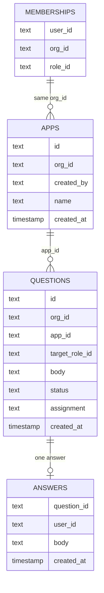

# Vibe SDK organization run

## Important changes

- Remove the extra card. The prompt box already on the page is the only place anyone types.
- Only the Project Manager can press Enter to create an app. The Developer cannot.
- The organization owns the app. There is no private app and no single-user owner.
- The real builder agent asks. The question popup Vibe SDK already has shows that question to the named role.
- The other role sees a waiting line and does not see the question.
- The named role types the reply in the prompt box. During the check, an agent reads the question and types that reply, because the question is not known ahead of time.
- Rework the organization schema. An app is owned by `org_id` only. A question stores a role and a body. Drop `owner_type`, `phase`, and the gate step names from the tables this run uses.
- Leave the three stages, the phase permissions, Gas City, Electron, `hitl-web`, and the Bolt walkthrough as they are. Do not copy them into this run.

## The run

One organization. Two people. Two browsers. One app. The real builder agent.

1. Both people sign in with Clerk. Each browser shows that person’s role from `wewebplus.memberships`. The role is `project-manager` or `developer`. Clerk `org:admin` is the invite flag. It is not a role and it does not answer questions.
2. The Project Manager types a prompt in the existing prompt box and presses Enter. That creates the organization app and sends the prompt to the builder agent.
3. The Developer’s Enter does nothing until a question is addressed to the Developer. The Developer does not get a second app.
4. Both people see the same app, the same files, and the same preview.
5. When the agent must ask, the existing question popup shows the question to the named role. A requirements question goes to the Project Manager. A technical question goes to the Developer. A question with no role goes to the Project Manager and is marked `fallback`.
6. The other role sees “Waiting on the Project Manager.” or “Waiting on the Developer.” The question text is absent.
7. The named role types the reply in the same prompt box and presses Enter. That reply is stored once and becomes the agent’s next prompt. A second reply does not start another prompt.
8. When the agent finishes with no question, both people see the finished app.

## Enter

Enter is the send button on the existing prompt box.

- Before an app exists, only the Project Manager’s Enter creates the app and sends the prompt.
- While a question is open, only the named role’s Enter sends the reply.
- The other person’s Enter does not send.

## Schema rework

The organization store already has `memberships`, `apps`, `questions`, and `answers`. This run changes those tables. It does not add a second set beside them.

- `apps` loses `owner_type`. A private `user` owner is gone. `org_id` is the only owner. `created_by` is the Project Manager who pressed Enter. A Developer insert is refused.
- `questions` loses `phase`. It also loses the step names `plan-approve`, `review-approve-dev`, and `review-approve-pm`. What remains is `target_role_id`, `body`, `status` (`open` or `answered`), and `assignment` (`declared` or `fallback`).
- `answers` stays one row per question. `question_id` is unique.
- `memberships` stays. `role_id` is `project-manager` or `developer`.
- `phase_approvals` and `phase_comments` are not used.
- Vibe SDK’s app row stops using one `userId` as the owner. It points at this organization app. The `hitl_*` tables added for the extra card are removed.

The builder’s files and chat stay in Vibe SDK. These four tables are who owns the app, who may press Enter, and which role a question is for.

## Database

## Do not copy

These pieces exist and they describe the three-stage walkthrough. An agent must not treat them as the design of this run.

- **Phase.** Discovery, Implementation, and Delivery. `questions.phase` is required on the old rows because every old question named a stage. `FACTORY_PHASES` says an app workspace has these three phases.
- **Gate names.** `plan-approve` is the Project Manager approving the plan at the end of Discovery. `review-approve-dev` is the Developer approving the build at the end of Implementation. `review-approve-pm` is the Project Manager approving the result at the end of Delivery.
- **Phase permissions.** `approve-discovery`, `approve-implementation`, `approve-delivery`, `work-implementation`, and `comment` on a phase. A private account (`owner_type = user`) is allowed to approve every phase. This run has no private owner.
- **Recipe words.** Formula, run, bead, and gate. A gate is a bead only a person can finish. This run stops when the builder asks a question.
- **Other databases.** Dyad sqlite mirrors the phase questions. Vibe SDK D1 gives each app one `userId` and has no organization. The extra card added `hitl_*` tables beside that app. None of those is this schema.
- **Other places.** Dyad Electron shows the three phase chats. `hitl-web` polls Postgres and does not talk to the builder. Bolt’s walkthrough is the phase recording. Gas City posts questions through `127.0.0.1:32100` and closes them with a bead script.
- **Old sentences.** “The agents stop at three gates.” “A person working alone has no organization and no gates.” Approach A and Approach B are swapped between two sections of the old semantics note. Here the builder asks when it must, and there is no stage strip.

## Verification

An agent drives both browsers. It signs in as each role, types the Project Manager’s prompt, watches the real builder, reads the question the popup actually shows, and types a fitting reply in the prompt box. It checks that the other browser does not show the question and that Enter does not send there.

The record is both browsers on video, encoded so the frames are visible. A Playwright script may open the browsers and record them. It cannot decide the reply.

The two existing walkthrough accounts are the Project Manager and the Developer. A second pair is not created.

## Out of scope

Electron, Gas City, the Bolt project, the phase strip, `hitl-web`, shared Cloudflare tokens, the lab worker, and production Clerk stay untouched.
