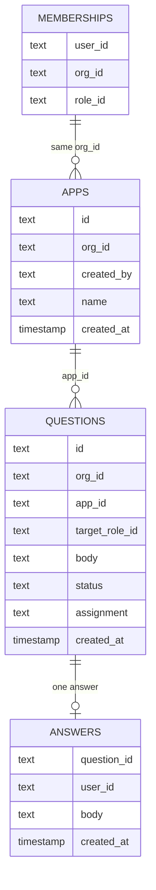

# Fix the Vibe SDK organization run

## Important changes

- Remove the extra card above the page. It was never part of the request.
- The prompt box already on the page is the only place anyone types.
- Only the Project Manager can press Enter to start an app. The Developer cannot.
- The app belongs to the organization. There is no private app.
- The real builder agent asks the questions. A script with memorized questions and answers does not.
- The question appears in the question popup Vibe SDK already has, and only for the role that was asked.
- The other role sees a waiting line and does not see the question.
- An agent reads the question that actually appeared and types the reply in the prompt box.
- A Playwright script alone cannot verify this, because it cannot understand a question it has not seen before.
- An app has an organization id and the Project Manager who created it. It has no private owner.
- A question has a role and a body. It has no phase, and it has none of the three old gate names.

## What went wrong

The preview added a card above the builder’s prompt box. That card asked two fixed questions and accepted two fixed answers. The recording left the real prompt box empty.

That missed the request in three ways.

- The only typing place is the prompt box that is already on the page.
- The builder already has a popup that raises a question. The run uses that popup.
- The builder will not ask the same question every time, so a script cannot know the reply in advance.

## What the run is

One organization. Two people. Two browsers. One app. The real builder agent.

1. Both people sign in. Each browser shows that person’s role.
2. The Project Manager types a prompt in the existing prompt box and presses Enter. That starts the organization app and sends the prompt to the builder agent.
3. The Developer’s Enter does nothing at the start. The Developer does not get a second app.
4. The agent builds. Both people see the same app.
5. When the agent must ask a person, the existing question popup shows the question to the named role. A requirements question goes to the Project Manager. A technical question goes to the Developer. A question with no role goes to the Project Manager and is marked fallback.
6. The other role sees “Waiting on the Project Manager.” or “Waiting on the Developer.” The question text is absent there.
7. The named role types the reply in the same prompt box and presses Enter. That reply is the agent’s next prompt. The agent continues.
8. When the agent finishes without a question, both people see the finished app. No extra question appears.

There is no Discovery, Implementation, or Delivery step.

## Enter

Enter is the send button on the existing prompt box.

- Before an app exists, only the Project Manager’s Enter sends the prompt and creates the organization app.
- While a question is open, only the named role’s Enter sends the reply.
- The other person’s Enter does not send.

## What leaves

- The organization-run card, its answer field, and the “Start the scripted build” button.
- The scripted questions “What should the page be called?” and “Which file should hold the page title?”
- The memorized replies “North Pier Fish” and “index.html” as the proof.
- A Playwright test whose pass depends on those fixed sentences.
- A private app owned by one user. Membership in the organization is what allows both people to see the app.

The role rule stays. The matching role sees the question and can answer. The other role in the organization sees the waiting line. Someone outside the organization does not see the app.

## Verification

An agent drives both browsers. It signs in as each role, types the Project Manager’s prompt, watches the real builder, reads the question the popup actually shows, and types a reply that fits that question into the prompt box.

The agent also checks the other browser. The question text is absent there, and Enter does not send.

The record of the run is the two browsers on video, encoded so the frames are visible. The video is the proof that the prompt went through the real box and that the reply followed the question the builder asked.

A Playwright script may open the browsers and record them. It cannot be the thing that decides the reply.

## Database

The organization store today is `wewebplus` in Postgres. Two of its columns are leftovers from the three fixed stages.

`questions.phase` is required on every row. A question cannot be saved unless it names Discovery, Implementation, or Delivery. This run has no stages, so that column is not part of the schema below.

The three step names are the old approval buttons, not a general review system.

- `plan-approve` is the Project Manager approving the written plan at the end of Discovery.
- `review-approve-dev` is the Developer approving the build at the end of Implementation.
- `review-approve-pm` is the Project Manager approving the result at the end of Delivery.

Those names exist so the old phase strip can record who pressed Continue. This run does not use them.

`apps.owner_type` can be `user` or `org`. A `user` value is a private app. This run keeps only the organization.

The schema this run needs:

- `memberships.role_id` is `project-manager` or `developer`. This table already exists.
- `apps.org_id` is the only owner. `created_by` is the Project Manager who pressed Enter. A Developer insert is refused.
- `questions` has no `phase` and no step name. `target_role_id` is the person who may see the body. `status` is `open` or `answered`. `assignment` is `declared` when the agent named the role, and `fallback` when it did not and the question went to the Project Manager.
- `answers.question_id` is unique. One reply is stored. A second reply does not create another row.

The builder’s files and chat stay in Vibe SDK. These four tables are the organization record: who may see the app, who may press Enter, and which role a question is for.

## Out of scope

Electron, Gas City, the Bolt project, a phase strip, and a second website stay out. This does not change shared Cloudflare tokens, the lab worker, or production Clerk.
